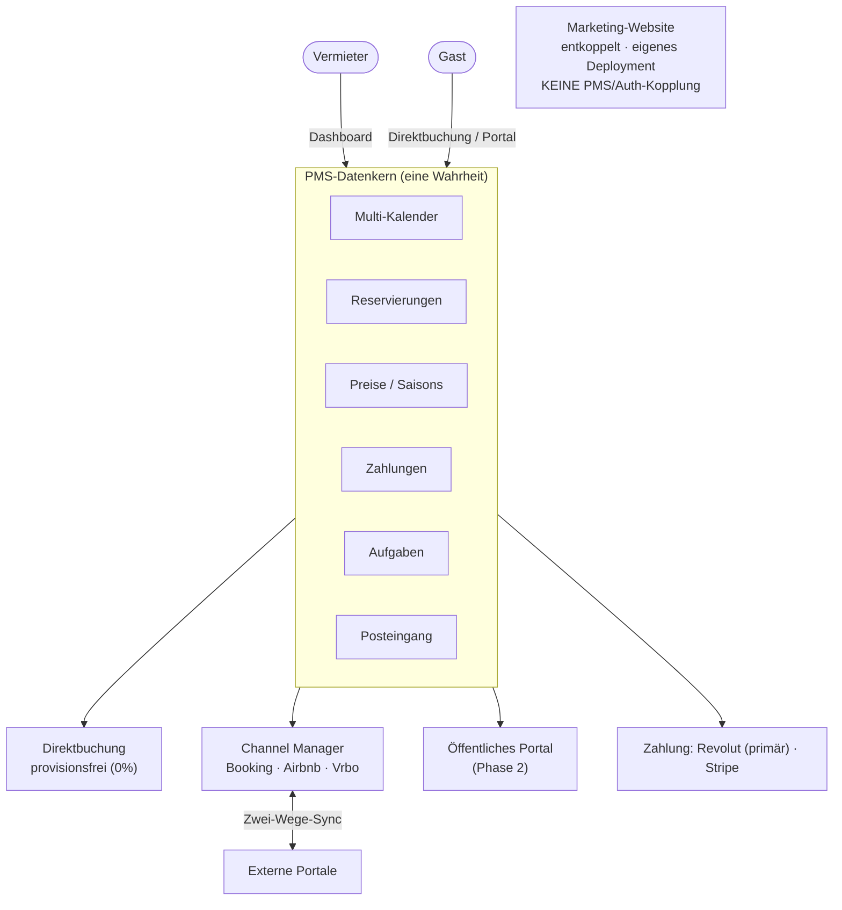
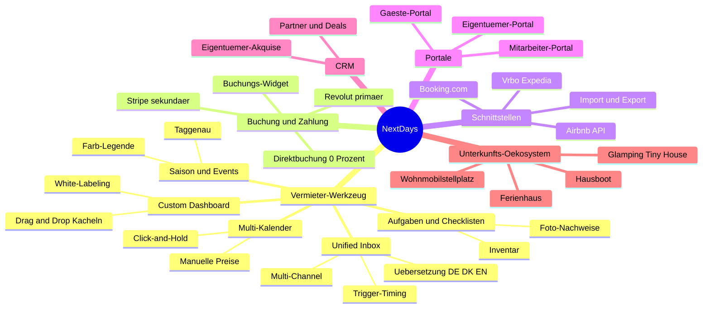
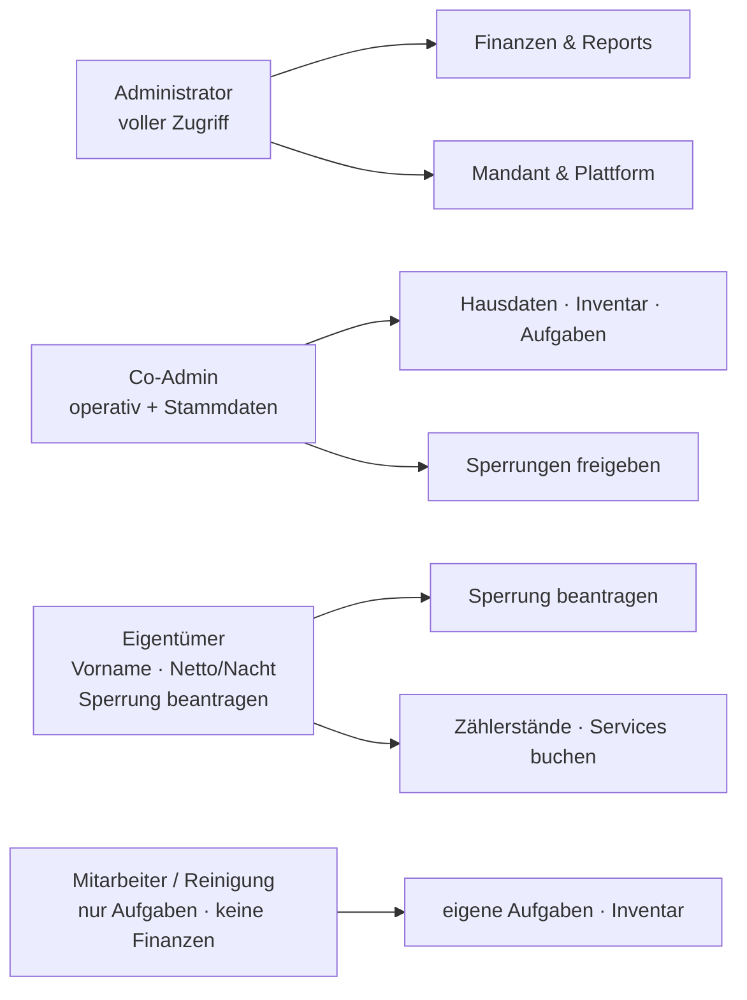

<div align="center">

# NextDays

**Weltweite Vacation-Rental-Plattform mit fairem Pricing.**
Ein PMS-Kern, der Channel Manager, Direktbuchung und ein eigenes Buchungsportal vereint.

[](NOTES.md)
[](apps/api)
[](apps/web)
[](supabase)
[](apps/api/pyproject.toml)
[](LICENSE)

</div>

---

## Was ist NextDays?

NextDays kombiniert **zwei Geschäftsmodelle auf einem gemeinsamen Datenkern**:

1. **Vermieter-Werkzeug (Supply-Seite)** — PMS + Channel Manager + Direktbuchungs-Website. Vergleichbar mit Lodgify, aber einfacher, fairer, stabiler.
2. **Eigenes Buchungsportal (Demand-Seite)** — ein zweiseitiger Marktplatz, auf dem Gäste Unterkünfte suchen und direkt buchen.

**Architektur-Leitsatz:** Das **PMS ist der Kern in der Mitte**. Channel Manager, Direktbuchung und das öffentliche Portal docken alle an denselben Datenkern an. Eine Unterkunft hat **einen Multi-Kalender** als einzige Wahrheit → verhindert Double-Bookings über alle Kanäle.

> **Fairer Preis:** ein Preis, voller Funktionsumfang — keine Paket- oder Feature-Stufen.

---

## Architektur auf einen Blick

Alle Kanäle docken an **einen** PMS-Datenkern an. Der zentrale Kalender ist die
einzige Wahrheit und verhindert Double-Bookings über alle Kanäle.



### Funktionsumfang (Module aus dem Lastenheft)

Jeder Nutzer erhält **den vollen Funktionsumfang** — kein Feature-Gating, **0 %
Buchungsgebühr**, Preis skaliert nur über die Anzahl der Unterkünfte.



### Rollen & Daten-Split (Lastenheft §4)

Wer sieht was — die Berechtigungs-Matrix sorgt für strikten Daten-Split
(Eigentümer sehen nur Vorname + Netto/Nacht, Mitarbeiter keine Finanzen/Namen).



Details & technische Diagramme (C4, ER, Sequenz, Deployment):
**[docs/ARCHITECTURE.md](docs/ARCHITECTURE.md)** · Anforderungen:
**[docs/LASTENHEFT.md](docs/LASTENHEFT.md)**

---

## Tech-Stack

| Ebene | Technologie |
|---|---|
| Web-Frontend | Next.js (App Router), TypeScript, **Bun** |
| UI | shadcn/ui (Tailwind v4 via `@theme`), **Iconify**, Light/Dark via `next-themes` |
| Design-System | **Storybook** (Komponenten-Doku, Light/Dark, Design-Tokens) — Marke aus NextDays-Logo |
| Backend | **FastAPI** (Python 3.12), Vertical Slice Architecture |
| Datenbank/Auth/Storage | **Supabase** (Postgres, Auth, Storage), Multi-Tenant mit Row-Level-Security |
| Cache & Queue | **Redis** |
| Zahlungen | **Revolut** (primär) · **Stripe** (sekundär) — Gateway-Adapter-Muster, vgl. [ADR-0003](docs/decisions/0003-zahlungs-gateway-revolut-primaer.md) |
| Deployment | Web → Vercel · API → Hetzner (Coolify, Docker) · DSGVO-konform, self-hosted bevorzugt |

---

## Schnellstart

> **Voraussetzungen:** [Bun](https://bun.sh), [uv](https://docs.astral.sh/uv/), Docker, [Supabase CLI](https://supabase.com/docs/guides/cli).

```bash
# 1. Supabase-Stack lokal starten (Postgres, Auth, Storage, Studio)
supabase start

# 2. Migrationen anwenden
supabase db reset

# 3. Backend-Env vorbereiten
cp apps/api/.env.example apps/api/.env   # Werte aus `supabase status` eintragen

# 4. Backend + Redis starten
docker compose up
# → API auf http://localhost:8000 · Docs auf http://localhost:8000/docs
```

**Design-System / Storybook** — live für den UX/UI-Designer (kein Login nötig):
**https://nextdays-storybook.vercel.app**

Lokal entwickeln (zeigt alle Komponenten, Light/Dark, Design-Tokens):

```bash
cd apps/web
bun install
bun run storybook        # → http://localhost:6006
# bun run build-storybook # statischer Build, als URL deploybar
```

Ausführliche Anleitung: **[docs/SETUP.md](docs/SETUP.md)**

---

## Projektstruktur

```
nextdays/
├── PROJECT.md              # verbindliche Spezifikation (zuerst lesen)
├── NOTES.md                # Live-Session-Status
├── docs/
│   ├── ARCHITECTURE.md     # System-Architektur & Datenmodell
│   ├── SETUP.md            # lokales Setup, Schritt für Schritt
│   ├── CONTRIBUTING.md     # Arbeitsweise, Konventionen, Git-Flow
│   ├── API.md              # API-Übersicht (Slices, Endpoints)
│   └── decisions/          # ADRs (Architecture Decision Records)
├── marketing/              # öffentliche Marketing-Website (ENTKOPPELT, eigenes Deployment)
├── supabase/
│   └── migrations/         # 19 Migrationen (Kern + Marktplatz + RLS), auf echter DB angewandt
├── apps/
│   ├── web/                # Next.js — Vermieter-Dashboard + Portal
│   │   ├── components/ui/  # shadcn-Stil-Komponenten (+ .stories.tsx)
│   │   ├── styles/         # globals.css — Design-Tokens (einzige Quelle der Wahrheit)
│   │   └── .storybook/     # Storybook (Design-System für UX/UI)
│   └── api/                # FastAPI — gesamte Business-Logik
│       └── src/
│           ├── core/       # Config, Auth (ES256/JWKS), Supabase, Logging
│           └── features/   # 16 Vertical Slices (auth, calendar, tasks, payments, …)
└── packages/
    └── shared/             # geteilte TS-Typen
```

---

## Stand der Entwicklung

| Bereich | Status |
|---|---|
| Monorepo-Gerüst + Infra (Docker, Supabase-Config) | ✅ |
| FastAPI `core/` (Config, Logging, Supabase, Auth ES256/JWKS) | ✅ |
| 16 Vertical Slices angelegt | ✅ |
| `auth`-Slice voll (Register/Login/Me · Rollen · Capability-Matrix) | ✅ |
| `calendar`-Slice (Verfügbarkeit, Sperrung, Preis-Override) | ✅ |
| `tasks`-Slice (Aufgaben, Checklisten, Inventar, Vertretung) | ✅ |
| `payments` (Gateway-Adapter Revolut/Stripe) | ✅ Gerüst · ⏳ Revolut-Implementierung |
| Supabase-Migrationen (19) auf echter DB · 41 Tabellen · alle RLS · 0 Security-Advisors | ✅ |
| Web-Frontend (shadcn-Stil · Iconify · next-themes · Tailwind v4) | ✅ |
| Storybook (Design-System) — **live**, 22 UI-Bausteine + 15 PMS-Komponenten + 7 Eigentümer-Doku-Seiten | ✅ |
| Inbox/Messaging · Channel-Adapter · CRM/Dashboard-Logik · Gäste-Portal | ⏳ geplant |

Aktueller Detail-Stand & nächste Schritte: **[NOTES.md](NOTES.md)**

---

## Dokumentation

- **[PROJECT.md](PROJECT.md)** — verbindliche Spezifikation (Stack, Architektur, Konventionen)
- **[docs/ARCHITECTURE.md](docs/ARCHITECTURE.md)** — System-Aufbau, Datenmodell, RLS
- **[docs/SETUP.md](docs/SETUP.md)** — lokales Entwicklungs-Setup
- **[docs/CONTRIBUTING.md](docs/CONTRIBUTING.md)** — Arbeitsweise & Konventionen
- **[docs/API.md](docs/API.md)** — API-Übersicht
- **[docs/LASTENHEFT.md](docs/LASTENHEFT.md)** — vollständiges Lastenheft (Anforderungen)
- **[docs/REQUIREMENTS-GAP.md](docs/REQUIREMENTS-GAP.md)** — Soll/Ist-Abgleich & Roadmap
- **[docs/decisions/](docs/decisions/)** — 8 Architecture Decision Records (Channel Manager, Marketing-Entkopplung, Revolut, i18n, Rundung, Preismodell, Ökosystem, Storybook)

---

## Lizenz

Proprietär — © NextDays. Alle Rechte vorbehalten. Siehe **[LICENSE](LICENSE)**.
