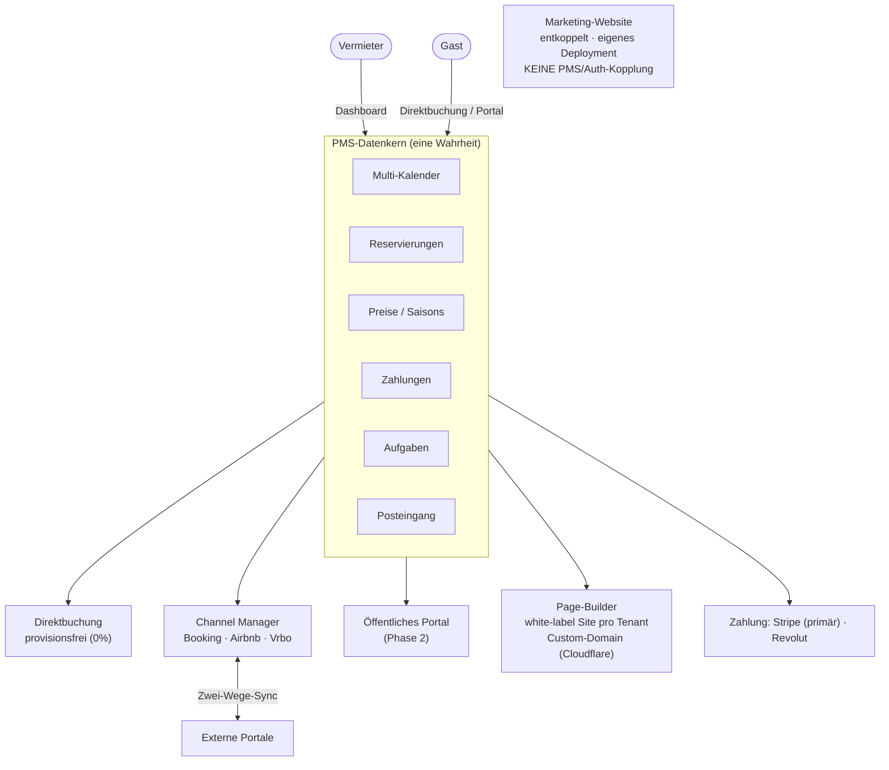
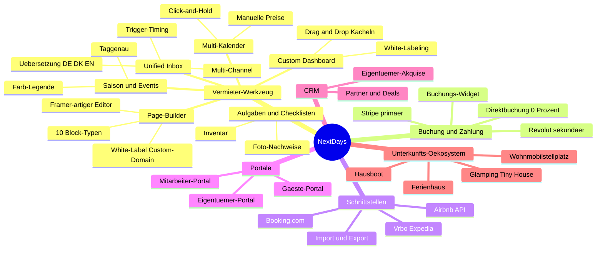
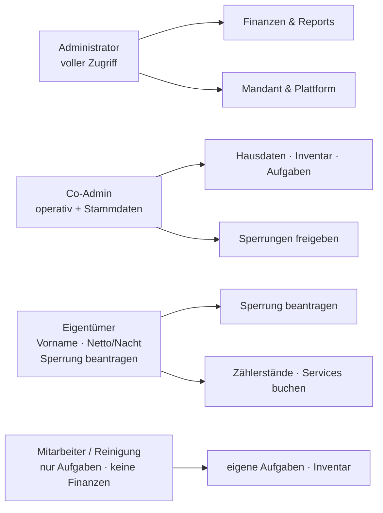

<div align="center">

# NextDays

**Weltweite Vacation-Rental-Plattform mit fairem Pricing.**
Ein PMS-Kern, der Channel Manager, Direktbuchung und ein eigenes Buchungsportal vereint.

[](NOTES.md)
[](apps/api)
[](apps/web)
[](supabase)
[](apps/api/pyproject.toml)
[](LICENSE)

</div>

---

## Was ist NextDays?

NextDays kombiniert **zwei Geschäftsmodelle auf einem gemeinsamen Datenkern**:

1. **Vermieter-Werkzeug (Supply-Seite)** — PMS + Channel Manager + **Page-Builder**: jeder Mandant bekommt eine eigene white-label Buchungs-Website unter eigener Custom-Domain, visuell bearbeitbar im Framer-artigen Editor (Spec: [docs/FRAMER-FEATURES.md](docs/FRAMER-FEATURES.md)). Vergleichbar mit .., aber einfacher, fairer, stabiler.
2. **Eigenes Buchungsportal (Demand-Seite)** — ein zweiseitiger Marktplatz, auf dem Gäste Unterkünfte suchen und direkt buchen.

**Zwei Marken, ein Datenkern:** Die Supply-Seite (PMS, Channel Manager,
Marketing-Seite: `web`, `apps/api`, `marketing`, `admin`, `builder`) heißt
**myNextDays**. Die Demand-Seite — Marktplatz `plattform`, Gastgeber-Dashboard
`gastgeber` und die Marktplatz-App `mobile-bestdays` — heißt **myBestDays**;
ebenso der Kanal „Plattform" im PMS (`reservations.ota_name = 'myBestDays'`).
Nativ gibt es entsprechend zwei Apps: `mobile-bestdays` (Marktplatz, Gast) und
`mobile-nextdays` (PMS, Betrieb) — siehe ADR-0019.

myNextDays bedient dabei **zwei Betriebsarten** pro Mandant: klassische
Ferienvermietung und Hotels (`tenants.accommodation_type`, Migration 0090) —
die Betriebsart wird im 5-Schritte-Onboarding gewählt und steuert Navigation
und Begriffe im Dashboard (z. B. „Objekte" vs. „Zimmer", Eigentümer-Modul nur
für Ferienvermietung).

**Architektur-Leitsatz:** Das **PMS ist der Kern in der Mitte**. Channel Manager, Direktbuchung und das öffentliche Portal docken alle an denselben Datenkern an. Eine Unterkunft hat **einen Multi-Kalender** als einzige Wahrheit → verhindert Double-Bookings über alle Kanäle.

> **Fairer Preis:** ein Preis, voller Funktionsumfang — keine Paket- oder Feature-Stufen.

---

## Architektur auf einen Blick

Alle Kanäle docken an **einen** PMS-Datenkern an. Der zentrale Kalender ist die
einzige Wahrheit und verhindert Double-Bookings über alle Kanäle.



### Funktionsumfang (Module aus dem Lastenheft)

Jeder Nutzer erhält **den vollen Funktionsumfang** — kein Feature-Gating, **0 %
Buchungsgebühr**, Preis skaliert nur über die Anzahl der Unterkünfte.



### Rollen & Daten-Split (Lastenheft §4)

Wer sieht was — die Berechtigungs-Matrix sorgt für strikten Daten-Split
(Eigentümer sehen nur Vorname + Netto/Nacht, Mitarbeiter keine Finanzen/Namen).



Details & technische Diagramme (C4, ER, Sequenz, Deployment):
**[docs/ARCHITECTURE.md](docs/ARCHITECTURE.md)** · Anforderungen:
**[docs/LASTENHEFT.md](docs/LASTENHEFT.md)**

---

## Tech-Stack

| Ebene                  | Technologie                                                                                                                                                                                                                                            |
| ---------------------- | ------------------------------------------------------------------------------------------------------------------------------------------------------------------------------------------------------------------------------------------------------ |
| Web-Frontend           | Next.js (App Router), TypeScript, **Bun**                                                                                                                                                                                                              |
| UI                     | shadcn/ui (Tailwind v4 via `@theme`), **Iconify**, Light/Dark via `next-themes`                                                                                                                                                                        |
| Design-System          | **Storybook** (Komponenten-Doku, Light/Dark, Design-Tokens) — Marke aus NextDays-Logo                                                                                                                                                                  |
| Backend                | **FastAPI** (Python 3.12), Vertical Slice Architecture                                                                                                                                                                                                 |
| Datenbank/Auth/Storage | **Supabase** (Postgres, Auth, Storage), Multi-Tenant mit Row-Level-Security                                                                                                                                                                            |
| Cache & Queue          | **Redis**                                                                                                                                                                                                                                              |
| Zahlungen              | **Stripe Connect Custom** (primär) · **Revolut** (sekundär) — Gateway-Adapter-Muster, vgl. [ADR-0011](docs/decisions/0011-zahlungs-gateway-stripe-primaer.md)                                                                                          |
| Page-Builder           | **craft.js**-Editor in `apps/web` · eigener Renderer `builder/` · Custom-Domains via **Cloudflare for SaaS** — Spec: [docs/FRAMER-FEATURES.md](docs/FRAMER-FEATURES.md), vgl. [ADR-0013](docs/decisions/0013-page-builder-renderer-editor-trennung.md) |
| Deployment             | Self-hosted auf Hetzner via **Coolify** (API + Supabase + Redis + Frontends als Docker-Apps) · DSGVO-konform                                                                                                                                           |

---

## Schnellstart

> **Voraussetzungen:** [Bun](https://bun.sh), [uv](https://docs.astral.sh/uv/), Docker, [Supabase CLI](https://supabase.com/docs/guides/cli).

```bash
# 1. Supabase-Stack lokal starten (Postgres, Auth, Storage, Studio)
supabase start

# 2. Migrationen anwenden
supabase db reset

# 3. Backend-Env vorbereiten
cp apps/api/.env.example apps/api/.env   # Werte aus `supabase status` eintragen

# 4. Backend + Redis starten
docker compose up
# → API auf http://localhost:8000 · Docs auf http://localhost:8000/docs
```

**Design-System / Storybook** — live, **zugangsgeschützt** (Login erforderlich,
enthält Produktidee + sensible Daten): über die Coolify-App `nextdays-storybook`: **https://u67kn5pj9cb2gqryt2ezsc8r.65.21.144.136.sslip.io/sb**

Der Zugang läuft über eine Next.js-Auth-Hülle (Supabase Auth, serverseitige
Middleware). Neue Nutzer werden im **Admin-Bereich** (`/admin`) mit Sofort-
Passwort angelegt — kein Self-Signup. Enthält außerdem einen Echtzeit-
**Team-Chat** (`Austausch/`, Supabase Realtime). Details:
[docs/ARCHITECTURE.md §11](docs/ARCHITECTURE.md).

Lokal entwickeln (zeigt alle Komponenten, Light/Dark, Design-Tokens):

```bash
cd apps/storybook        # eigenständiges Design-System-Package
bun install
bun run storybook        # nur Storybook  → http://localhost:6006
bun run dev              # mit Auth-Hülle  → http://localhost:6007
# bun run build           # Storybook (protected/sb) + Next-Build (Deploy)
```

Ausführliche Anleitung: **[docs/SETUP.md](docs/SETUP.md)**

---

## Projektstruktur

```
nextdays/
├── PROJECT.md              # verbindliche Spezifikation (zuerst lesen)
├── NOTES.md                # Live-Session-Status
├── docs/
│   ├── ARCHITECTURE.md     # System-Architektur & Datenmodell
│   ├── SETUP.md            # lokales Setup, Schritt für Schritt
│   ├── CONTRIBUTING.md     # Arbeitsweise, Konventionen, Git-Flow
│   ├── API.md              # API-Übersicht (Slices, Endpoints)
│   └── decisions/          # ADRs (Architecture Decision Records)
├── marketing/              # öffentliche Marketing-Website (ENTKOPPELT, eigenes Deployment)
├── builder/                # White-Label-Site-Renderer — eigene Next.js-App (Port 3200):
│                           # rendert pro Custom-Domain die veröffentlichte Agentur-Website
├── deploy/                 # Production-Deploy (Coolify/Hetzner): Compose-Dateien, Dockerfiles,
│                           # Env-Inventar, Backup/Recovery, Monitoring, Rate-Limiting-Doku
├── supabase/
│   └── migrations/         # 90 Migrationen (Kern + Marktplatz + RLS + Page-Builder), auf echter DB angewandt
├── apps/
│   ├── web/                # Next.js — volles Vermieter-Dashboard inkl. visuellem Website-Editor (craft.js)
│   ├── storybook/          # Design-System & Komponenten-Werkstatt (eigenes Package)
│   │   ├── components/     # ui/ + pms/ — entstehen HIER (Designer)
│   │   ├── stories/        # Stories (ui/ + pms/) + Eigentümer-Doku (MDX)
│   │   ├── styles/         # globals.css — Design-Tokens (einzige Quelle der Wahrheit)
│   │   └── .storybook/     # Storybook-Konfiguration
│   └── api/                # FastAPI — gesamte Business-Logik
│       └── src/
│           ├── core/       # Config, Auth (ES256/JWKS), Supabase, Logging
│           └── features/   # 26 Vertical Slices (auth, calendar, tasks, payments, reviews, site_config, …)
└── packages/
    └── shared/             # geteilte TS-Typen
```

> **Design-System-Workflow:** UI-Komponenten entstehen in `apps/storybook`
> (Werkstatt des Designers). Erst wenn eine Komponente fertig ist, wird sie ins
> Web-Projekt (`apps/web`) übernommen.

---

## Stand der Entwicklung

| Bereich                                                                                                                                           | Status                                                                     |
| ------------------------------------------------------------------------------------------------------------------------------------------------- | -------------------------------------------------------------------------- |
| Monorepo-Gerüst + Infra (Docker, Supabase-Config)                                                                                                 | ✅                                                                         |
| FastAPI `core/` (Config, Logging, Supabase, Auth ES256/JWKS)                                                                                      | ✅                                                                         |
| 26 Vertical Slices angelegt                                                                                                                       | ✅                                                                         |
| `travel_agencies` (Reisebüro-Kartei: Verträge nach Jahren, Saison-Preise, Stop-Sell-Adressat)                                                     | ✅                                                                         |
| `auth`-Slice voll (Register/Login/Me · Rollen · Capability-Matrix)                                                                                | ✅                                                                         |
| `calendar`-Slice (Verfügbarkeit, Sperrung, Preis-Override)                                                                                        | ✅                                                                         |
| `tasks`-Slice (Aufgaben, Checklisten, Inventar, Vertretung)                                                                                       | ✅                                                                         |
| `payments` — **Stripe Connect Custom** (primär, [ADR-0011](docs/decisions/0011-zahlungs-gateway-stripe-primaer.md)) · Revolut sekundär im Adapter | ✅                                                                         |
| Supabase-Migrationen (90) auf echter DB · RLS · Realtime                                                                                          | ✅                                                                         |
| Web-Frontend `apps/web` — volles Dashboard (shadcn-Stil · Iconify · next-themes · Tailwind v4)                                                    | ✅                                                                         |
| **Page-Builder** — craft.js-Editor unter `/website`, `site_config`-Slice, `builder/`-Renderer, Custom-Domains via Cloudflare (0086/0087)          | ✅ Kern · 🟡 Editor-Ausbau nach [FRAMER-FEATURES](docs/FRAMER-FEATURES.md) |
| **Betriebsart** Hotel / Ferienvermietung (`tenants.accommodation_type`, 0090) — eigene Sidebar-Navigation, Wahl im 5-Schritte-Onboarding          | ✅                                                                         |
| Channel-Manager (Channex: ARI-Push, Buchungs-Sync, 4-Schritt-Channel-Flow) · Unified Inbox (inkl. WhatsApp)                                       | ✅                                                                         |
| Storybook (Design-System) — **live & zugangsgeschützt**, 22 UI-Bausteine + 15 PMS-Komponenten + 7 Eigentümer-Doku-Seiten                          | ✅                                                                         |
| Storybook-Zugang: Supabase-Login (Middleware) · Admin-Bereich (Nutzer anlegen) · Realtime-Team-Chat                                               | ✅                                                                         |
| CRM-Ausbau · Gäste-Portal                                                                                                                         | ⏳ geplant                                                                 |

Aktueller Detail-Stand & nächste Schritte: **[NOTES.md](NOTES.md)**

---

## Deployment (Production)

Self-hosted auf **einem Hetzner-Server (CX43, Helsinki)** via **Coolify** —
Backend + self-hosted Supabase + Redis als Container. Auch die Frontends laufen
als Coolify-Apps (`nextdays-web`, `-plattform`, `-storybook`, `-marketing`);
die `builder/`-App bringt ein eigenes Dockerfile mit (white-label Sites hinter
Cloudflare-Custom-Domains). Env-Inventar: **[deploy/ENVIRONMENT.md](deploy/ENVIRONMENT.md)** ·
Details: **[ADR-0010](docs/decisions/0010-production-deployment-coolify-hetzner.md)**.

Repo-Deploy-Dateien (Dev-Setup bleibt unberührt, alles getrennt unter `deploy/`):

- `deploy/supabase/docker-compose.yml` — self-hosted Supabase-Stack (Pooler an, Analytics aus, SMTP)
- `deploy/api/Dockerfile` — Prod-Image (Multi-Worker, Non-Root, kein `--reload`, Healthcheck)
- `deploy/docker-compose.prod.yml` — api + Redis (AOF/Queue-Broker) + Worker-Stub
- `deploy/.env.example` — alle Prod-Variablennamen (Platzhalter) inkl. Staging-Hinweise

**Aufgabenteilung beim Go-Live**

- **Andy (im Browser/Server):** Coolify-GitHub-App verbinden · DNS + HTTPS einrichten ·
  Env-Werte + `kong.yml` auf dem Server setzen · 200-GB-Volume mounten · Migrationen fahren.
- **Repo:** enthält die versionierbaren Deploy-Dateien oben.

> Zahlungen laufen über **Stripe Connect Custom** (primäres Gateway, ADR-0011);
> `STRIPE_SECRET_KEY` + `STRIPE_WEBHOOK_SECRET` sind Pflicht-Secrets. Staging
> nutzt **eigene** Secrets und TEST-Keys, nie die Prod-DB.

---

## Dokumentation

- **[PROJECT.md](PROJECT.md)** — verbindliche Spezifikation (Stack, Architektur, Konventionen)
- **[docs/ARCHITECTURE.md](docs/ARCHITECTURE.md)** — System-Aufbau, Datenmodell, RLS
- **[docs/SETUP.md](docs/SETUP.md)** — lokales Entwicklungs-Setup
- **[docs/CONTRIBUTING.md](docs/CONTRIBUTING.md)** — Arbeitsweise & Konventionen
- **[docs/API.md](docs/API.md)** — API-Übersicht
- **[docs/LASTENHEFT.md](docs/LASTENHEFT.md)** — vollständiges Lastenheft (Anforderungen)
- **[docs/REQUIREMENTS-GAP.md](docs/REQUIREMENTS-GAP.md)** — Soll/Ist-Abgleich & Roadmap
- **[docs/FRAMER-FEATURES.md](docs/FRAMER-FEATURES.md)** — Spec/Bau-Vorlage des Website-Builders (Framer-Funktionsreferenz mit ✅/🟡/❌-Status)
- **[docs/decisions/](docs/decisions/)** — 13 Architecture Decision Records (Channel Manager, Marketing-Entkopplung, Zahlungs-Gateway, i18n, Rundung, Preismodell, Ökosystem, Storybook, Taskilo-Integration, Production-Deployment, Stripe primär, OTA-Anbieter-Wahl, Page-Builder)

---

## Lizenz

Proprietär — © NextDays. Alle Rechte vorbehalten. Siehe **[LICENSE](LICENSE)**.
