# Architektur

> Verbindliche Grundlage: **[PROJECT.md](../PROJECT.md)**. Dieses Dokument erläutert
> die Architektur mit Diagrammen und beschreibt den **tatsächlich umgesetzten** Stand.
>
> **Notation:** [C4-Modell](https://c4model.com) (System Context · Container · Component)
> + ergänzende ER-, Sequenz-, State- und Deployment-Diagramme. Alle Diagramme sind als
> Mermaid (Diagrams-as-Code) eingebettet und werden von GitHub nativ gerendert.

## Inhalt

1. [Leitidee](#1-leitidee-pms-kern-in-der-mitte)
2. [System Context (C4 Level 1)](#2-system-context-c4-level-1)
3. [Container (C4 Level 2)](#3-container-c4-level-2)
4. [Component: Channel Manager (C4 Level 3)](#4-component-channel-manager-c4-level-3)
5. [Datenmodell (ER-Diagramm)](#5-datenmodell-er-diagramm)
6. [Mandantenfähigkeit & RLS](#6-mandantenfähigkeit--rls)
7. [Kritische Flows (Sequenzdiagramme)](#7-kritische-flows-sequenzdiagramme)
8. [Reservierungs-Lifecycle (State)](#8-reservierungs-lifecycle-state)
9. [Deployment & Skalierung](#9-deployment--skalierung)
10. [Backend-Aufbau (Vertical Slices)](#10-backend-aufbau-vertical-slices)

---

## 1. Leitidee: PMS-Kern in der Mitte

NextDays ist kein loses Bündel aus Tools, sondern **ein Datenkern**, an den alle
Kanäle andocken. Der gemeinsame Nenner ist die **`availability`-Tabelle**: eine Zeile
pro `(property_id, date)` mit `UNIQUE`-Constraint — die *eine Wahrheit* und der
strukturelle Schutz gegen Double-Bookings über alle Kanäle hinweg.

---

## 2. System Context (C4 Level 1)

Wer nutzt NextDays, und mit welchen externen Systemen spricht es?

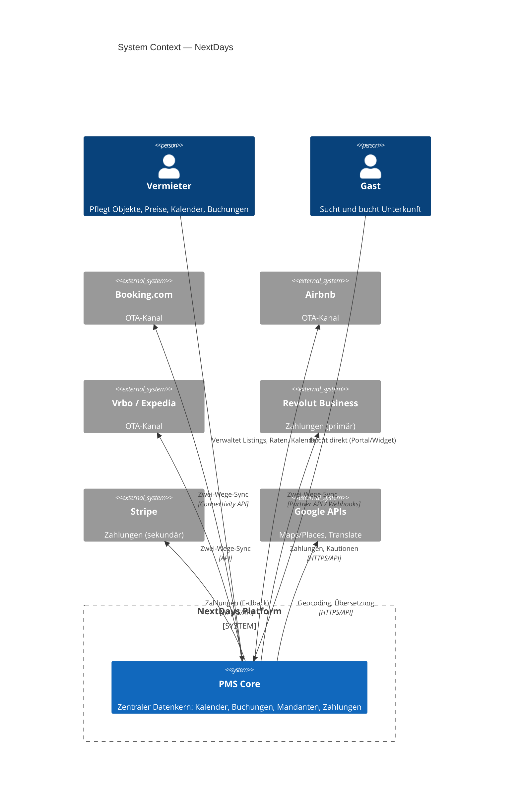

---

## 3. Container (C4 Level 2)

Die ausführbaren Bausteine und Datastores des Systems, mit Technologie und Protokoll.

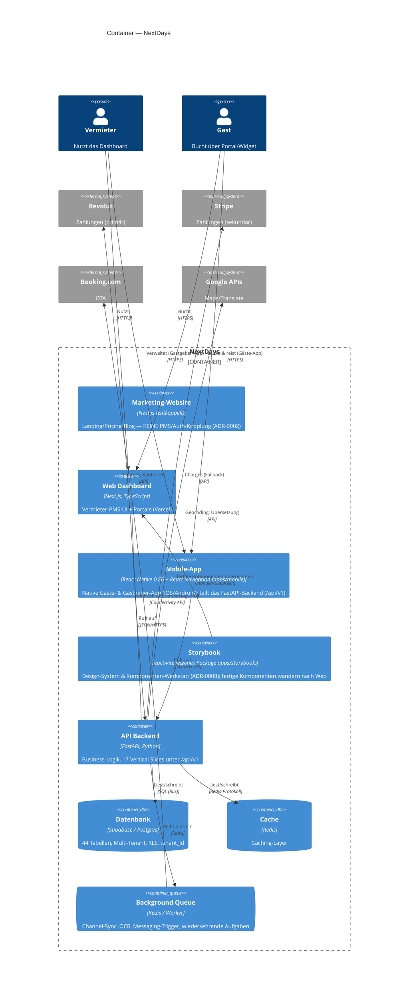

> **Hinweis zur C4-Notation:** „Container" meint hier eine *separat ausführbare App
> oder einen Datastore* (Next.js, FastAPI, Postgres, Redis) — nicht zwingend einen
> Docker-Container. Die Marketing-Website ist bewusst entkoppelt (eigenes Deployment).

### Slice-Landkarte (Component-Ebene, API-Backend)

Die 17 Vertical Slices und ihre Datenbereiche — der Stand der Geschäftslogik:

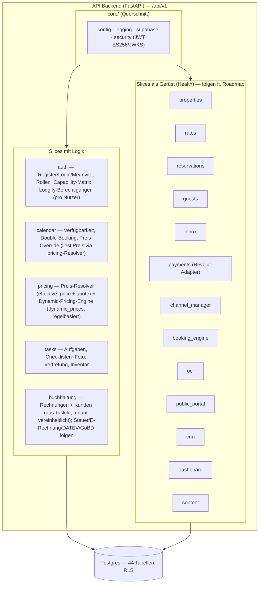

---

## 4. Component: Channel Manager (C4 Level 3)

Der `channel_manager`-Slice nutzt ein **Adapter-Pattern** (Anti-Corruption-Layer):
ein einheitliches Interface zum PMS-Kern, dahinter austauschbare Adapter pro Kanal.
So bleibt die Entscheidung *Direkt-Anbindung vs. Aggregator* reversibel
(siehe [ADR-0001](decisions/0001-channel-manager-architektur.md)).

**Aktueller Stand: Aggregator-Pfad über Channex.** Statt N Direkt-Adapter je OTA
nutzen wir **Channex** als Aggregator (https://docs.channex.io) — eine API für alle
Kanäle (Booking.com, Airbnb, Expedia …). Der `ChannexClient` (`channex_client.py`)
ist der konkrete Adapter hinter der Facade; ARI/Buchungen laufen über die Channex-
API (Auth `user-api-key`, ARI gebündelt, Buchungen via `booking_revisions/feed`
+ ack, Webhook als Trigger). Beträge in Cent. Mapping in `channex_*`-Tabellen
(Migration `0027_channex.sql`).

**PMS-Mapping (NextDays hat keine Zimmerkategorien).** Eine `property` ist die
buchbare Einheit (Ferienwohnungs-Modell). Channex verkauft jedoch Room-Types mit
`count_of_rooms`. Der Content-Sync bildet daher ab: `property` → Channex-Property,
**ein synthetischer Room-Type pro Property** (`count_of_rooms=1`,
`local_unit_ref = property_id`), je lokalem `rate_plans`-Eintrag ein Channex-Rate-Plan.
Der Sync ist idempotent (POST/PUT je nach vorhandenem Mapping) und läuft non-blocking
beim Objekt-Anlegen.

**Kanäle inhouse verbinden (kein Provider-iFrame, white-label-Pflicht).** Der
Adapter implementiert den vollen Channel-API-Flow selbst: `test_connection` →
`mapping_details` → `create` (mit `group_id`, `rate_plans[]`, Codes als **Integer**)
→ `activate`. Die eigene UI (`channel-connect-button.tsx`) führt durch
Portal-Wahl → Zugangsdaten → Zimmer/Raten-Zuordnung; der Provider bleibt unsichtbar.
Für Tests ohne echtes OTA-Konto: Sandbox-Kanal (OpenChannel) gegen einen eigenen
Mock-OTA-Endpoint (`sandbox_ota.py`, Flag `channex_sandbox_portals`).

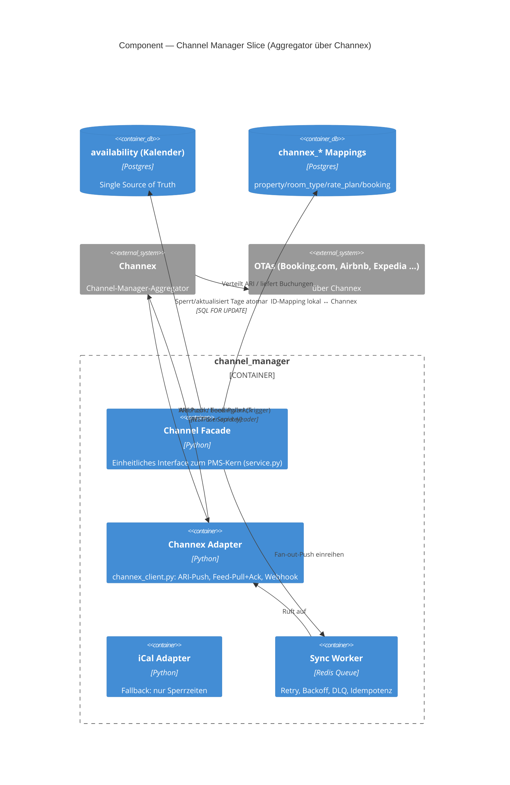

---

## 5. Datenmodell (ER-Diagramm)

Tatsächliches Schema aus **[supabase/migrations/](../supabase/migrations/)** (Phase 1).

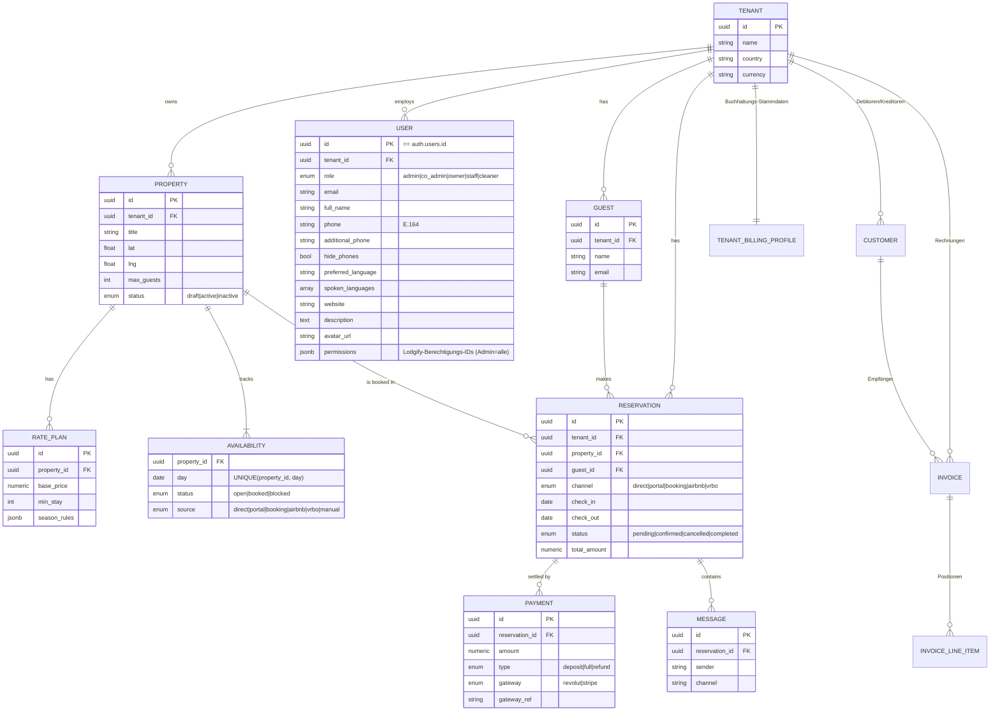

**Marktplatz-Tabellen (angelegt, mit RLS; Geschäftslogik in Phase 2):** `portal_guests`,
`reviews`, `commissions` — siehe [Migration 0006](../supabase/migrations/0006_marketplace.sql).
Das Kern-Diagramm oben zeigt bewusst nur die zentralen Entitäten; alle übrigen der
**44 Tabellen** sind nach Bereich gruppiert im nächsten Abschnitt aufgeführt.

**Kardinalität:** `||` = genau eins · `o{` = null bis viele · `|{` = ein bis viele.
`--` = identifizierend (Kind kann ohne Eltern nicht existieren).

### Datenmodell-Erweiterungen aus dem Lastenheft (Migrationen 0009–0019)

Das Modell ist auf **44 Tabellen (alle mit RLS)** gewachsen — verifiziert gegen das
echte Supabase-Projekt. Zur Lesbarkeit hier nach Bereich gruppiert (Details in den
jeweiligen Migrationen):

```mermaid
erDiagram
    TENANT ||--o{ SEASON_TEMPLATE : has
    SEASON_TEMPLATE ||--o{ SEASON : contains
    SEASON ||--o{ SEASON_PERIOD : "gilt an"
    SEASON_TEMPLATE ||--o{ SEASON_ASSIGNMENT : "zugewiesen an"
    TENANT ||--o{ EVENT : has
    EVENT ||--o{ EVENT_PERIOD : "gilt an"
    PROPERTY ||--o{ SURCHARGE : "Aufschläge"

    TENANT ||--o{ TASK : has
    TENANT ||--o{ TASK_RULE : "wiederkehrend"
    TASK_RULE ||--o{ TASK_RULE_ASSIGNMENT : "je Objekt"
    TASK ||--o{ CHECKLIST_ITEM : enthaelt
    CHECKLIST_ITEM ||--o{ CHECKLIST_PHOTO : "Foto-Nachweis"
    TASK ||--o{ TASK_SUBSTITUTION : "Vertretung"
    TENANT ||--o{ INVENTORY_ITEM : "Inventar/Pool"
    USER ||--o{ STAFF_PROPERTY_ASSIGNMENT : "Stamm-MA"

    TENANT ||--o{ LEAD : "Akquise"
    TENANT ||--o{ PARTNER : has
    PARTNER ||--o{ DEAL : "Rabatte"

    TENANT ||--o{ MESSAGE_TEMPLATE : has
    MESSAGE_TEMPLATE ||--o{ MESSAGE_TRIGGER : "Timing/Kanal"
    TENANT ||--o{ CONTENT_BLOCK : "dreisprachig"
    CONTENT_BLOCK ||--o{ CONTENT_ASSIGNMENT : "zugewiesen"

    TENANT ||--o{ BLOCK_REQUEST : "Sperrung beantragt"
    PROPERTY ||--o{ METER_READING : "Zählerstand (append-only)"
    PROPERTY ||--o{ CO_OWNER : "Miteigentümer"
    PROPERTY ||--o{ PRICE_OVERRIDE : "Tagespreis"
    USER ||--|| DASHBOARD_LAYOUT : personalisiert

    PLAN ||--o{ SUBSCRIPTION : "unit-basiert"
    TENANT ||--|| SUBSCRIPTION : abonniert
```

**Channel-Manager-Mapping (Channex, Migration `0027_channex.sql`, alle mit RLS):**

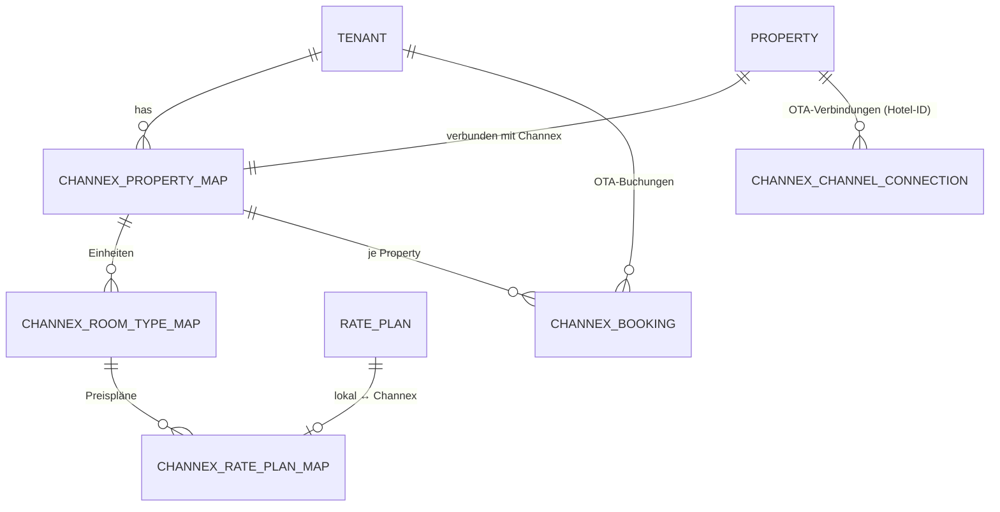

Jede Mapping-Tabelle hält die `channex_*_id` (externe UUID) neben der lokalen
Referenz; `channex_booking` speichert zusätzlich `revision_id`/`system_id` (Dedup),
die volle `raw`-Payload und seit Migration `0047` `guest_id` (Thread→Gast-Link, vom
zentralen Resolver gesetzt). Beträge in Cent (`amount_cents`). Die kanal-
übergreifende Gast-Identität trägt `guest_external_ids` (Migration `0047`: je
Tenant eindeutig pro `channel`+`external_id`). `channex_group_map`
(Migration `0028`) hält je Tenant die Provider-Group (Whitelabel-Konto-Modell:
ein Konto, eine Group pro Hotel). **White-Label-Pflicht:** Provider-Name/IDs
erscheinen nie im Frontend (Responses neutralisiert: `property_title`/`external_id`).

`channex_channel_connection` (Migration `0035`) persistiert pro (Objekt, Portal) die
vom Vermieter eingegebene **OTA-Hotel-ID**, den erzeugten Channel und den Aktiv-Status —
damit ist die Portal-Verbindung sichtbar und verwaltbar (Status, Trennen, Re-Connect
mit vorbefüllter Hotel-ID). Modell: Der Vermieter legt seine Unterkunft selbst beim OTA
an (Hotel-ID), trägt sie in NextDays ein → Auto-Connect über Channex. Ein OTA-seitiges
„Property von Null anlegen" ist kein verfügbarer Weg (s. ADR-0011).

**Weitere Änderungen am Bestand:** `property_type` + `type_attributes` an
`properties` (Ökosystem, ADR-0007); Rollen-Enum um `admin`, `co_admin`
erweitert; `payments`: `stripe_ref` → `gateway_ref` + `gateway`-Enum (ADR-0003).
Marktplatz-Tabellen (`portal_guests`, `reviews`, `commissions`) wie oben.
`users.permissions` (JSONB, Migration 0022) für feingranulare
Lodgify-Berechtigungen pro Nutzer.

**Zweistufiges Berechtigungsmodell (Konto → Benutzer):**

1. **Capability-Matrix** (`permissions.py`, rollenbasiert) — schützt interne
   Slice-Endpoints über `require_permission(Capability.…)` / `require_role(…)`.
2. **Lodgify-Berechtigungen** (`lodgify_permissions.py`, pro Nutzer in
   `users.permissions`) — im Benutzer-Wizard zugewiesen (Default je Rolle,
   überschreibbar), per `require_lodgify_permission(Permission.…)` an Endpoints
   durchgesetzt und im Frontend (`app-sidebar`, `getMe().permissions`) zum
   Aus-/Einblenden von Menüpunkten genutzt. **Admin = immer alle.** Die
   Nutzerverwaltung selbst sehen nur admin/owner/co_admin (sonst `403`); ein
   **Admin sieht alle Nutzer plattformweit**, Owner/Co-Admin nur den eigenen
   Tenant.

**Enterprise-Posteingang & DSGVO-Daten-Split (drei unabhängige Achsen):** Der
Posteingang-Zugriff läuft **nicht** über den groben Rollen-Guard, sondern über die
feingranularen Berechtigungen — `inbox/authz.py` löst aus `users.permissions` ein
`InboxAccess` (Scope `inbox_view_all`, Aktionen `pm_chat`/`inbox_reply`/
`inbox_assign`/`inbox_manage_config`, Feld-Maske) auf. Die Feldsichtbarkeit von
Gastdaten (Name → nur Vorname ohne `view_guest_name`, Kontakt, Beträge, Quelle,
**Ausweisnummern** → `••• 1234` ohne `view_guest_id_docs`) ist in **einem**
zentralen Helper `auth/guest_masking.py` gebündelt und wird identisch von `inbox`,
`reservations`, `dashboard` und `guests` (Gästekarte) genutzt (Single Source of
Truth, fail-closed).

**Gästekarte (guests-Slice, Migration 0046):** Enterprise-Gästeprofil (vgl. OPERA
Cloud / protel) mit Stammdaten + Sub-Tabellen `guest_addresses`, `guest_contacts`,
`guest_identity_documents` (DSGVO-sensibel), `guest_preferences`, `guest_consents`
(append-only), `guest_notes`, `guest_documents` — alle tenant-scoped mit RLS.
Zugriff über `pm_guest_details`; DSGVO-Löschung anonymisiert bei Reservierungs-
bezug (statt Hard-Delete). Quelle der Wahrheit für die Permissions ist immer die DB (nicht das
evtl. veraltete JWT). Zuweisungen sind auditiert (`channex_booking.assigned_by/at`
+ `inbox_assignment_log`, Migration `0045`).

**Reservierungs-Storno (Migration `0050`):** Stornieren erfordert eine
Pflicht-Begründung und ist dokumentiert — `reservations.cancel_reason/cancelled_by/
cancelled_at` + append-only `reservation_cancellation_log`. Kanal-agnostisch
(Direkt, eigene Plattform, alle 45+ Channex-OTAs): die belegten Tage werden
freigegeben und an Channex zurückgemeldet (availability=1); eine lokale Storno
hebt die OTA-Buchung NICHT beim Portal auf (das UI weist darauf hin). Guard:
`MANAGE_CALENDAR` + `EDIT_CALENDAR_BOOKINGS` (wie Verschieben).

**Zentrale Preis-Wahrheit (pricing-Slice, Migrationen `0051`/`0052`/`0053`):** Preise
liefen früher in vier unverbundenen Quellen auseinander — im Objekt bearbeitete
Preise erschienen nicht im Kalender/Quote. Jetzt gibt es **einen** Resolver
`pricing/resolver.py` als Single Source of Truth:
- `effective_price(property_id, day)` → Effektivpreis pro Tag in fester Priorität
  **manueller `price_overrides`(Tag) > `dynamic_prices` (Regel-Engine) >
  Wochentagspreis > `rate_plans.base_price`**; ohne Preis `None` (kein erfundener
  Fallback).
- `quote(property_id, range, guests, channel)` → vollständige Aufschlüsselung:
  Effektiv-Tagespreise + Längenpreis (verdrängt Basispreis), Kurzaufenthalts- und
  Extra-Gast-Aufschlag, Kanal-Markup (direct = 0), Gebühren, Aktionen (Rabatt),
  Steuern → Summe + Positionen.

Jede Oberfläche liest Preise **ausschließlich** über den Resolver: der Kalender
(`calendar/get_availability`) zeigt denselben Effektivpreis wie die Buchungs-Quote;
`reservations.create` füllt `total_amount` + `quote_items` automatisch aus dem Quote
(manueller Betrag > 0 überschreibt); der Reservierungs-Wizard zeigt die Quote-
Aufschlüsselung live. Die zuvor opake Pricing-Konfiguration (Markups, Aufschläge,
Gebühren, Steuern, Aktionen, Add-ons) wurde aus `properties.type_attributes.pricing`
in die typisierte, vom Resolver gelesene Tabelle **`property_pricing_config`** (`0051`,
Backfill aus dem Blob) überführt; `properties.update` spiegelt jede Änderung dorthin.
`rate_plans` + `property_pricing_config` sind jetzt in der Realtime-Publication (`0052`)
— Preisänderungen erscheinen ohne Reload in allen Tabs (`calendar-board` abonniert sie).
Das zweite Saison-Modell (`seasons`/`season_*` aus `0011`) wurde mit `0053` als
deprecated für die *manuellen* Tagespreise markiert (die laufen über
`price_overrides`); die Saison-/Event-**Perioden** werden aber von der Dynamic-
Pricing-Engine als Aufschlag-Signal gelesen (s. u.).

**Dynamic Pricing (Phase 1, regelbasiert, Migration `0055`):** Eine reine Regel-
Engine (`pricing/engine.py`, deterministisch/unit-testbar) berechnet je (Objekt,
Tag) einen dynamischen Preis + Min-Stay aus **multiplikativen** Faktoren auf den
Basispreis: Saison (`season_periods`), Event (`event_periods`), Wochenende, eigene
Auslastung (Belegung im ±30-Tage-Fenster), Lead-Time/Last-Minute (Tage bis Anreise),
Orphan-Gap (1–2-Nächte-Lücken in `availability`) — anschließend `clamp(min_price,
…, max_price)`. Der `recompute`-Service lädt die Quellen, ruft die Engine und
schreibt nach **`dynamic_prices`** (NIE in `price_overrides`); danach löst er den
vorhandenen Channex-ARI-Push (Preis in Cent + Min-Stay, run-length-kodiert) aus.
Konfiguration je Objekt in **`dp_settings`** (opt-in, **default AUS**). Der tägliche
Lauf kommt über `POST /pricing/recompute` (Cron-Secret, Coolify Scheduled Task,
Horizont 540 Tage); zusätzlich rechnet `reservations.create/cancel` die betroffenen
Tage (±2) sofort neu (Auslastung/Orphan ändern sich). **Manuell schlägt automatisch:**
ein vom Host gesetzter `price_override` gewinnt im Resolver immer über den DP-Vorschlag;
bei DP-AUS gibt es keine `dynamic_prices` und der Resolver fällt auf Basis zurück.
Phase 2 (separat) ergänzt ein Markt-/Wettbewerbssignal (AirDNA/PriceLabs) als
weitere Quelle — schreibt ebenfalls nach `dynamic_prices`, Verteilpfad unverändert.

**Kanalübergreifende Nachricht→Gast-Zuordnung (Resolver, Migration 0047):** Jede
eingehende Buchung/Nachricht — OTA via Channex, WhatsApp, manuelle Reservierung,
künftig E-Mail/Direkt — läuft durch **einen** zentralen Resolver
`guests/identity.py::resolve_or_create_guest`. Deterministische Match-Reihenfolge:
(1) normalisierte E-Mail, (2) normalisierte Telefonnummer (E.164), (3) kanal-
spezifische externe ID (`guest_external_ids`: OTA-Guest-ID / WhatsApp-Nummer /
`external_ref`), sonst (4) Neuanlage. **Nie** allein auf den Namen mergen; bei
mehrdeutigem Treffer (E-Mail ≠ Telefon) wird konservativ neu angelegt und
`guests.needs_review` gesetzt (manuelles Merge via `/guests/merge`). `channex_booking`
trägt jetzt `guest_id` (direkter Thread→Gast-Link, ersetzt die fragile Brücke über
`reservations.source_channex_booking_id`); `whatsapp_conversation` ebenso. Damit
zeigt die Gästekarte (`GET /guests/{id}/threads`) verknüpfte Threads, und im
Posteingang führt jeder Thread zur Gästekarte. Korrektur durch Berechtigte
(`inbox_manage_config`): `PUT /inbox/{thread_id}/guest` ordnet einen Thread manuell
einem Gast zu oder legt „Gast aus Thread an". Backfill für Alt-Threads:
`scripts/backfill_guest_links.py`. Kanal-IDs gelten als personenbezogen
(DSGVO-Löschung/Anonymisierung).

---

## 6. Mandantenfähigkeit & RLS

Jeder Vermieter ist ein **Tenant**. Die Isolation läuft über **Row-Level-Security (RLS)**
in Postgres — nicht über Anwendungslogik. Das ist das **Pool-Modell** (geteiltes Schema,
`tenant_id` auf allen Tabellen).

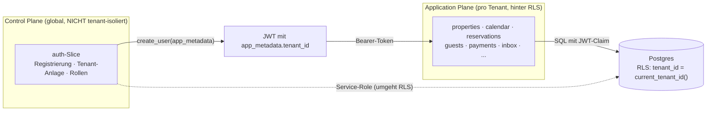

**Schlüsselpunkte:**
- `tenant_id` steht im **JWT `app_metadata`**; `public.current_tenant_id()` liest sie.
- Jede Policy filtert `tenant_id = current_tenant_id()`. Tabellen ohne eigene
  `tenant_id` (`rate_plans`, `availability`, `messages`, `payments`) leiten ihn über
  den Parent ab.
- **Control Plane vs. Application Plane:** Der `auth`-Slice (Tenant-Anlage, Onboarding)
  ist *global* — er läuft über den **Service-Role-Client**, der RLS bewusst umgeht
  (beim Registrieren existiert noch kein `tenant_id` im JWT → Henne-Ei).

---

## 7. Kritische Flows (Sequenzdiagramme)

### 7.1 Registrierung (atomar mit Rollback)

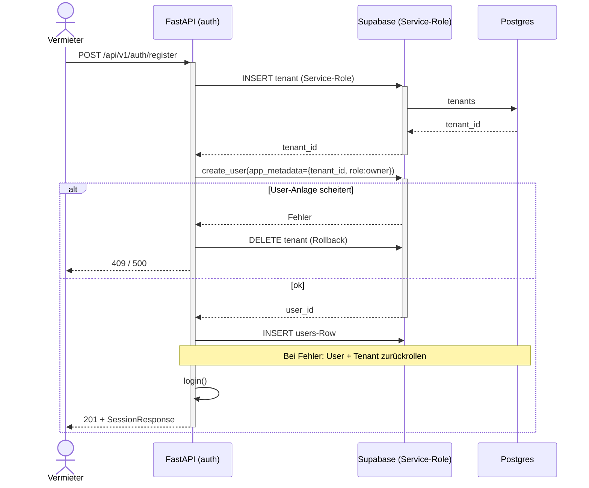

### 7.1a Social-Login (Google via Supabase OAuth)

Neben dem FastAPI-Login („E-Mail/Passwort", Cookies `nd_access`/`nd_refresh`)
gibt es einen Social-Login über **Supabase Auth**. Der Browser spricht hier
direkt mit Supabase (publishable Key), die Session liegt in den Supabase-
Auth-Cookies (`@supabase/ssr`). Das Dashboard-Gate akzeptiert **beide**
Session-Arten.

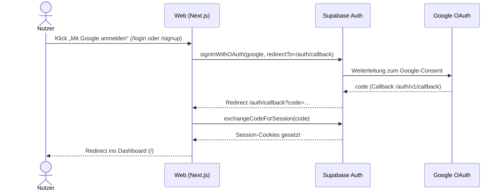

- **Google-Client:** OAuth-Client-ID in Google Cloud (Projekt `nextdays`),
  Redirect-URI = `https://<ref>.supabase.co/auth/v1/callback`. Das Client-Secret
  liegt **nur** in Supabase (Provider-Konfiguration), nie im Repo.
- **Apple:** vorgesehen, aber noch nicht konfiguriert (Buttons deaktiviert).
- **Rollen/Tenant:** ein per Social-Login angelegter Nutzer hat noch keine
  FastAPI-Rolle; das Profil/Tenant-Mapping folgt im auth-Slice.

### 7.2 Direktbuchung mit Double-Booking-Schutz

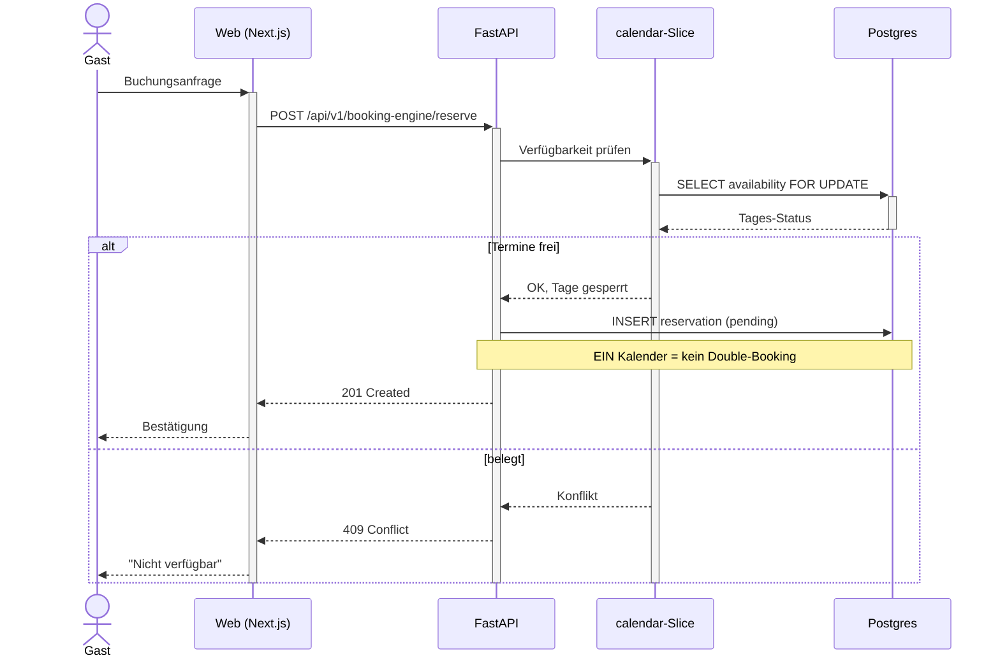

### 7.3 Auto-Aufgaben bei Buchung + Vertretung (§2.5/§4.3)

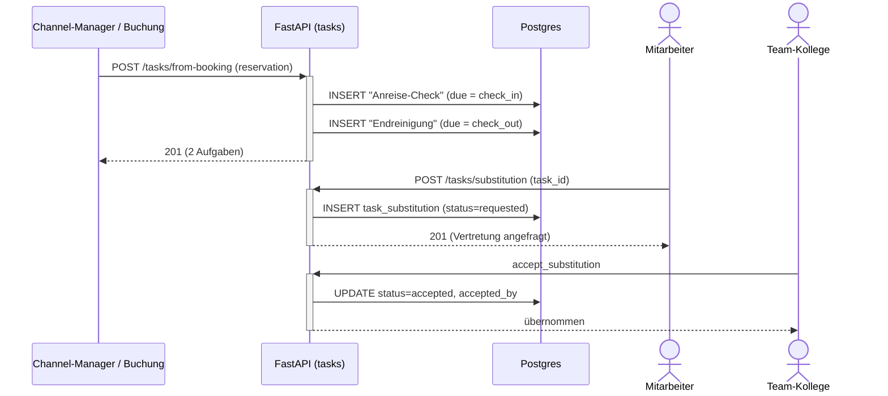

---

## 8. Reservierungs-Lifecycle (State)

`reservation.status` ist eine echte State-Machine.

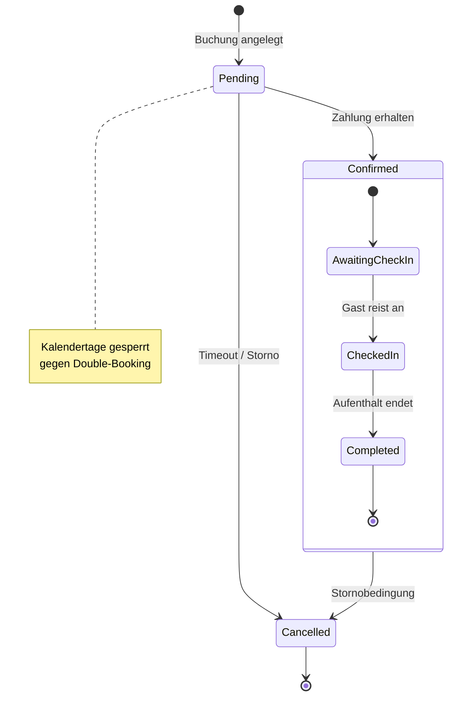

Beim **manuellen Anlegen** über den Kalender (`POST /api/v1/reservations`,
Reservierungs-Assistent im Vermieter-Dashboard) kann der Vermieter den Status
direkt auf `confirmed` setzen; das Backend belegt sofort die Übernachtungstage
in `availability` (= `booked`).

---

## 9. Deployment & Skalierung

DSGVO-konform, self-hosted bevorzugt. EU-Datenresidenz als harte Grenze.

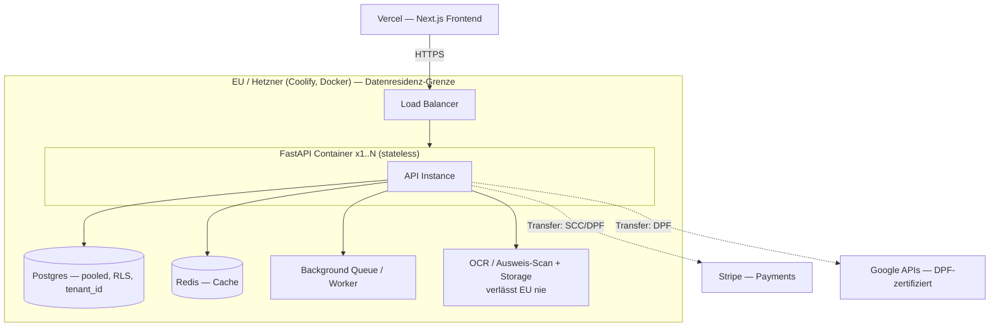

**Prinzipien:**
- FastAPI **zustandslos & containerisiert** → horizontale Skalierung (`x1..N` hinter LB).
- Aller State (Postgres, Redis, Queue, Storage) **externalisiert** — alle Instanzen
  teilen ihn, keine lokalen Daten im Container.
- **Kein** Serverless (Cold Starts, DB-Pooling-Probleme bei langlaufendem FastAPI).
- **US-Cloud als Compute bewusst vermieden** (CLOUD Act vs. DSGVO-Positionierung).
- Jede EU-Grenze überschreitende Kante ist mit Transfer-Rechtsgrundlage annotiert.

---

## 10. Backend-Aufbau (Vertical Slices)

Pro Feature ein **in sich geschlossener Slice** unter `apps/api/src/features/<name>/`:

```
features/auth/
├── router.py        # HTTP-Endpoints (FastAPI APIRouter)
├── service.py       # Business-Logik
├── schemas.py       # Pydantic-Modelle (explizit typisiert)
├── dependencies.py  # slice-spezifische Dependencies (optional)
└── tests/           # Tests des Slice
```

Gemeinsame Infrastruktur in `apps/api/src/core/`:

| Modul | Inhalt |
|---|---|
| `config.py` | `Settings` mit `SecretStr` für alle Secrets |
| `logging.py` | structlog (Console lokal, JSON in Produktion) |
| `supabase.py` | Client-Factory — Anon (RLS) und Service-Role (System) getrennt |
| `security.py` | Supabase-JWT-Verifikation (HS256) → `AuthContext`, `CurrentUser` |

**Slices:** `auth` · `properties` · `rates` · `pricing` · `calendar` · `reservations` ·
`guests` · `inbox` · `payments` · `channel_manager` · `booking_engine` · `ocr` ·
`public_portal` · `tasks` · `crm` · `dashboard` · `content`.

Die letzten vier (`tasks`, `crm`, `dashboard`, `content`) ergänzen den durch das
[Lastenheft](LASTENHEFT.md) erweiterten Funktionsumfang (Aufgaben/Checklisten,
Eigentümer-Akquise & Partner, Dashboard-Personalisierung, dreisprachige
Standardtexte). Der `payments`-Slice nutzt ein **Gateway-Adapter-Pattern**
(Revolut primär, Stripe sekundär — [ADR-0003](decisions/0003-zahlungs-gateway-revolut-primaer.md)).

Alle Router unter dem gemeinsamen Prefix **`/api/v1`** (versioniert von Anfang an).
`auth` ist als Referenz-Muster voll implementiert (siehe **[API.md](API.md)**).

---

## 11. Frontend & Design-System (apps/web)

- **Next.js** (App Router, TS) mit **Bun**; UI im **shadcn-Stil** (CVA + Radix-Slot
  + `cn`), Icons über **Iconify** (kein lucide-react, PROJECT.md §2).
- **Tailwind v4** über `@theme` in `styles/globals.css` — **kein**
  `tailwind.config.ts`. Light/Dark via `next-themes` (`.dark`-Klasse).
- **Design-Tokens** sind die einzige Quelle der Wahrheit für Farben/Radius
  (`:root` + `.dark` in `globals.css`). Startwerte aus dem NextDays-Logo
  (Primär `#0a0a0a`, Akzent-Rot `#b82028`) — **vorläufig, vom Designer
  überschreibbar**. Komponenten referenzieren nur semantische Tokens.
- **Storybook** (react-vite) als lebende Komponenten-Doku & Design-System-Brücke
  ([ADR-0008](decisions/0008-storybook-design-system.md)) — **live deployt**:
  **https://nextdays-storybook.vercel.app** — **zugangsgeschützt** (Login
  erforderlich, siehe Auth-Proxy unten; enthält die ganze Idee + sensible Daten,
  daher kein öffentlicher Zugriff). Addons: `addon-docs` (MDX/Autodocs),
  `addon-a11y` (WCAG-Prüfung), `addon-themes` (Light/Dark), `addon-designs`
  (Figma-Einbettung).
- **Bibliotheks-Umfang** (deckungsgleich mit den Lastenheft-Modulen):
  - **20 UI-Bausteine** (`UI-Bausteine/…`): Input, Label, Textarea, Select,
    Checkbox, Switch, Badge, Avatar, Dialog, DropdownMenu, Tabs, Tooltip,
    Popover, Accordion, Separator, Table, Skeleton, Alert, Progress, Breadcrumb
    (+ Button, Card).
  - **15 PMS-Komponenten** (`PMS-Komponenten/…`, je mit Modul-/Tabellen-Bezug):
    Status-Badges, Rollen-Badge, Preis-Anzeige, Kanal-Icon, Objekt-Karte,
    Reservierungs-Karte, Saison-Legende, Kalender-Tageszelle, **Multi-Kalender
    (§2.2 Herzstück)**, Aufgaben-Checkliste, Inventar-Zeile, Nachrichten-Bubble,
    Onboarding-Stepper (§6), Berechtigungs-Matrix (§4), Zahlungs-Zeile.
  - **7 Eigentümer-Doku-Seiten** (`Einführung/…`, MDX, nicht-technisch): Was ist
    NextDays · Rollen & wer sieht was · Der Multi-Kalender erklärt · Preissystem
    · Nachrichten & Automatisierung · Aufgaben & Checklisten · Häufige Fragen.
  - **Architektur-Diagramme** (`Architektur/…`, MDX): technische C4-/ER-/Flow-
    Diagramme **und** Eigentümer-freundliche „So funktioniert es"-Diagramme.
  - **Austausch/Team-Chat** (`Austausch/…`, MDX): Echtzeit-Chat fürs Team
    (Supabase Realtime, siehe unten).
  - **Design/Tokens**: visuelle Token-Palette.
- Status-Tokens `--success` / `--warning` in `globals.css` ergänzt (für die
  Status-Badges), weiterhin als semantische Tokens — kein Hardcoding.

**Trennung App ↔ Design-System (bewusst entkoppelt):** Das Storybook ist ein
**eigenständiges Package `apps/storybook`** — die Werkstatt des UX/UI-Designers.
UI-Komponenten entstehen dort; eine fertige Komponente wird **erst dann** ins
Web-Projekt `apps/web` übernommen. So bleibt `apps/web` schlank und enthält keine
in Entwicklung befindlichen Komponenten.

```
apps/web/                # Next.js — App-Gerüst (Dashboard/Portal)
├── app/                 # Route-Gruppen (auth)/(dashboard)/(public)
│   └── (public)/marketing/   # Öffentliche Marketing-Landingpage (kein Auth-Gate)
├── components/marketing/     # Sektions-Komponenten der Landingpage (Hero, Trial, …)
├── public/marketing/channels/ # Buchungskanal-Logos (Booking.com, Airbnb, …)
├── public/marketing/reviews/  # Review-Plattform-Logos (Capterra, Trustpilot, …)
└── lib/supabase/        # Browser- + Server-Client (@supabase/ssr)

apps/storybook/          # Design-System + Auth-Proxy (eigenes Package, eigenes Vercel)
├── app/                 # Next.js App Router (Auth-Hülle vor dem Storybook)
│   ├── login/           # Login-Seite (Supabase signInWithPassword)
│   ├── admin/           # Admin-Bereich: Nutzer anlegen (Sofort-Passwort)
│   ├── api/users/       # Service-Role: Nutzer anlegen/listen (nur Admins)
│   └── sb/[[...path]]/  # Catch-all: liefert das GESCHÜTZTE Storybook aus
├── middleware.ts        # Auth-Gate: jede Route außer /login + /api verlangt Session
├── protected/sb/        # statisch gebautes Storybook (privat, nie direkt erreichbar)
├── components/
│   ├── ui/              # 22 shadcn-Stil-Primitive
│   ├── pms/             # 15 fachliche PMS-Komponenten
│   └── docs/            # team-chat.tsx (Realtime) · mermaid.tsx (Diagramme)
├── stories/
│   ├── ui/ · pms/       # Stories je Komponente
│   └── *.mdx            # Eigentümer-Doku · Architektur · Austausch · Design/Tokens
├── lib/
│   ├── utils.ts         # cn()
│   ├── supabase-server.ts   # updateSession() für Middleware
│   ├── supabase-browser.ts  # Browser-Client (Login)
│   └── supabase-chat.ts     # SSR-Browser-Client (Chat sieht Login-Session)
├── styles/globals.css   # Tailwind v4 @theme — Tokens (Quelle der Wahrheit)
└── .storybook/          # main.ts · preview.tsx · BUILD_REFERENCE.md (Bau-Standard)
```

### Zugangsschutz: Auth-Proxy vor dem Storybook

Das Storybook enthält die gesamte Produktidee und sensible Daten — es darf nur
von befugten Personen gesehen werden. Statt eines statischen Builds liegt vor dem
Storybook eine **Next.js-Auth-Hülle** im selben Package:

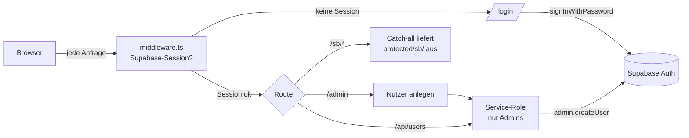

- **`middleware.ts`** prüft serverseitig die Supabase-Session. Ohne Session →
  Redirect auf `/login`. Greift auch für **alle** Storybook-Assets (`/sb/*`),
  sodass nichts ohne Login ausgeliefert wird. `/api/*` antwortet selbst mit
  `403`-JSON statt Redirect.
- Das Storybook wird statisch nach **`protected/sb/`** gebaut (außerhalb von
  `public/`, daher nicht direkt erreichbar) und nur über den Catch-all
  `/sb/[[...path]]` mit gültiger Session ausgeliefert. In die `index.html` wird
  `<base href="/sb/">` injiziert, damit relative Asset-Pfade auflösen.
- **Accounts gibt es nur per Admin** (`/admin` → `/api/users`, Service-Role-Key
  bleibt serverseitig). Kein Self-Signup. Optionale strikte Allowlist über
  `STORYBOOK_ALLOWED_EMAILS`; Admins über `STORYBOOK_ADMIN_EMAILS`.

### Echtzeit-Austausch (Team-Chat)

`Austausch/Team-Chat` ist ein Echtzeit-Chat direkt im Storybook über **Supabase
Realtime** (Tabelle `storybook_chat`, Migration `0020`, Publication
`supabase_realtime`). Der Chat nutzt **dieselbe Login-Session** (SSR-Browser-
Client) — der Anzeigename kommt automatisch aus dem eingeloggten Account, keine
zweite Anmeldung. RLS erlaubt anonymem Schlüssel nur `SELECT` + `INSERT`; der
Chat ist bewusst von allen PMS-/Kundendaten getrennt.

---

## Externe Dienste

Vom FastAPI-Backend als Dienste aufgerufen, Datenhoheit bleibt bei uns. Jeder Dienst
wird in **[docs/decisions/](decisions/)** mit Rechtsgrundlage dokumentiert.

| Dienst | Zweck |
|---|---|
| Google Maps / Places | Adress-Autocomplete, Geocoding, Kartenansicht (Portal) |
| Google Calendar | optionaler Sync persönlicher Sperrzeiten (nicht Kanal-Sync) |
| Google Translate | mehrsprachige Inhalte (server-seitig gecacht) |
| OCR (self-hosted) | Ausweis-/Pass-Scan (Meldepflicht) + Belege — bleibt auf Hetzner |
| **Channex** | Channel-Manager-Aggregator: OTA-Distribution (Booking.com, Airbnb, Expedia …). ARI-Push + Buchungs-Pull über den `channel_manager`-Slice (`channex_client.py`). Secrets: `CHANNEX_API_KEY`, `CHANNEX_BASE_URL`, `CHANNEX_WEBHOOK_SECRET`. |

---

> **Diagramme pflegen:** Alle Diagramme sind Mermaid-Code in dieser Datei — im PR
> diffbar, mit dem Code versioniert. Bei Architektur-Änderungen hier aktualisieren.
> C4Context/C4Container sind in Mermaid „experimental" — nach Änderungen im
> GitHub-Preview gegenprüfen.

---

## „My Next" — Taskilo-Integration (Buchhaltung · Marktplatz · HR · Jobs)

NextDays wird um den Geschäftsumfang von **Taskilo** erweitert. Maßgeblich:
**[ADR-0009](decisions/0009-taskilo-integration-architektur.md)**, Bestand:
**[TASKILO-INVENTAR.md](TASKILO-INVENTAR.md)**.

**Leitplanken (ADR-0009):**
- **Ein Stack, ein Backend, ein Supabase, eine Auth.** Die neuen Bereiche werden
  als **Vertical Slices in `apps/api`** umgesetzt (wie die PMS-Slices),
  Mandant **`tenant_id`** (RLS via `current_tenant_id()`), `companies` → `tenants`
  (+ `tenant_billing_profile`).
- **Frontend im NextDays-Paradigma:** Server Actions in `apps/web/lib/<domäne>.ts`,
  UI ausschließlich `components/ui/*` + Tokens (kein `@tasko/ui`, kein react-query).
  Taskilo-Komponenten werden **neu geschrieben**, nicht kopiert.
- **Eine App, Pfade statt Subdomains:** `/dashboard`, `/buchhaltung`, `/marktplatz`,
  `/hr`, `/jobs` unter einer Domain. **Keine** Feature-Subdomains (bricht
  Auth/Session). Nur Marketing-Website ↔ App darf per Subdomain getrennt werden.
- **Eine große Sidebar** mit aufklappbaren Gruppen je Domäne; Menü per
  Lodgify-Berechtigung gegated.
- **NICHT übernommen:** Chat, Admin-Dashboard, SEO/Marketing, WhatsApp,
  Advertising, Taskilos eigene Auth + Onboarding.

**Neue Slices (geplant):** `buchhaltung` (✅ Basis), `tax`, `datev`, `einvoice`,
`banking`, `employees`, `jobs`, `job_applications`, `marketplace`.
Vorgehen je Modul: **DB-Migration → Backend-Slice → Server Actions → UI**.
