# Architektur

> Verbindliche Grundlage: **[PROJECT.md](../PROJECT.md)**. Dieses Dokument erläutert
> die Architektur mit Diagrammen und beschreibt den **tatsächlich umgesetzten** Stand.
>
> **Notation:** [C4-Modell](https://c4model.com) (System Context · Container · Component)
> + ergänzende ER-, Sequenz-, State- und Deployment-Diagramme. Alle Diagramme sind als
> Mermaid (Diagrams-as-Code) eingebettet und werden von GitHub nativ gerendert.

## Inhalt

1. [Leitidee](#1-leitidee-pms-kern-in-der-mitte)
2. [System Context (C4 Level 1)](#2-system-context-c4-level-1)
3. [Container (C4 Level 2)](#3-container-c4-level-2)
4. [Component: Channel Manager (C4 Level 3)](#4-component-channel-manager-c4-level-3)
5. [Datenmodell (ER-Diagramm)](#5-datenmodell-er-diagramm)
6. [Mandantenfähigkeit & RLS](#6-mandantenfähigkeit--rls)
7. [Kritische Flows (Sequenzdiagramme)](#7-kritische-flows-sequenzdiagramme)
8. [Reservierungs-Lifecycle (State)](#8-reservierungs-lifecycle-state)
9. [Deployment & Skalierung](#9-deployment--skalierung)
10. [Backend-Aufbau (Vertical Slices)](#10-backend-aufbau-vertical-slices)
11. [Frontend & Design-System (apps/web)](#11-frontend--design-system-appsweb)
12. [Page-Builder](#12-page-builder)

---

## 1. Leitidee: PMS-Kern in der Mitte

NextDays ist kein loses Bündel aus Tools, sondern **ein Datenkern**, an den alle
Kanäle andocken. Der gemeinsame Nenner ist die **`availability`-Tabelle**: eine Zeile
pro `(property_id, date)` mit `UNIQUE`-Constraint — die *eine Wahrheit* und der
strukturelle Schutz gegen Double-Bookings über alle Kanäle hinweg.

---

## 2. System Context (C4 Level 1)

Wer nutzt NextDays, und mit welchen externen Systemen spricht es?

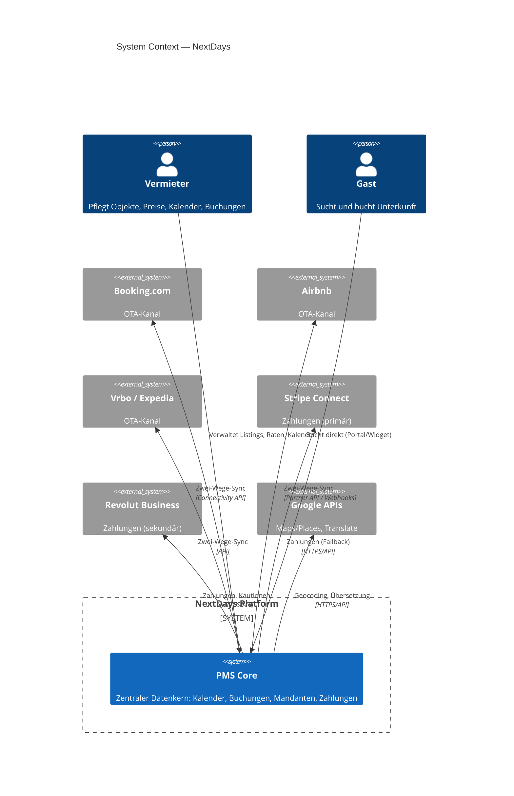

---

## 3. Container (C4 Level 2)

Die ausführbaren Bausteine und Datastores des Systems, mit Technologie und Protokoll.

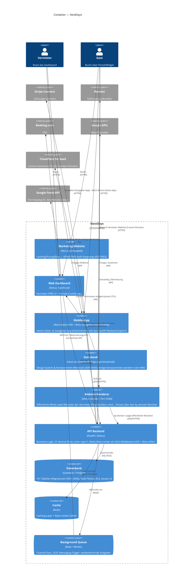

> **Hinweis zur C4-Notation:** „Container" meint hier eine *separat ausführbare App
> oder einen Datastore* (Next.js, FastAPI, Postgres, Redis) — nicht zwingend einen
> Docker-Container. Die Marketing-Website ist bewusst entkoppelt (eigenes Deployment).

### Slice-Landkarte (Component-Ebene, API-Backend)

Die Vertical Slices und ihre Datenbereiche — der Stand der Geschäftslogik:

```mermaid
flowchart TB
    subgraph API["API Backend (FastAPI) — /api/v1"]
        subgraph CORE["core/ (Querschnitt)"]
            CFG["config · logging · supabase · security (JWT ES256/JWKS)"]
        end
        subgraph DONE["Slices mit Logik"]
            AUTH["auth — Register/Login/Me/Invite, Rollen+Capability-Matrix + Lodgify-Berechtigungen (pro Nutzer)"]
            CAL["calendar — Verfügbarkeit, Double-Booking, Preis-Override (liest Preis via pricing-Resolver)"]
            PRICE["pricing — Preis-Resolver (effective_price + quote) + Dynamic-Pricing-Engine (dynamic_prices; Regeln + gelernte Pickup-Kurve/Wetter/Autopilot)"]
            TASKS["tasks — Aufgaben, Checklisten+Foto, Vertretung, Inventar"]
            BUCH["buchhaltung — Rechnungen + Kunden (aus Taskilo, tenant-vereinheitlicht) + Firmenprofil/Logo; Nummernkreise (next_document_number)"]
            OWN["owners — Eigentümer-Stammdaten, Objekt-Zuweisung (Anteil + Provisions-Override je Objekt)"]
            OWNST["owner_statements — Auszahlungs-Abrechnung (Provision je Objekt, EU-Steuer/Reverse-Charge, Storno, Mehrwährung via ECB-Tageskurs)"]
            INBOXL["inbox — Threads (OTA + eigene Plattform), Versand, Vorlagen/KI, geplante Nachrichten + planbare Automails (Zeit + Zuweisung Haus/Kanal)"]
            ADDON["addons — Zusatzleistungen/Upsells je Objekt (Medien, Basis, appears_in, wann-anzeigen); Verkauf via booking_engine + Gäste-Portal, Extra-Umsatz in Owner-Statement, Task-Trigger addon_purchased, Payment-gegatet"]
            PROP["properties — Objekt-Stammdaten, Fotos, Typ-Attribute, Adress-Split, Owner-Scope (RLS)"]
            RATES["rates — Saison-/Event-Preise, Rate-Plans, Aufschläge"]
            RES["reservations — Buchungen, Lifecycle, Gast-Maskierung (Daten-Split)"]
            GUE["guests — Enterprise-Gästeprofil (Adressen/Kontakte/Ausweise/Consents), Merge, DSGVO"]
            PAY["payments — Stripe Connect Custom (primär), Destination Charge, Kaution, Refund, Webhooks; OTA-Gate; Revolut sekundär"]
            SUB["subscriptions — Abo-Billing Tenant→myNextDays: Grundgebühr + Objekt-Staffel (graduated) + Zusatzmodule; Stripe Subscription/Checkout/Portal, Adaptive Pricing (27 EU); Modul-Entitlements"]
            CM["channel_manager — Channex (ARI-Push, Buchungs-Import, Webhooks, Hotel-ID-Flow, Stop-Sell, ARI-Outbox)"]
            BOOK["booking_engine — eigene Direktbuchungs-Strecke (provisionsfrei) + Buchungs-Widget"]
            PORTAL["public_portal — White-Label-Gäste-Portal (Phase 2-Struktur, 9 Routen)"]
            WA["whatsapp — WhatsApp Cloud API (Conversations/Messages, im Posteingang integriert)"]
            TAG["travel_agencies — Reisebüro-Kartei (Profile, Verträge nach Jahren, Saison-Preise, Vertragsdateien)"]
            SITE["site_config — Page-Builder: Branding, Custom-Domains (Cloudflare for SaaS), Seiten + Blöcke (Page-Builder), Templates, Draft-Token; öffentlicher by-domain-Resolver (s. §12)"]
        end
        subgraph SCAFFOLD["Slices als Gerüst (Health-only) — Logik folgt lt. Roadmap"]
            OCR["ocr"]; CRM["crm"]; DASH["dashboard (min.)"]; CONT["content (min.)"]
        end
    end
    DB[("Postgres — 101 Tabellen (Migrationen 0001–0090), RLS")]
    DONE --> DB
    SCAFFOLD --> DB
    CORE --> DONE
    CORE --> SCAFFOLD
```

---

## 4. Component: Channel Manager (C4 Level 3)

Der `channel_manager`-Slice nutzt ein **Adapter-Pattern** (Anti-Corruption-Layer):
ein einheitliches Interface zum PMS-Kern, dahinter austauschbare Adapter pro Kanal.
So bleibt die Entscheidung *Direkt-Anbindung vs. Aggregator* reversibel
(siehe [ADR-0001](decisions/0001-channel-manager-architektur.md)).

**Aktueller Stand: Aggregator-Pfad über Channex.** Statt N Direkt-Adapter je OTA
nutzen wir **Channex** als Aggregator (https://docs.channex.io) — eine API für alle
Kanäle (Booking.com, Airbnb, Expedia …). Der `ChannexClient` (`channex_client.py`)
ist der konkrete Adapter hinter der Facade; ARI/Buchungen laufen über die Channex-
API (Auth `user-api-key`, ARI gebündelt, Buchungen via `booking_revisions/feed`
+ ack, Webhook als Trigger). Beträge in Cent. Mapping in `channex_*`-Tabellen
(Migration `0027_channex.sql`).

**PMS-Mapping (NextDays hat keine Zimmerkategorien).** Eine `property` ist die
buchbare Einheit (Ferienwohnungs-Modell). Channex verkauft jedoch Room-Types mit
`count_of_rooms`. Der Content-Sync bildet daher ab: `property` → Channex-Property,
**ein synthetischer Room-Type pro Property** (`count_of_rooms=1`,
`local_unit_ref = property_id`), je lokalem `rate_plans`-Eintrag ein Channex-Rate-Plan.
Der Sync ist idempotent (POST/PUT je nach vorhandenem Mapping) und läuft non-blocking
beim Objekt-Anlegen.

**Kanäle inhouse verbinden (kein Provider-iFrame, white-label-Pflicht).** Der
Adapter implementiert den vollen Channel-API-Flow selbst: `test_connection` →
`mapping_details` → `create` (mit `group_id`, `rate_plans[]`, Codes als **Integer**)
→ `activate`. Die eigene UI (`channel-connect-button.tsx`) führt durch
Portal-Wahl → Zugangsdaten → Zimmer/Raten-Zuordnung; der Provider bleibt unsichtbar.
Für Tests ohne echtes OTA-Konto: Sandbox-Kanal (OpenChannel) gegen einen eigenen
Mock-OTA-Endpoint (`sandbox_ota.py`, Flag `channex_sandbox_portals`).

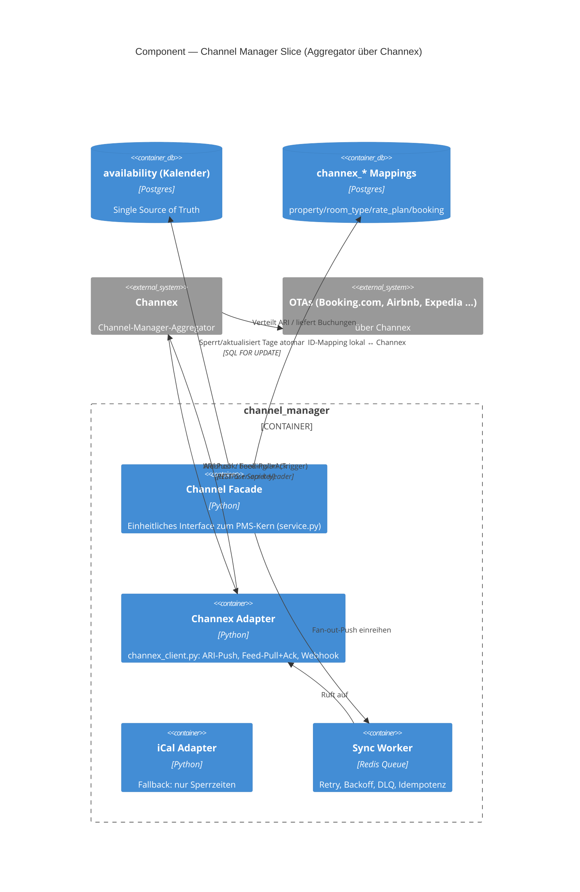

---

## 5. Datenmodell (ER-Diagramm)

Tatsächliches Schema aus **[supabase/migrations/](../supabase/migrations/)** (Phase 1).

> **Migrationen anwenden:** Es gibt **keinen** automatischen Runner — `deploy.yml`
> deployt nur Container, das Supabase-Image-Init läuft nur beim allerersten Start
> eines leeren Datenverzeichnisses. App-Migrationen werden mit
> **[supabase/apply-migrations.sh](../supabase/apply-migrations.sh)** eingespielt:
> das Skript fährt alle `supabase/migrations/*.sql` in Reihenfolge per SSH/psql
> gegen die Server-DB und trackt sie in `public.schema_migrations` (nur noch nicht
> Angewendete laufen, gefahrlos wiederholbar). Bei nachträglicher Tracking-Einführung
> auf einer bestehenden DB einmalig `--baseline` (markiert vorhandene Migrationen
> als angewendet, ohne ihr SQL erneut zu fahren).


**Marktplatz-Tabellen (angelegt, mit RLS; Geschäftslogik in Phase 2):** `portal_guests`,
`reviews`, `commissions` — siehe [Migration 0006](../supabase/migrations/0006_marketplace.sql).
Das Kern-Diagramm oben zeigt bewusst nur die zentralen Entitäten; alle übrigen der
**101 Tabellen** sind nach Bereich gruppiert im nächsten Abschnitt aufgeführt.

**Kardinalität:** `||` = genau eins · `o{` = null bis viele · `|{` = ein bis viele.
`--` = identifizierend (Kind kann ohne Eltern nicht existieren).

### Datenmodell-Erweiterungen aus dem Lastenheft (Migrationen 0009 ff.)

Das Modell ist auf **101 Tabellen (alle mit RLS)** gewachsen — verifiziert gegen das
echte Supabase-Projekt. Zur Lesbarkeit hier nach Bereich gruppiert (Details in den
jeweiligen Migrationen):

```mermaid
erDiagram
    TENANT ||--o{ SEASON_TEMPLATE : has
    SEASON_TEMPLATE ||--o{ SEASON : contains
    SEASON ||--o{ SEASON_PERIOD : "gilt an"
    SEASON_TEMPLATE ||--o{ SEASON_ASSIGNMENT : "zugewiesen an"
    TENANT ||--o{ EVENT : has
    EVENT ||--o{ EVENT_PERIOD : "gilt an"
    PROPERTY ||--o{ SURCHARGE : "Aufschläge"
    PROPERTY ||--o{ PROPERTY_ADDON : "Zusatzleistungen/Upsells"
    RESERVATION ||--o{ RESERVATION_ADDON : "gekaufte Extras"
    PROPERTY_ADDON ||--o{ RESERVATION_ADDON : "Snapshot bei Kauf"

    TENANT ||--o{ TASK : has
    TENANT ||--o{ TASK_RULE : "wiederkehrend"
    TASK_RULE ||--o{ TASK_RULE_ASSIGNMENT : "je Objekt"
    TASK ||--o{ CHECKLIST_ITEM : enthaelt
    CHECKLIST_ITEM ||--o{ CHECKLIST_PHOTO : "Foto-Nachweis"
    TASK ||--o{ TASK_SUBSTITUTION : "Vertretung"
    TENANT ||--o{ INVENTORY_ITEM : "Inventar/Pool"
    USER ||--o{ STAFF_PROPERTY_ASSIGNMENT : "Stamm-MA"

    TENANT ||--o{ LEAD : "Akquise"
    TENANT ||--o{ PARTNER : has
    PARTNER ||--o{ DEAL : "Rabatte"

    TENANT ||--o{ MESSAGE_TEMPLATE : has
    MESSAGE_TEMPLATE ||--o{ MESSAGE_TRIGGER : "Timing/Kanal"
    TENANT ||--o{ CONTENT_BLOCK : "dreisprachig"
    CONTENT_BLOCK ||--o{ CONTENT_ASSIGNMENT : "zugewiesen"

    TENANT ||--o{ BLOCK_REQUEST : "Sperrung beantragt"
    PROPERTY ||--o{ METER_READING : "Zählerstand (append-only)"
    PROPERTY ||--o{ CO_OWNER : "Miteigentümer"
    PROPERTY ||--o{ PRICE_OVERRIDE : "Tagespreis"
    USER ||--|| DASHBOARD_LAYOUT : personalisiert

    PLAN ||--o{ SUBSCRIPTION : "unit-basiert"
    TENANT ||--|| SUBSCRIPTION : abonniert
```

**Channel-Manager-Mapping (Channex, Migration `0027_channex.sql`, alle mit RLS):**

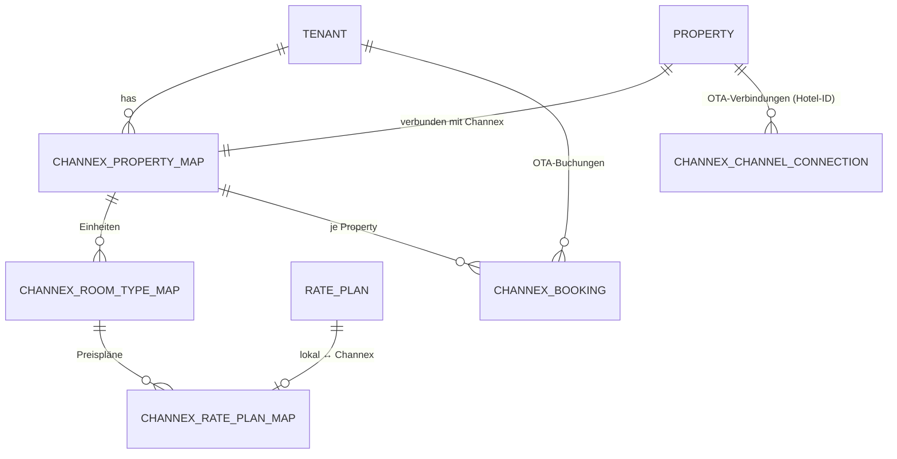

Jede Mapping-Tabelle hält die `channex_*_id` (externe UUID) neben der lokalen
Referenz; `channex_booking` speichert zusätzlich `revision_id`/`system_id` (Dedup),
die volle `raw`-Payload und seit Migration `0047` `guest_id` (Thread→Gast-Link, vom
zentralen Resolver gesetzt). Beträge in Cent (`amount_cents`). Die kanal-
übergreifende Gast-Identität trägt `guest_external_ids` (Migration `0047`: je
Tenant eindeutig pro `channel`+`external_id`). `channex_group_map`
(Migration `0028`) hält je Tenant die Provider-Group (Whitelabel-Konto-Modell:
ein Konto, eine Group pro Hotel). **White-Label-Pflicht:** Provider-Name/IDs
erscheinen nie im Frontend (Responses neutralisiert: `property_title`/`external_id`).

`channex_channel_connection` (Migration `0035`) persistiert pro (Objekt, Portal) die
vom Vermieter eingegebene **OTA-Hotel-ID**, den erzeugten Channel und den Aktiv-Status —
damit ist die Portal-Verbindung sichtbar und verwaltbar (Status, Trennen, Re-Connect
mit vorbefüllter Hotel-ID). Modell: Der Vermieter legt seine Unterkunft selbst beim OTA
an (Hotel-ID), trägt sie in NextDays ein → Auto-Connect über Channex. Ein OTA-seitiges
„Property von Null anlegen" ist kein verfügbarer Weg (s. ADR-0012).

**Weitere Änderungen am Bestand:** `property_type` + `type_attributes` an
`properties` (Ökosystem, ADR-0007); Rollen-Enum um `admin`, `co_admin`
erweitert; `payments`: `stripe_ref` → `gateway_ref` + `gateway`-Enum
(Adapter-Pattern ADR-0003; Primärwahl Stripe via ADR-0011).
Marktplatz-Tabellen (`portal_guests`, `reviews`, `commissions`) wie oben.
`users.permissions` (JSONB, Migration 0022) für feingranulare
Lodgify-Berechtigungen pro Nutzer.

**Zweistufiges Berechtigungsmodell (Konto → Benutzer):**

1. **Capability-Matrix** (`permissions.py`, rollenbasiert) — schützt interne
   Slice-Endpoints über `require_permission(Capability.…)` / `require_role(…)`.
2. **Lodgify-Berechtigungen** (`lodgify_permissions.py`, pro Nutzer in
   `users.permissions`) — im Benutzer-Wizard zugewiesen (Default je Rolle,
   überschreibbar), per `require_lodgify_permission(Permission.…)` an Endpoints
   durchgesetzt und im Frontend (`app-sidebar`, `getMe().permissions`) zum
   Aus-/Einblenden von Menüpunkten genutzt. **Admin = immer alle.** Die
   Nutzerverwaltung selbst sehen nur admin/owner/co_admin (sonst `403`); ein
   **Admin sieht alle Nutzer plattformweit**, Owner/Co-Admin nur den eigenen
   Tenant.

**Enterprise-Posteingang & DSGVO-Daten-Split (drei unabhängige Achsen):** Der
Posteingang-Zugriff läuft **nicht** über den groben Rollen-Guard, sondern über die
feingranularen Berechtigungen — `inbox/authz.py` löst aus `users.permissions` ein
`InboxAccess` (Scope `inbox_view_all`, Aktionen `pm_chat`/`inbox_reply`/
`inbox_assign`/`inbox_manage_config`, Feld-Maske) auf. Die Feldsichtbarkeit von
Gastdaten (Name → nur Vorname ohne `view_guest_name`, Kontakt, Beträge, Quelle,
**Ausweisnummern** → `••• 1234` ohne `view_guest_id_docs`) ist in **einem**
zentralen Helper `auth/guest_masking.py` gebündelt und wird identisch von `inbox`,
`reservations`, `dashboard` und `guests` (Gästekarte) genutzt (Single Source of
Truth, fail-closed).

**Gästekarte (guests-Slice, Migration 0046):** Enterprise-Gästeprofil (vgl. OPERA
Cloud / protel) mit Stammdaten + Sub-Tabellen `guest_addresses`, `guest_contacts`,
`guest_identity_documents` (DSGVO-sensibel), `guest_preferences`, `guest_consents`
(append-only), `guest_notes`, `guest_documents` — alle tenant-scoped mit RLS.
Zugriff über `pm_guest_details`; DSGVO-Löschung anonymisiert bei Reservierungs-
bezug (statt Hard-Delete). Quelle der Wahrheit für die Permissions ist immer die DB (nicht das
evtl. veraltete JWT). Zuweisungen sind auditiert (`channex_booking.assigned_by/at`
+ `inbox_assignment_log`, Migration `0045`).

**Reservierungs-Storno (Migration `0050`):** Stornieren erfordert eine
Pflicht-Begründung und ist dokumentiert — `reservations.cancel_reason/cancelled_by/
cancelled_at` + append-only `reservation_cancellation_log`. Kanal-agnostisch
(Direkt, eigene Plattform, alle 45+ Channex-OTAs): die belegten Tage werden
freigegeben und an Channex zurückgemeldet (availability=1); eine lokale Storno
hebt die OTA-Buchung NICHT beim Portal auf (das UI weist darauf hin). Guard:
`MANAGE_CALENDAR` + `EDIT_CALENDAR_BOOKINGS` (wie Verschieben).

**Check-in/Check-out + Zimmerrechnung (Migrationen `0091`/`0092`):** Echte
Front-Desk-Aktionen im Kalender-Buchungs-Slider — `POST /reservations/{id}/
check-in|check-out` persistiert `checked_in_at`/`checked_out_at` (Guards wie
Storno); der Anzeige-Status „Eingecheckt" kommt seit `0091` aus diesen Feldern,
nicht mehr aus dem Anreisedatum, und der Check-out setzt `status='completed'`.
Fachliche Regeln (Nutzer-Entscheidung): Rechnungen aus Buchungen erst NACH
Check-in; **beim Check-out entsteht verpflichtend eine finale Rechnung mit
GoBD-Nummer** — schlägt die Rechnungserstellung fehl, findet kein Check-out
statt (Reihenfolge: erst Rechnung, dann Statuswechsel; Retry ist idempotent).
Der **Booking→Invoice-Builder** (`buchhaltung/reservation_invoice.py`, EINE
Quelle der Wahrheit für Check-out, `GET /buchhaltung/invoice-preview` und den
manuellen „Rechnung aus Buchung"-Flow) baut die Positionen aus
`reservations.quote_items` (neues optionales `kind`-Feld je Zeile:
`lodging|surcharge|fee|discount|tax|addon`; `tax`-Zeilen wie Kurtaxe → 0 % USt,
Bestands-Snapshots ohne `kind` via Label-Abgleich mit
`property_pricing_config.taxes`) plus `reservation_addons`
(Snapshot-Steuersatz; quote_items enthalten NIE Addon-Zeilen — Invariante).
Aufenthalts-Positionen werden mit `tenant_billing_profile.lodging_tax_rate`
versteuert (nullable, bewusst KEIN Default — fehlt der Satz, 422 mit klarer
Meldung; Kleinunternehmer → 0 %); Brutto→Netto wird je Zeile rückgerechnet, die
Brutto-Summe bleibt exakt der Gastpreis. Gast→Debitor-Brücke:
`customers.guest_id` (unique je Tenant, `KD-`-Nummern über
`next_document_number`). `invoices.reservation_id` + partieller Unique-Index
verhindern Doppelrechnungen (nach Storno ist eine neue möglich); Währung kommt
aus dem Buchungs-Snapshot, sonst deterministisch aus
`property_pricing_config.currency`/`rate_plans.currency`. Channex-Resync fasst
Buchungen mit `checked_out_at` nicht mehr an (kein Status-Rollback);
`invoices`/`invoice_line_items` sind in der Realtime-Publication.

**USt-Satz je Gebühr (Snapshot-Kette wie Addons):** Gebühren im Preis-Setup
(`property_pricing_config.fees[]`, jsonb) tragen ein optionales `taxRate`
(z. B. Frühstück 19 % neben Logis 7 %; leer = Standard-Übernachtungssatz —
Override-Hierarchie, kein erfundener Wert). Der Pricing-Resolver schreibt den
Satz als Snapshot in die QuoteLine (`tax_rate`), der Buchungs-Snapshot
persistiert ihn in `reservations.quote_items`, und `build_positions` nutzt die
Prioritätskette **Kleinunternehmer → Zeilen-`tax_rate` → Abgabe
(kind='tax'/Label) 0 % → `lodging_tax_rate`**. Bestands-Snapshots und
Channex-Fees (liefern nie einen Satz — Modellgrenze) laufen unverändert über
den Übernachtungssatz.

**Rechnungssprache = Gastsprache (`0099`):** Belegtexte aus Buchungen
(Aufenthalts-Label, Sammelposition, `head_text`, Einheit, Addon-Label aus dem
mehrsprachigen `name`-jsonb) entstehen in der Korrespondenzsprache des Gastes
(`reservations.guest_language`) — Begriffskatalog `buchhaltung/doc_i18n.py`
(24 EU-Sprachen inkl. zählabhängiger Pluralformen und Datumsformat je Sprache;
unbekannt/fehlend → de). Die Sprache wird als `invoices.language` gespeichert
und über `InvoiceResponse`/`invoice-preview` (`guestLanguage`) ausgeliefert;
das PDF-Frontend übersetzt seine statischen Beschriftungen über
`apps/web/hooks/pdf/document-translations.ts` (24 Locales, gleiche Liste wie
`messages/*`) und belegt die Sprach-Auswahl im Versand-Dialog damit vor.
Der Kalender-Slider öffnet den Dokument-Dialog (PDF-Vorschau/Download/Druck)
direkt („Ansehen & versenden", `lib/invoice-document.ts` mappt die
snake_case-`InvoiceResponse` auf die camelCase-Dokumentform des Bestands).
Der **E-Mail-Versand** läuft über einen **eigenen Mailcow-Server** auf separatem
Host (`mail.mynextdays.dk`, außerhalb des DB-/App-Stacks); die API sendet per
SMTP-Submission (Port 587, STARTTLS) über `core/mail.py` (`MailService`). Ohne
konfigurierten `SMTP_HOST`/`SMTP_FROM_ADDRESS` ist der Versand fail-closed
deaktiviert (503, kein stiller Erfolg). Setup/DNS/Betrieb: [`deploy/mail/`](../deploy/mail/README.md).

**Zentrale Preis-Wahrheit (pricing-Slice, Migrationen `0051`/`0052`/`0053`):** Preise
liefen früher in vier unverbundenen Quellen auseinander — im Objekt bearbeitete
Preise erschienen nicht im Kalender/Quote. Jetzt gibt es **einen** Resolver
`pricing/resolver.py` als Single Source of Truth:
- `effective_price(property_id, day)` → Effektivpreis pro Tag in fester Priorität
  **manueller `price_overrides`(Tag) > `dynamic_prices` (Regel-Engine) >
  Wochentagspreis > `rate_plans.base_price`**; ohne Preis `None` (kein erfundener
  Fallback).
- `quote(property_id, range, guests, channel)` → vollständige Aufschlüsselung:
  Effektiv-Tagespreise + Längenpreis (verdrängt Basispreis), Kurzaufenthalts- und
  Extra-Gast-Aufschlag, Kanal-Markup (direct = 0), Gebühren, Aktionen (Rabatt),
  Steuern → Summe + Positionen.

Jede Oberfläche liest Preise **ausschließlich** über den Resolver: der Kalender
(`calendar/get_availability`) zeigt denselben Effektivpreis wie die Buchungs-Quote;
`reservations.create` füllt `total_amount` + `quote_items` automatisch aus dem Quote
(manueller Betrag > 0 überschreibt); der Reservierungs-Wizard zeigt die Quote-
Aufschlüsselung live. Die zuvor opake Pricing-Konfiguration (Markups, Aufschläge,
Gebühren, Steuern, Aktionen, Add-ons) wurde aus `properties.type_attributes.pricing`
in die typisierte, vom Resolver gelesene Tabelle **`property_pricing_config`** (`0051`,
Backfill aus dem Blob) überführt; `properties.update` spiegelt jede Änderung dorthin.
`rate_plans` + `property_pricing_config` sind jetzt in der Realtime-Publication (`0052`)
— Preisänderungen erscheinen ohne Reload in allen Tabs (`calendar-board` abonniert sie).
Das zweite Saison-Modell (`seasons`/`season_*` aus `0011`) wurde mit `0053` als
deprecated für die *manuellen* Tagespreise markiert (die laufen über
`price_overrides`); die Saison-/Event-**Perioden** werden aber von der Dynamic-
Pricing-Engine als Aufschlag-Signal gelesen (s. u.).

**Dynamic Pricing (Phase 1, regelbasiert, Migration `0055`):** Eine reine Regel-
Engine (`pricing/engine.py`, deterministisch/unit-testbar) berechnet je (Objekt,
Tag) einen dynamischen Preis + Min-Stay aus **multiplikativen** Faktoren auf den
Basispreis: Saison (`season_periods`), Event (`event_periods`), Wochenende, eigene
Auslastung (Belegung im ±30-Tage-Fenster), Lead-Time/Last-Minute (Tage bis Anreise),
Orphan-Gap (1–2-Nächte-Lücken in `availability`) — anschließend `clamp(min_price,
…, max_price)`. Der `recompute`-Service lädt die Quellen, ruft die Engine und
schreibt nach **`dynamic_prices`** (NIE in `price_overrides`); danach löst er den
vorhandenen Channex-ARI-Push (Preis in Cent + Min-Stay, run-length-kodiert) aus.
Konfiguration je Objekt in **`dp_settings`** (opt-in, **default AUS**). Der tägliche
Lauf kommt über `POST /pricing/recompute` (Cron-Secret, Coolify Scheduled Task,
Horizont 540 Tage); zusätzlich rechnet `reservations.create/cancel` die betroffenen
Tage (±2) sofort neu (Auslastung/Orphan ändern sich). **Manuell schlägt automatisch:**
ein vom Host gesetzter `price_override` gewinnt im Resolver immer über den DP-Vorschlag;
bei DP-AUS gibt es keine `dynamic_prices` und der Resolver fällt auf Basis zurück.
**Phase 2 (Migration `0056`)** ergänzt einen **Markt-/Wettbewerbs-Faktor** über eine
pluggable Provider-Schnittstelle (`pricing/market/`: `MarketSignalProvider` → comp_price/
demand_index/event_uplift_pct). Auswahl per Env `MARKET_DATA_PROVIDER`: Default
**NullProvider** (neutral → exakt wie Phase 1), `AirDnaProvider` nur mit `AIRDNA_API_KEY`.
Der Markt-Faktor zieht den Preis gewichtet (`market_sensitivity`) Richtung Markt-Median +
Nachfrage, gedeckelt auf ±`market_max_adjust_pct`; Markt-Events werden mit `event_periods`
gemerged (Maximum, keine Doppelzählung). Markt ist opt-in (`dp_settings.market_enabled/
market_key/comp_refs`). Die Engine persistiert je Tag die **Faktor-Aufschlüsselung**
(`dynamic_prices.factors`), die der Kalender als „Warum dieser Preis?"-Tooltip zeigt
(Saison/Wochenende/Markt/Auslastung … mit %-Beitrag). Verteilpfad unverändert. Ohne
AirDNA-Konto läuft alles über den NullProvider — DP wie Phase 1, nur mit Markt-Schaltern
+ Preis-Erklärung bereit. Optionale Alternative: ein PriceLabs-IAPI-Connector als
umschaltbare Preis-Quelle (separat), der ebenfalls nach `dynamic_prices` schreibt.
**Phase 3 (Migration `0057`)** bringt das zentrale Bedienmodell gängiger
Channel-Manager (Hostaway) ins UI: ein eigener Hauptmenü-Bereich **`/dynamic-pricing`**
mit einer **Objekt-Tabelle** (alle Objekte: Basispreis + Modus-Label, Min/Max,
Aktiv-Toggle, Bearbeiten-Slider, 30-Tage-Vorschau `/dynamic-pricing/{id}`), gespeist
aus `GET /pricing/overview` (`settings_service.overview`). Pro Objekt wählt der
Vermieter den **Basispreis-Modus** (`dp_settings.base_mode`): `data_driven` (Anker aus
`rate_plans.base_price`, Aggressivität `base_rate_mode` konservativ/empfohlen/aggressiv
= ×0,5/×1,0/×1,5 auf Auslastung+Markt) oder `manual` (fester `manual_base_price`). Die
Engine (`DpSettings.effective_base`/`aggressiveness`) ist der einzige Ort dieser Logik;
Resolver-Priorität (manuell > dynamisch > Wochentag > Basis) und Verteilpfad bleiben
unverändert. Rein additiv, Defaults bilden das bisherige Verhalten ab.
**Phase 4 — KI-Lernen + RateBoard-Bausteine (Migration `0060`):** Drei Erweiterungen,
alle opt-in und additiv. (a) **Pickup-Erfassung + gelernter Forecast**: ein täglicher
Snapshot je (Objekt, Anreisetag) in **`dp_pickup_snapshots`** (booked/days_before) ist
das Lern-Fundament. `pricing/forecast.py::PickupCurveModel` lernt daraus die erwartete
Belegungs-Wahrscheinlichkeit je (Anreise-Monat × Vorlauf-Bucket) — die normale
Buchungskurve des Objekts. Der heutige Ist-Stand vs. diese Erwartung ergibt eine
**Forecast-Velocity** (Ist über Erwartung → schneller → Aufschlag, antizipativ); sie
speist denselben `pickup`-Faktor und ersetzt das grobe Phase-2-Lookback-Signal, wo die
Kurve trägt. **Cold-Start:** unter `_MIN_OBSERVATIONS` Beobachtungen je Zelle KEIN
Signal (neutral, keine erfundenen Werte). (b) **Wetter** (`pricing/weather.py`): Tages-
Score aus DWD/Bright Sky (amtlich, frei, kein Key) für Tage im Forecast-Horizont
(~10 Tage); gutes Wetter → Aufschlag, gedeckelt `weather_max_adjust_pct`. Opt-in
`dp_settings.weather_enabled` + Objekt-Koordinaten (`properties.lat/lng`); ferne Tage
neutral. (c) **Rate Rules** (`dp_settings.rate_rules`): manuelle Regeln
(weekday/month/Vorlauf-Fenster → adjust_pct), die als bewusster Vermieter-Override
OBENDRAUF auf die kombinierten Auto-Faktoren wirken (nicht von der Anti-Über-
Rabattierung erfasst). (d) **Autopilot** (`dp_settings.autopilot_enabled`): trennt
Rechnen von Veröffentlichen — `enabled` rechnet immer (Vorschau/Kalender sichtbar), der
Channex-OTA-Push läuft nur bei aktivem Autopilot, sonst bleibt der Preis reine
Empfehlung. Anti-Über-Rabattierung (nur stärkster Rabatt zählt, Aufschläge stapeln) +
asymmetrische Caps (−20 %/+15 %) + Vorlauf-Buckets sind ebenfalls in `0060`. Damit
erreicht die Engine das Funktionsniveau von PriceLabs/Beyond/RateBoard mit eigenen
Daten; die Booking-Market-Insights-Quelle dockt später über dieselbe
`MarketSignalProvider`-Schnittstelle an.

**Kanalübergreifende Nachricht→Gast-Zuordnung (Resolver, Migration 0047):** Jede
eingehende Buchung/Nachricht — OTA via Channex, WhatsApp, manuelle Reservierung,
künftig E-Mail/Direkt — läuft durch **einen** zentralen Resolver
`guests/identity.py::resolve_or_create_guest`. Deterministische Match-Reihenfolge:
(1) normalisierte E-Mail, (2) normalisierte Telefonnummer (E.164), (3) kanal-
spezifische externe ID (`guest_external_ids`: OTA-Guest-ID / WhatsApp-Nummer /
`external_ref`), sonst (4) Neuanlage. **Nie** allein auf den Namen mergen; bei
mehrdeutigem Treffer (E-Mail ≠ Telefon) wird konservativ neu angelegt und
`guests.needs_review` gesetzt (manuelles Merge via `/guests/merge`). `channex_booking`
trägt jetzt `guest_id` (direkter Thread→Gast-Link, ersetzt die fragile Brücke über
`reservations.source_channex_booking_id`); `whatsapp_conversation` ebenso. Damit
zeigt die Gästekarte (`GET /guests/{id}/threads`) verknüpfte Threads, und im
Posteingang führt jeder Thread zur Gästekarte. Korrektur durch Berechtigte
(`inbox_manage_config`): `PUT /inbox/{thread_id}/guest` ordnet einen Thread manuell
einem Gast zu oder legt „Gast aus Thread an". Backfill für Alt-Threads:
`scripts/backfill_guest_links.py`. Kanal-IDs gelten als personenbezogen
(DSGVO-Löschung/Anonymisierung).

**Eigentümer-Abrechnung (owners + owner_statements, Migrationen `0063`–`0071`):**
Zwei Slices. **`owners`** (`0063`) hält die Eigentümer-Stammdaten (Adresse, Steuer-/
USt-IdNr., Bank, `default_commission_pct`) und die Objekt-Zuweisung
`owner_properties` (Anteil `ownership_share` + Provisions-Override
`commission_override_pct` je Objekt). **`owner_statements`** (`0064`) ist die
Auszahlungs-Abrechnung je Eigentümer + Zeitraum, mit Snapshot der PM-/Owner-
Stammdaten, Status (`draft`/`finalized`/`cancelled`) und eingefrorenen Summen.

- **Provision je Objekt (`0068`):** `owner_statements.commission_pct` ist NULL =
  Provision je Objekt aus den Stammdaten (`commission_override_pct`, sonst
  `default_commission_pct`); ein gesetzter Wert ist ein manueller, abrechnungsweiter
  Override. Buchungssatz = (`total_amount` − `channel_fee`) × (1 − Provision); je
  Reservierung mit dem Satz IHRES Objekts gerechnet (gemischte Sätze korrekt).
- **EU-Steuer (`0065`, `tax.py`):** Kategorie/Satz nach EU-Recht — Kleinunternehmer
  → 'E', Reverse-Charge (Käufer-USt-IdNr. + beide EU + Aussteller≠Käufer) → 'AE',
  sonst 'S'. Fortlaufende Nummern über den Buchhaltungs-Bestand
  (`next_document_number`/`tenant_billing_profile`, kein paralleles System).
- **Storno:** Eine finalisierte Rechnung wird nicht gelöscht, sondern per
  Stornorechnung (eigene Nummer, negierte Beträge, Referenz) neutralisiert; das
  Original bleibt `cancelled` (`kind`/`cancels_statement_id`/`cancelled_by_statement_id`).
- **Mehrwährung (`0069`/`0070`, `fx.py` + `currencies.py`):** Buchungen kommen in
  ihrer Quellwährung (`reservations.currency`, via Channex ODER eigene Plattform).
  Der Eigentümer gibt sein **Herkunftsland** an → **Owner-Zielwährung**
  (`currencies.COUNTRY_CURRENCY`). NUR die Owner-Auszahlung wird umgerechnet — mit
  dem **ECB-Tageskurs am Check-out** je Reservierung. Kursquelle: **Frankfurter**
  (ECB, kostenlos, kein Key), gecacht in **`fx_rates`** (`rate_date,base,quote,rate,
  source`; Tageskurs stabil/reproduzierbar, GoBD). **Kein Fallback** — fehlt ein
  Kurs, `FxError` → 502 (keine erfundenen Beträge). Verwaltungsanteil bleibt je
  Quellwährung getrennt (`pm_payout_by_currency`); Owner-Summe in `owner_currency`
  (`0070`). Beträge verschiedener Währungen werden nie addiert.
- **Live (`0071`):** `owners`, `owner_properties`, `owner_expenses`,
  `owner_statements` sind in der Realtime-Publication — die Eigentümer-Seite
  aktualisiert sich vollständig per WebSocket (s. § Echtzeit).

### Zusatzleistungen / Add-ons (`0074`/`0075`)

- **`property_addons`** (`0074`): Upsells je Objekt (Reinigung, Wäsche, Hund,
  Frühstück …) mit Preis, Medien, `appears_in` und `available_until` (z. B.
  `anytime` / vor Anreise). Realtime via `0076`.
- **`reservation_addons`** (`0075`): pro Reservierung gekaufte Add-ons
  (Snapshot von Bezeichnung/Preis zum Kaufzeitpunkt — kein Nachträglich-
  Verändern). Verkauf über `booking_engine` + Gäste-Portal, fließt als
  Extra-Umsatz in das Owner-Statement, triggert die Aufgabe `addon_purchased`.

### Zahlungen & Stripe Connect (`0079`–`0083`)

Das Zahlungs-Fundament (vgl. `payments`-Slice, ADR-0011 — Stripe primär):

- **`0081` Connect-Account** — Felder auf `tenant_billing_profile`:
  `stripe_account_id`, `stripe_charges_enabled`, `stripe_payouts_enabled`,
  `stripe_details_submitted`, `stripe_onboarding_at`. Der `account.updated`-
  Webhook spiegelt den KYC-Status hierher.
- **`0082` payments_core** — neue Tabelle **`stripe_webhook_event`** (Event-ID-
  Dedup → Idempotenz); `reservations.payment_status` (Enum
  `reservation_payment_status`: `unpaid|pending|paid|refunded|deposit_held`);
  `properties.deposit_amount` (Kautionsbetrag); `payments.gateway` Default
  `stripe`.
- **`0083` billing_kyc** — `tenant_billing_profile.account_type`
  (`individual|company`) + `owner_dob` (date): die für die Stripe-Freischaltung
  nötigen KYC-Angaben, erfasst im Konto (Stammdaten) und per Auto-Connect an
  Stripe übertragen.

**AGB & Stripe Connected Account Agreement (Custom-Pflicht):** Die Agentur-AGB
liegen als 24-sprachige TS-Module in `apps/web/content/legal/agb/` (öffentliche
Route `/agb`, `de.ts` ist die Quellfassung); § 5 verankert das
[Stripe Connected Account Agreement](https://stripe.com/connect-account/legal/full)
nach Stripes Empfehlungstext. Der „Zahlungen aktivieren"-Klick
(`components/zahlungen/payments-activation.tsx`) verlinkt AGB + Stripe-Vertrag
und dokumentiert die Annahme via `tos_acceptance` (date + echte Nutzer-IP).
Gast-AGB für den Marktplatz: `plattform/app/agb` (`?sprache=<code>`).
- **`0079` `properties.platform_description`** — abweichender Beschreibungstext
  nur für die eigene Buchungsstrecke (OTAs erhalten weiter den kanonischen Text).
- **`0080` `availability` CTA/CTD** — Closed-to-Arrival/Departure je Tag.

**Geldfluss-Regel (OTA-Gate):** Ein PaymentIntent (Buchung/Kaution) entsteht
**nur** für eigene Kanäle (`channel` ∈ {`direct`,`portal`} ohne
`source_channex_booking_id`). OTA-Buchungen (`booking`/`airbnb`/`vrbo`) zahlt der
Gast bei der OTA — die zahlt den Vermieter direkt aus, kein Stripe (409). **0%
Buchungsgebühr** auf eigene Buchungen (ADR-0006); Provision nur im
Phase-2-Marktplatz (`commissions`).

### Härtung, Page-Builder & Betriebsart (`0084`–`0090`)

- **`0084` RLS-Nachzügler** — schließt eine Security-Audit-Lücke: 6 public-Tabellen
  hatten volle anon/authenticated-Grants, aber **kein aktiviertes RLS** (über
  PostgREST tenant-übergreifend les-/schreibbar). Tenant-gebundene Tabellen
  (`ari_outbox`, `channex_tax_map`, `stop_sell`) erhalten die Standard-tenant-Policy;
  System-/globale Tabellen bekommen bewusst **keine** permissive Policy (nur
  `service_role`). Konsequenz-Regel: **jede neue public-Tabelle braucht RLS.**
- **`0085` service_role statement_timeout** — DB-Backpressure: `statement_timeout
  = 15s` + `lock_timeout = 8s` für die Rolle `service_role` (vorher unbegrenzt —
  eine langsame Query konnte Connections aushungern). Teil des Rate-Limiting-/
  Backpressure-Konzepts, siehe [deploy/RATE-LIMITING.md](../deploy/RATE-LIMITING.md).
- **`0086` tenant_site_config** — Fundament des Page-Builders:
  `tenant_site_config` (Branding 1:1 je Tenant) + `tenant_custom_domains`
  (Kunden-Domains, Cloudflare-Custom-Hostname-Status). Details in [§12](#12-page-builder).
- **`0087` site_pages / site_blocks** — Seiten + geordnete Inhaltsblöcke des
  Page-Builders (10 Block-Typen per CHECK, partieller Unique-Index „genau eine
  Home-Seite je Tenant"). Details in [§12](#12-page-builder).
- **`0088` travel_agencies** — Reisebüro-/Partner-Kartei (Profile, Kontakte,
  Verträge nach Jahren, Saison-Preiszeilen, Vertragsdateien im privaten Bucket
  `agency-contracts`); `stop_sell.agency_id` (Adressat einer Stop-Sale-Meldung).
- **`0089` stop_sell_agency_idx** — partieller Index auf `stop_sell.agency_id`
  (FK-Löschpfad + Partner-Filter der Kartei).
- **`0090` tenants.accommodation_type** — **Betriebsart** des Mandanten:
  `'vacation_rental' | 'hotel'` (Default `vacation_rental`, CHECK-Constraint).

**Betriebsart (`accommodation_type`, `0090`):** myNextDays bedient
Ferienwohnungs-Vermieter UND Hotels. Die Betriebsart steuert die
Dashboard-Navigation in `apps/web` (Hotel- vs. FeWo-Sidebar, Begriffe wie
„Objekte" vs. „Zimmer"; Eigentümer-Modul nur für Ferienvermietung) und wird im
**5-Schritte-Onboarding** als eigener Schritt („Betriebsart") abgefragt
(`onboarding-wizard.tsx`: welcome → type → company → tax → done). Umstellen per
`PATCH /api/v1/auth/tenant/accommodation-type` (Capability `MANAGE_TENANT`).
**Nicht verwechseln:** die Channex-OTA-„Hotel-ID" (`channex_channel_connection`,
§4) ist eine externe Portal-Kennung und hat mit der Betriebsart nichts zu tun;
ebenso beschreibt `tenants.business_type` (`0066`) das Vermarktungsmodell
(agency/self_managed), nicht die Beherbergungsart.

**Betriebsart-Scope der Objektlisten:** Die Typ-Gruppen leben serverseitig in
`properties/schemas.py` (`VR_TYPES`/`HOTEL_TYPES` +
`types_for_accommodation()`, Spiegel von `apps/web/lib/property-meta.ts`).
`GET /properties` filtert nach der Betriebsart des Tenants (Hotel sieht nur
Zimmertypen, Ferienvermietung nur Ferienobjekt-Typen; `accommodation_type`
NULL = kein Filter) — damit sind ALLE Flächen (Kalender inkl. Views/Wizard,
/objekte, /stop-sell, Dialoge, Channel-Mapping) in einem Schnitt korrekt.
`owners/available_properties` filtert identisch. `create`/`update` lehnen
betriebsfremde Objekttypen mit 422 ab (sonst entstünden unsichtbare Objekte);
`GET /properties/{id}` bleibt bewusst ungefiltert (Direktlink als
Sicherheitsventil für falsch typisierte Bestandsobjekte).

### Weitere Tabellen nach Bereich

Über die oben im ER-Diagramm gezeigten Kern-Entitäten hinaus existieren diese
Detail-/Hilfstabellen (mit RLS, tenant-scoped):

| Bereich | Tabellen | Zweck |
|---|---|---|
| Buchhaltung | `quotes`, `quote_line_items` (`0024`), `number_sequences` (`0025`) | Angebote + GoBD-Nummernkreise |
| Sicherheit | `user_mfa` (`0021`) | TOTP-2FA pro Nutzer |
| Onboarding | `tenant_onboarding` (`0029`) | Onboarding-Fortschritt des Tenants |
| Channex | `stop_sell` (`0032`), `ari_outbox` (`0033`), `channex_tax_map` (`0034`), `sandbox_message` (`0036`) | Stop-Sell, ARI-Outbox-Queue, Steuer-Mapping, Sandbox-Mock-OTA |
| Posteingang | `inbox_ai_settings` (`0037`), `inbox_scheduled_message`, `inbox_thread_note` (`0040`) | KI-Settings, geplante Nachrichten, Thread-Notizen |
| WhatsApp | `whatsapp_conversation`, `whatsapp_message` (`0041`) | WhatsApp Cloud API — im Posteingang integriert |
| Objekte | `property_photos` (`0061`) | Objekt-Fotos (mehrsprachige Caption, Cover, Sortierung) |
| Page-Builder | `tenant_site_config`, `tenant_custom_domains` (`0086`), `site_pages`, `site_blocks` (`0087`) | White-Label-Website je Tenant: Branding, Custom-Domains, Seiten + Blöcke (s. §12) |
| Reisebüros | `travel_agencies`, `travel_agency_contacts`, `travel_agency_contracts`, `travel_agency_rates` (`0088`) | Partner-Kartei mit Verträgen + Saison-Preisen |

---

## 6. Mandantenfähigkeit & RLS

Jeder Vermieter ist ein **Tenant**. Die Isolation läuft über **Row-Level-Security (RLS)**
in Postgres — nicht über Anwendungslogik. Das ist das **Pool-Modell** (geteiltes Schema,
`tenant_id` auf allen Tabellen).

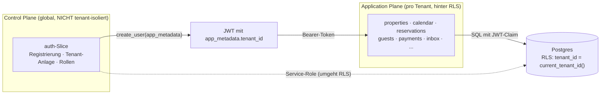

**Schlüsselpunkte:**
- `tenant_id` steht im **JWT `app_metadata`**; `public.current_tenant_id()` liest sie.
- Jede Policy filtert `tenant_id = current_tenant_id()`. Tabellen ohne eigene
  `tenant_id` (`rate_plans`, `availability`, `messages`, `payments`) leiten ihn über
  den Parent ab.
- **Control Plane vs. Application Plane:** Der `auth`-Slice (Tenant-Anlage, Onboarding)
  ist *global* — er läuft über den **Service-Role-Client**, der RLS bewusst umgeht
  (beim Registrieren existiert noch kein `tenant_id` im JWT → Henne-Ei).

### 6.1 Eigentümer-Objekt-Scope (zweite RLS-Achse, Lastenheft §4.2)

Innerhalb eines Tenants gibt es eine **zweite Isolationsachse**: ein eingeloggter
**Eigentümer** (Rolle `owner`) sieht nur SEINE Objekte, die Agentur (admin/co_admin/
staff/cleaner) den ganzen Tenant. Read-only-Stufe — Eigentümer haben keinen
Schreibzugriff.

- **Zuordnung:** `owner_property_assignments (tenant_id, user_id, property_id)`
  (Migration 0058, Vorbild `staff_property_assignments`). Die Agentur pflegt sie über
  `GET/PUT /auth/owners/{user_id}/properties` (Capability `MANAGE_OWNERS`) + UI in
  Konto → Benutzer.
- **Rolle aus dem JWT:** `public.current_user_role()` liest `app_metadata.role`
  (analog `current_tenant_id()`).
- **Durchsetzung (RLS, Migration 0059):** RESTRICTIVE SELECT-Policies via
  `public.owner_can_see_property(property_id)` auf `properties` + allen 23
  `property_id`-Tabellen. Die Funktion gibt für Nicht-owner immer `true` (Agentur-Sicht
  unverändert), für owner nur bei zugeordnetem Objekt. RESTRICTIVE = UND-verknüpft mit
  der tenant-Policy, kann also nur weiter einschränken.
- **API-Durchsetzung:** Da die FastAPI-Slices den Service-Role-Key nutzen (RLS umgangen),
  setzt die Pricing-API den Scope zusätzlich explizit durch (`overview()` filtert auf
  zugeordnete Objekte; `update()` → 403 für owner).
- **UI:** Sidebar reduziert für owner (`OWNER_ALLOWED_HREFS`: Dashboard, Kalender,
  Objekte, Dynamic Pricing, Berichte). Die UI ist nur Komfort — die Sicherheit liegt
  in RLS + API.
- **Abrechnung:** Der `owner_statements`-Slice setzt denselben Scope durch — eine
  Abrechnung umfasst nur die dem Eigentümer zugeordneten Objekte (`owner_properties`),
  deren Reservierungen, Provision je Objekt und Auszahlung (s. Datenmodell).

---

## 7. Kritische Flows (Sequenzdiagramme)

### 7.1 Registrierung (atomar mit Rollback)

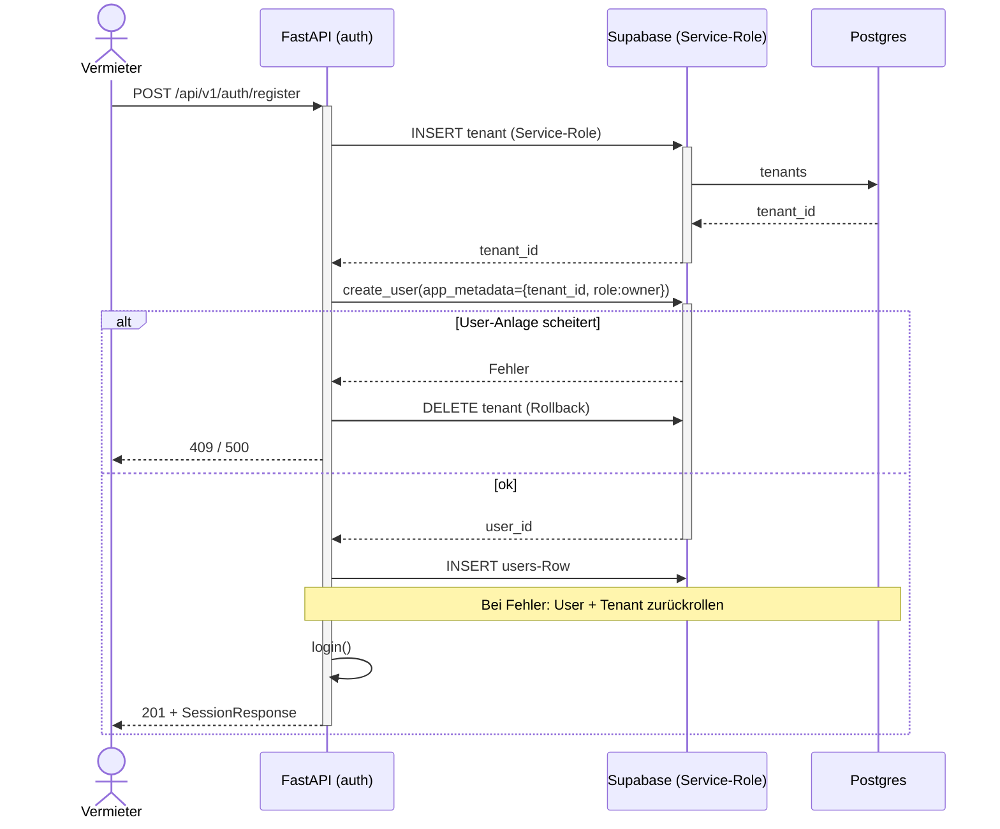

### 7.1a Social-Login (Google via Supabase OAuth)

Neben dem FastAPI-Login („E-Mail/Passwort", Cookies `nd_access`/`nd_refresh`)
gibt es einen Social-Login über **Supabase Auth**. Der Browser spricht hier
direkt mit Supabase (publishable Key), die Session liegt in den Supabase-
Auth-Cookies (`@supabase/ssr`). Das Dashboard-Gate akzeptiert **beide**
Session-Arten.

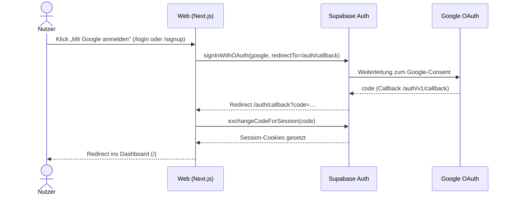

- **Google-Client:** OAuth-Client-ID in Google Cloud (Projekt `nextdays`),
  Redirect-URI = `https://<ref>.supabase.co/auth/v1/callback`. Das Client-Secret
  liegt **nur** in Supabase (Provider-Konfiguration), nie im Repo.
- **Apple:** vorgesehen, aber noch nicht konfiguriert (Buttons deaktiviert).
- **Rollen/Tenant:** ein per Social-Login angelegter Nutzer hat noch keine
  FastAPI-Rolle; das Profil/Tenant-Mapping folgt im auth-Slice.

### 7.2 Direktbuchung mit Double-Booking-Schutz

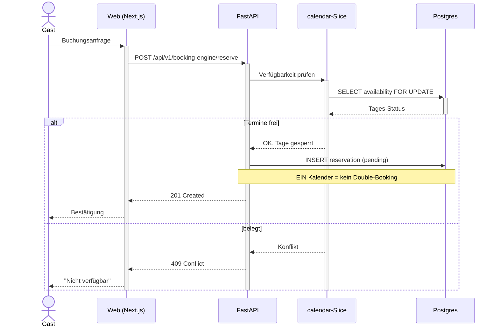

### 7.3 Auto-Aufgaben bei Buchung + Vertretung (§2.5/§4.3)

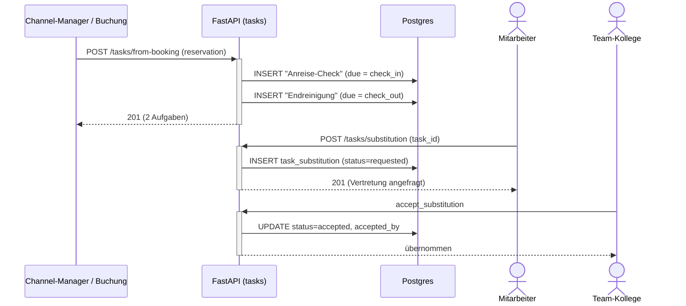

---

## 8. Reservierungs-Lifecycle (State)

`reservation.status` ist eine echte State-Machine.

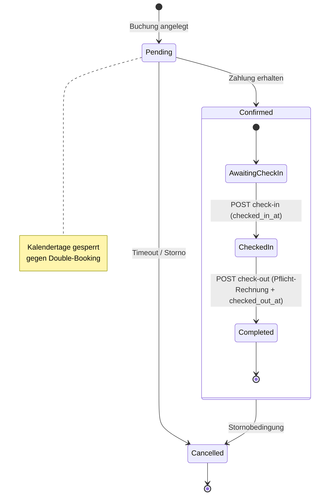

Beim **manuellen Anlegen** über den Kalender (`POST /api/v1/reservations`,
Reservierungs-Assistent im Vermieter-Dashboard) kann der Vermieter den Status
direkt auf `confirmed` setzen; das Backend belegt sofort die Übernachtungstage
in `availability` (= `booked`).

Seit `0091` sind Check-in/Check-out **echte Übergänge** (Front-Desk-Buttons im
Buchungs-Slider): `checked_in_at`/`checked_out_at` persistieren den Zustand,
`completed` wird beim Check-out gesetzt. Der Check-out erzeugt verpflichtend
die finale Rechnung (siehe Abschnitt Check-in/Check-out + Zimmerrechnung) —
ohne Rechnung kein Übergang nach `Completed`.

---

## 9. Deployment & Skalierung

DSGVO-konform, self-hosted bevorzugt. EU-Datenresidenz als harte Grenze.

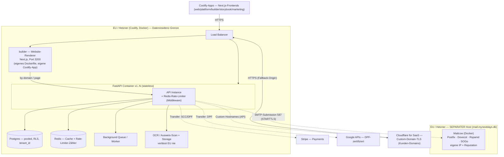

> **Mailserver bewusst auf separatem Host:** Ein Mailserver braucht exklusive Ports
> (25/465/587/…) und eine saubere IP-Reputation und darf beim Crash NICHT den
> DB-Stack mitreißen (Regel „Worker nie in DB-Stack"). Deshalb läuft Mailcow auf
> einem eigenen Hetzner-Server außerhalb der Coolify-Datenresidenz-Gruppe, aber
> weiterhin in der EU. Die API erreicht ihn nur outbound über SMTP-Submission (587,
> STARTTLS). Setup/DNS/Härtung: [`deploy/mail/`](../deploy/mail/README.md).

**Prinzipien:**
- FastAPI **zustandslos & containerisiert** → horizontale Skalierung (`x1..N` hinter LB).
- Aller State (Postgres, Redis, Queue, Storage) **externalisiert** — alle Instanzen
  teilen ihn, keine lokalen Daten im Container.
- **Kein** Serverless (Cold Starts, DB-Pooling-Probleme bei langlaufendem FastAPI).
- **US-Cloud als Compute bewusst vermieden** (CLOUD Act vs. DSGVO-Positionierung).
- Jede EU-Grenze überschreitende Kante ist mit Transfer-Rechtsgrundlage annotiert.
- **builder/** ist eine eigenständige Next.js-App mit **eigenem Dockerfile** und
  eigener Coolify-App (Port 3200) — die öffentlichen Vermieter-Websites skalieren
  unabhängig vom Dashboard. Kunden-Domains terminieren TLS über **Cloudflare for
  SaaS** (Custom Hostnames → Fallback-Origin).
- **Rate-Limiting & Backpressure:** Redis-backed Fixed-Window-Limiter als
  ASGI-Middleware (`core/ratelimit.py` + `ratelimit_middleware.py`; gestaffelte
  Buckets, 429 + `Retry-After`/`X-RateLimit-*`, fail-open außer Auth/Payments)
  plus `statement_timeout` für `service_role` (`0085`) — Details in
  **[deploy/RATE-LIMITING.md](../deploy/RATE-LIMITING.md)**.

---

## 10. Backend-Aufbau (Vertical Slices)

Pro Feature ein **in sich geschlossener Slice** unter `apps/api/src/features/<name>/`:

```
features/auth/
├── router.py        # HTTP-Endpoints (FastAPI APIRouter)
├── service.py       # Business-Logik
├── schemas.py       # Pydantic-Modelle (explizit typisiert)
├── dependencies.py  # slice-spezifische Dependencies (optional)
└── tests/           # Tests des Slice
```

Gemeinsame Infrastruktur in `apps/api/src/core/`:

| Modul | Inhalt |
|---|---|
| `config.py` | `Settings` mit `SecretStr` für alle Secrets |
| `logging.py` | structlog (Console lokal, JSON in Produktion) |
| `supabase.py` | Client-Factory — Anon (RLS) und Service-Role (System) getrennt |
| `security.py` | Supabase-JWT-Verifikation (ES256/JWKS) → `AuthContext`, `CurrentUser` |

**Slices (24):** `auth` · `properties` · `rates` · `pricing` · `calendar` ·
`reservations` · `guests` · `inbox` · `whatsapp` · `payments` ·
`channel_manager` · `booking_engine` · `addons` · `owners` · `owner_statements` ·
`buchhaltung` · `travel_agencies` · `site_config` · `ocr` · `public_portal` ·
`tasks` · `crm` · `dashboard` · `content`. (24 namentlich + interne
Slice-Bausteine — Router-Prefixe je unter `/api/v1`; `site_config` mountet zwei
Router: `/site-config` (Dashboard) und `/site` (öffentlicher Resolver).)

Die kleineren (`ocr`, `crm`) sind Health-/Gerüst-Slices; `dashboard`/`content`
minimal. Der Rest ist mit Geschäftslogik ausgebaut: u. a. `tasks`
(Aufgaben/Checklisten), `owners`/`owner_statements` (Eigentümer-Scope +
Auszahlungs-Abrechnung), `buchhaltung` (Rechnungen/Firmenprofil), `whatsapp`
(WhatsApp Cloud API im Posteingang), `addons` (Upsells). Der `payments`-Slice nutzt ein **Gateway-Adapter-Pattern**
(Stripe Connect Custom primär, Revolut sekundär/konfigurierbar —
[ADR-0011](decisions/0011-zahlungs-gateway-stripe-primaer.md), ersetzt ADR-0003).

Alle Router unter dem gemeinsamen Prefix **`/api/v1`** (versioniert von Anfang an).
`auth` ist als Referenz-Muster voll implementiert (siehe **[API.md](API.md)**).

---

## 11. Frontend & Design-System (apps/web)

- **Next.js** (App Router, TS) mit **Bun**; UI im **shadcn-Stil** (CVA + Radix-Slot
  + `cn`), Icons über **Iconify** (kein lucide-react, PROJECT.md §2).
- **Tailwind v4** über `@theme` in `styles/globals.css` — **kein**
  `tailwind.config.ts`. Light/Dark via `next-themes` (`.dark`-Klasse).
- **Design-Tokens** sind die einzige Quelle der Wahrheit für Farben/Radius
  (`:root` + `.dark` in `globals.css`). Startwerte aus dem NextDays-Logo
  (Primär `#0a0a0a`, Akzent-Rot `#b82028`) — **vorläufig, vom Designer
  überschreibbar**. Komponenten referenzieren nur semantische Tokens.
- **Storybook** (react-vite) als lebende Komponenten-Doku & Design-System-Brücke
  ([ADR-0008](decisions/0008-storybook-design-system.md)) — **live deployt**
  als Coolify-App `nextdays-storybook`
  (https://u67kn5pj9cb2gqryt2ezsc8r.65.21.144.136.sslip.io/sb) — **zugangsgeschützt** (Login
  erforderlich, siehe Auth-Proxy unten; enthält die ganze Idee + sensible Daten,
  daher kein öffentlicher Zugriff). Addons: `addon-docs` (MDX/Autodocs),
  `addon-a11y` (WCAG-Prüfung), `addon-themes` (Light/Dark), `addon-designs`
  (Figma-Einbettung).
- **Bibliotheks-Umfang** (deckungsgleich mit den Lastenheft-Modulen):
  - **20 UI-Bausteine** (`UI-Bausteine/…`): Input, Label, Textarea, Select,
    Checkbox, Switch, Badge, Avatar, Dialog, DropdownMenu, Tabs, Tooltip,
    Popover, Accordion, Separator, Table, Skeleton, Alert, Progress, Breadcrumb
    (+ Button, Card).
  - **15 PMS-Komponenten** (`PMS-Komponenten/…`, je mit Modul-/Tabellen-Bezug):
    Status-Badges, Rollen-Badge, Preis-Anzeige, Kanal-Icon, Objekt-Karte,
    Reservierungs-Karte, Saison-Legende, Kalender-Tageszelle, **Multi-Kalender
    (§2.2 Herzstück)**, Aufgaben-Checkliste, Inventar-Zeile, Nachrichten-Bubble,
    Onboarding-Stepper (§6), Berechtigungs-Matrix (§4), Zahlungs-Zeile.
  - **7 Eigentümer-Doku-Seiten** (`Einführung/…`, MDX, nicht-technisch): Was ist
    NextDays · Rollen & wer sieht was · Der Multi-Kalender erklärt · Preissystem
    · Nachrichten & Automatisierung · Aufgaben & Checklisten · Häufige Fragen.
  - **Architektur-Diagramme** (`Architektur/…`, MDX): technische C4-/ER-/Flow-
    Diagramme **und** Eigentümer-freundliche „So funktioniert es"-Diagramme.
  - **Austausch/Team-Chat** (`Austausch/…`, MDX): Echtzeit-Chat fürs Team
    (Supabase Realtime, siehe unten).
  - **Design/Tokens**: visuelle Token-Palette.
- Status-Tokens `--success` / `--warning` in `globals.css` ergänzt (für die
  Status-Badges), weiterhin als semantische Tokens — kein Hardcoding.

**Trennung App ↔ Design-System (bewusst entkoppelt):** Das Storybook ist ein
**eigenständiges Package `apps/storybook`** — die Werkstatt des UX/UI-Designers.
UI-Komponenten entstehen dort; eine fertige Komponente wird **erst dann** ins
Web-Projekt `apps/web` übernommen. So bleibt `apps/web` schlank und enthält keine
in Entwicklung befindlichen Komponenten.

```
apps/web/                # Next.js — App-Gerüst (Dashboard/Portal)
├── app/                 # Route-Gruppen (auth)/(dashboard)/(public)
│   └── (public)/marketing/   # Öffentliche Marketing-Landingpage (kein Auth-Gate)
├── components/marketing/     # Sektions-Komponenten der Landingpage (Hero, Trial, …)
├── public/marketing/channels/ # Buchungskanal-Logos (Booking.com, Airbnb, …)
├── public/marketing/reviews/  # Review-Plattform-Logos (Capterra, Trustpilot, …)
└── lib/supabase/        # Browser- + Server-Client (@supabase/ssr)

apps/storybook/          # Design-System + Auth-Proxy (eigenes Package, eigene Coolify-App)
├── app/                 # Next.js App Router (Auth-Hülle vor dem Storybook)
│   ├── login/           # Login-Seite (Supabase signInWithPassword)
│   ├── admin/           # Admin-Bereich: Nutzer anlegen (Sofort-Passwort)
│   ├── api/users/       # Service-Role: Nutzer anlegen/listen (nur Admins)
│   └── sb/[[...path]]/  # Catch-all: liefert das GESCHÜTZTE Storybook aus
├── middleware.ts        # Auth-Gate: jede Route außer /login + /api verlangt Session
├── protected/sb/        # statisch gebautes Storybook (privat, nie direkt erreichbar)
├── components/
│   ├── ui/              # 22 shadcn-Stil-Primitive
│   ├── pms/             # 15 fachliche PMS-Komponenten
│   └── docs/            # team-chat.tsx (Realtime) · mermaid.tsx (Diagramme)
├── stories/
│   ├── ui/ · pms/       # Stories je Komponente
│   └── *.mdx            # Eigentümer-Doku · Architektur · Austausch · Design/Tokens
├── lib/
│   ├── utils.ts         # cn()
│   ├── supabase-server.ts   # updateSession() für Middleware
│   ├── supabase-browser.ts  # Browser-Client (Login)
│   └── supabase-chat.ts     # SSR-Browser-Client (Chat sieht Login-Session)
├── styles/globals.css   # Tailwind v4 @theme — Tokens (Quelle der Wahrheit)
└── .storybook/          # main.ts · preview.tsx · BUILD_REFERENCE.md (Bau-Standard)
```

### Zugangsschutz: Auth-Proxy vor dem Storybook

Das Storybook enthält die gesamte Produktidee und sensible Daten — es darf nur
von befugten Personen gesehen werden. Statt eines statischen Builds liegt vor dem
Storybook eine **Next.js-Auth-Hülle** im selben Package:

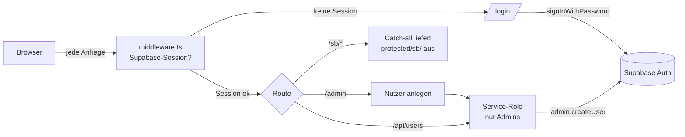

- **`middleware.ts`** prüft serverseitig die Supabase-Session. Ohne Session →
  Redirect auf `/login`. Greift auch für **alle** Storybook-Assets (`/sb/*`),
  sodass nichts ohne Login ausgeliefert wird. `/api/*` antwortet selbst mit
  `403`-JSON statt Redirect.
- Das Storybook wird statisch nach **`protected/sb/`** gebaut (außerhalb von
  `public/`, daher nicht direkt erreichbar) und nur über den Catch-all
  `/sb/[[...path]]` mit gültiger Session ausgeliefert. In die `index.html` wird
  `<base href="/sb/">` injiziert, damit relative Asset-Pfade auflösen.
- **Accounts gibt es nur per Admin** (`/admin` → `/api/users`, Service-Role-Key
  bleibt serverseitig). Kein Self-Signup. Optionale strikte Allowlist über
  `STORYBOOK_ALLOWED_EMAILS`; Admins über `STORYBOOK_ADMIN_EMAILS`.

### Echtzeit-Austausch (Team-Chat)

`Austausch/Team-Chat` ist ein Echtzeit-Chat direkt im Storybook über **Supabase
Realtime** (Tabelle `storybook_chat`, Migration `0020`, Publication
`supabase_realtime`). Der Chat nutzt **dieselbe Login-Session** (SSR-Browser-
Client) — der Anzeigename kommt automatisch aus dem eingeloggten Account, keine
zweite Anmeldung. RLS erlaubt anonymem Schlüssel nur `SELECT` + `INSERT`; der
Chat ist bewusst von allen PMS-/Kundendaten getrennt.

**Grundsatz Realtime statt Polling:** Datengetriebene Ansichten aktualisieren sich
über **Supabase Realtime (WebSocket, `postgres_changes`)** — kein Polling, kein
manuelles Reload. Zentraler Hook **`apps/web/lib/use-realtime.ts`**: ein
dedizierter Realtime-Client als **Modul-Singleton** (nur für Realtime, getrennt
vom Auth-Client), der **zwingend `realtime.setAuth(App-JWT)` VOR `.subscribe()`**
aufruft — sonst joint der Channel mit anon-Claims und es kommen **0 Events**
(RLS filtert alles weg). Der Hook abonniert eine Tabelle (optional gefiltert),
debounced die Events und folgt dem **Server-Props-Sync-Muster**: pro Seite eine
`<Domain>Realtime`-Komponente, die alle speisenden Tabellen abonniert und bei
Änderung `router.refresh()` (+ ggf. gezieltes Neuladen) auslöst — die Seite
bleibt server-gerendert, Realtime triggert nur den Refresh. Beispiele:
`property-realtime.tsx` (Objektseite), `calendar-board` (Preise, `0052`),
`owner-realtime.tsx` (Eigentümer-Seite: `owners`/`owner_properties`/
`owner_expenses`/`owner_statements`/`reservations`, Publication via `0071`).
Voraussetzung je Tabelle: Aufnahme in die Publication `supabase_realtime` per
Migration.

**Posteingang-Automails (inbox, Migration `0072`):** Planbare Auto-Nachrichten
(Buchungsbestätigung, Anreise-/Check-out-Info). `message_automation` (0037) trägt
zusätzlich `anchor` (arrival|departure|booking), `send_time`, `offset_days`
(vorzeichen-behaftet) sowie die Zuweisung `property_ids[]`/`channels[]` (leer =
alle, **UND-verknüpft**: Haus UND Kanal). Bei jedem Booking-Import plant
`schedule_automations_for_thread` je passender Regel eine Zeile in
`automation_scheduled_message` (Dedup über `(automation_id, thread_id)`); der Cron
`POST /inbox/internal/dispatch-automations` versendet fällige (Channex). Kein
Fallback bei fehlendem Ankerdatum (übersprungen). Beide Tabellen sind in der
Realtime-Publication. Kanäle sind OTAs **und** die eigene Plattform „myNextDays"
(gleichwertiger Buchungskanal, kein „Direkt").

---

## 12. Page-Builder

Jeder Mandant kann eine eigene **White-Label-Website** betreiben — myNextDays als
Baukasten, PMS-integriert (Suche, Objektlisten und Buchung docken direkt an den
Datenkern an). Verbindliche Feature-Spezifikation und Bau-Vorlage des Editors ist
**[docs/FRAMER-FEATURES.md](FRAMER-FEATURES.md)** (Soll/Ist je Feature mit
✅/🟡/❌-Status). Drei physisch getrennte Ebenen:

1. **Editor (`apps/web`)** — Framer-artiger visueller Canvas-Editor auf
   **craft.js** (`@craftjs/core`/`layers`/`utils`) als Vollbild-Overlay über dem
   Dashboard (`app/(dashboard)/website/[pageId]/page.tsx`). Die Seite wird
   serverseitig geladen (`listBlocks()`); `serialize.ts` konvertiert die flache
   DB-Blockliste in craft.js-Nodes am ROOT-Canvas. Beim Speichern diff't
   `syncBlocks()` (`lib/site-pages.ts`) den serialisierten craft-Baum gegen die
   DB über die einzelnen CRUD-Endpunkte (löschen/aktualisieren/anlegen/neu
   ordnen — **kein Bulk-Endpoint**); frische DB-IDs fließen zurück in die
   craft-Props. Editor-Features: unendliche Bühne mit Kamera (Pan,
   Zoom-zum-Cursor, `use-camera.ts`), Device-Frames/Breakpoints (Desktop 1200 /
   Tablet 810 / Phone 390 + Custom, Resize per Ziehgriff mit Live-Maß-Badge),
   Layer-Tree, Insert-Panel, Framer-Style-Inspektor
   (Seiten-/Frame-/Element-Ebene), Font-Picker (kuratierter Katalog + voller
   Google-Fonts-Katalog über die Next-Route `/api/google-fonts`), Inline-Text,
   Effekte/Motion. Der Editor nutzt bewusst **kein** Realtime; die Seitenliste
   (`/website`) abonniert `site_pages`.
2. **Backend (`apps/api`, Slice `site_config`)** — zwei Router:
   `manage_router` (`/api/v1/site-config`, JWT + Capability
   `MANAGE_SITE_CONFIG`, tenant-gescoped) und `public_router` (`/api/v1/site`,
   JWT-los). Der Service arbeitet immer mit dem Service-Role-Client + explizitem
   tenant-Scope aus dem JWT; RLS ist der default-deny-Backstop. Block-`content`
   wird **pro Typ strikt gegen Pydantic-Schemas validiert**. Alle Endpunkte im
   Detail: **[API.md → site_config](API.md#site_config-page-builder--implementiert)**.
3. **Renderer (`builder/`)** — eigenständige Next.js-App (Port 3200, eigenes
   Dockerfile, eigene Coolify-App). `middleware.ts` löst den Host über
   `GET /api/v1/site/by-domain` auf und setzt die Header
   `x-tenant-id`/`x-site-branding`; die öffentlichen Seiten (`app/page.tsx` =
   Home, `app/[slug]/page.tsx`) laden über `lib/site.ts` →
   `GET /api/v1/site/page` **nur veröffentlichte** Blöcke und rendern sie mit
   `components/blocks/block-renderer.tsx`. TLS für Kunden-Domains kommt von
   **Cloudflare for SaaS** (Custom Hostnames,
   `site_config/cloudflare_client.py`; ohne Cloudflare-Konfiguration antworten
   die Domain-Endpunkte `503`).

### Datenmodell (Migrationen `0086`/`0087`)

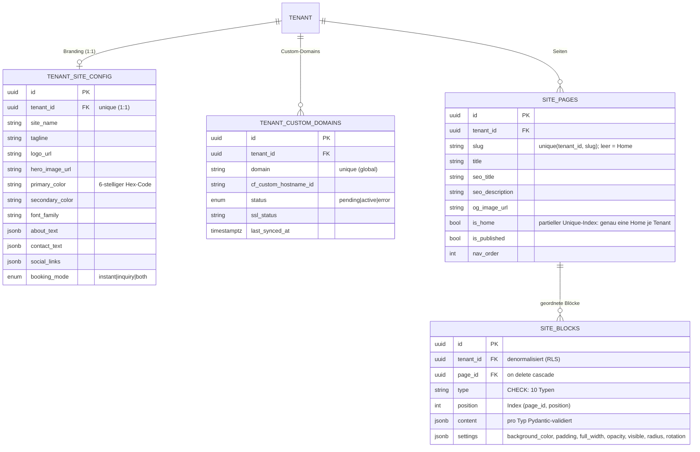

Alle vier Tabellen haben RLS (`tenant_id = current_tenant_id()`, using + with
check), `replica identity full` und sind in der Publication `supabase_realtime`.

**Die 10 Block-Typen** (DB-CHECK + `BlockType`-StrEnum + je ein eigenes
Pydantic-content-Schema): `hero` · `rich_text` · `image` · `gallery` · `button`
· `spacer` · `contact` · `search` · `properties_grid` · `featured_properties`.
Mehrsprachige Texte liegen als `{locale: text}`-Objekte im `content`. Drei
Start-Templates (`templates.py`: bergchalet/kueste/stadt, Unsplash-Bilder)
befüllen eine leere Site per `POST /site-config/templates/apply`.

### Draft-Token (Vorschau unveröffentlichter Seiten)

Der öffentliche Renderer liefert grundsätzlich nur `is_published`-Seiten. Für die
Editor-Vorschau erzeugt `POST /site-config/pages/{id}/draft-token` einen
kurzlebigen Token: **HMAC-SHA256** über `tenant_id.page_id.exp`, signiert mit
`SITE_DRAFT_SECRET`, Format `{exp}.{sig}`, **TTL 3600 s**, Verifikation
konstant-zeitig (`hmac.compare_digest`). `GET /api/v1/site/page/draft?page_id&token`
rendert damit auch unveröffentlichte Seiten (`403` bei ungültigem/abgelaufenem
Token). Die Draft-Route des Renderers (`builder/app/render/[pageId]/page.tsx`)
und die postMessage-Brücke (`canvas-bridge.tsx`) existieren als Infrastruktur für
eine iframe-Live-Vorschau, sind im aktuellen Editor aber **nicht verdrahtet**
(der Editor rendert die Nodes direkt, ohne iframe).

### Bewusste Abweichung: Editor-Modell vs. Persistenz-Modell

Der Editor ist funktional ein Framer-Klon, die Persistenz ein schlanker
10-Block-Stack — gekoppelt ausschließlich über `serialize.ts`. Der ehrliche
Ist-Stand:

1. **Persistiert wird eine flache, geordnete Liste** der 10 Block-Typen
   (`site_blocks`); der Editor arbeitet mit einem hierarchischen craft.js-Baum
   inkl. frei positionierter Frames (x/y/Breite/Höhe) und Layout-Containern.
2. **Frame/Stack/Grid/Masonry überleben das Speichern nicht:**
   `craftJsonToBlocks` iteriert nur die Top-Level-Nodes des ROOT und überspringt
   Typen außerhalb `NODE_BY_TYPE` — Container samt Kindern werden beim Speichern
   verworfen.
3. **Settings nur teilweise wirksam:** `splitProps` kennt 7 settings-Keys; das
   Backend verwirft Nicht-Schema-Felder. Der öffentliche Renderer wertet nur
   `content` + `settings.background_color` aus — `opacity`/`radius`/`rotation`/
   `visible` wirken derzeit nur im Editor.
4. **Page-Variables und Code-Overrides** (`variables-context.tsx`,
   CodeMirror-Editor) sind reiner In-Memory-Editor-State ohne DB-Ziel — nach
   einem Reload weg.
5. **Draft-Render + postMessage-Brücke** sind gebaut, aber nicht verdrahtet (s. o.).

[docs/FRAMER-FEATURES.md](FRAMER-FEATURES.md) hält diesen Soll-/Ist-Stand je
Feature fest und ist die verbindliche Vorlage für den Ausbau (u. a. Persistenz
des Editor-Baums).

### Ablauf: bearbeiten → veröffentlichen → öffentlicher Abruf (Custom-Domain)

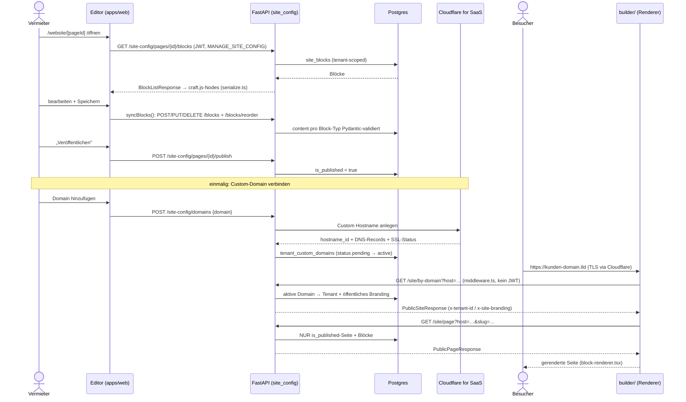

---

## Externe Dienste

Vom FastAPI-Backend als Dienste aufgerufen, Datenhoheit bleibt bei uns. Jeder Dienst
wird in **[docs/decisions/](decisions/)** mit Rechtsgrundlage dokumentiert.

| Dienst | Zweck |
|---|---|
| Google Maps / Places | Adress-Autocomplete, Geocoding, Kartenansicht (Portal) |
| Google Calendar | optionaler Sync persönlicher Sperrzeiten (nicht Kanal-Sync) |
| Google Translate | mehrsprachige Inhalte (server-seitig gecacht) |
| OCR (self-hosted) | Ausweis-/Pass-Scan (Meldepflicht) + Belege — bleibt auf Hetzner |
| **Channex** | Channel-Manager-Aggregator: OTA-Distribution (Booking.com, Airbnb, Expedia …). ARI-Push + Buchungs-Pull über den `channel_manager`-Slice (`channex_client.py`). Secrets: `CHANNEX_API_KEY`, `CHANNEX_BASE_URL`, `CHANNEX_WEBHOOK_SECRET`. |
| Frankfurter (ECB) | Tages-Wechselkurse (ECB-Referenz, kostenlos, kein Key) für die Eigentümer-Abrechnung (`owner_statements/fx.py`); gecacht in `fx_rates`. Kein Fallback bei Ausfall. |
| DWD / Bright Sky | amtliche Wetterdaten (frei, kein Key) als Dynamic-Pricing-Signal (`pricing/weather.py`). |
| **Google Fonts** | Font-Katalog des Website-Editors (Developer API `webfonts/v1`). Aufgerufen über die server-seitige Next-Route `apps/web/app/api/google-fonts/route.ts` (kein FastAPI-Endpunkt); Key `GOOGLE_FONTS_API_KEY` bleibt serverseitig — ohne Key antwortet die Route `503`. |
| **Cloudflare for SaaS** | Custom-Hostname-TLS für die Kunden-Domains des Page-Builders (`site_config/cloudflare_client.py`). Secrets: `CLOUDFLARE_API_TOKEN`, `CLOUDFLARE_ZONE_ID`, `CLOUDFLARE_FALLBACK_ORIGIN` (+ optional `CLOUDFLARE_BASE_URL`); fehlen sie, antworten die Domain-Endpunkte `503`. |
| Unsplash | Stock-Bilder der Website-Start-Templates (`site_config/templates.py`) — nur referenzierte Bild-URLs, kein API-Key, kein Server-Aufruf. |

---

> **Diagramme pflegen:** Alle Diagramme sind Mermaid-Code in dieser Datei — im PR
> diffbar, mit dem Code versioniert. Bei Architektur-Änderungen hier aktualisieren.
> C4Context/C4Container sind in Mermaid „experimental" — nach Änderungen im
> GitHub-Preview gegenprüfen.

---

## „My Next" — Taskilo-Integration (Buchhaltung · Marktplatz · HR · Jobs)

NextDays wird um den Geschäftsumfang von **Taskilo** erweitert. Maßgeblich:
**[ADR-0009](decisions/0009-taskilo-integration-architektur.md)**, Bestand:
**[TASKILO-INVENTAR.md](TASKILO-INVENTAR.md)**.

**Leitplanken (ADR-0009):**
- **Ein Stack, ein Backend, ein Supabase, eine Auth.** Die neuen Bereiche werden
  als **Vertical Slices in `apps/api`** umgesetzt (wie die PMS-Slices),
  Mandant **`tenant_id`** (RLS via `current_tenant_id()`), `companies` → `tenants`
  (+ `tenant_billing_profile`).
- **Frontend im NextDays-Paradigma:** Server Actions in `apps/web/lib/<domäne>.ts`,
  UI ausschließlich `components/ui/*` + Tokens (kein `@tasko/ui`, kein react-query).
  Taskilo-Komponenten werden **neu geschrieben**, nicht kopiert.
- **Eine App, Pfade statt Subdomains:** `/dashboard`, `/buchhaltung`, `/marktplatz`,
  `/hr`, `/jobs` unter einer Domain. **Keine** Feature-Subdomains (bricht
  Auth/Session). Nur Marketing-Website ↔ App darf per Subdomain getrennt werden.
- **Eine große Sidebar** mit aufklappbaren Gruppen je Domäne; Menü per
  Lodgify-Berechtigung gegated.
- **NICHT übernommen:** Chat, Admin-Dashboard, SEO/Marketing, WhatsApp,
  Advertising, Taskilos eigene Auth + Onboarding.

**Neue Slices (geplant):** `buchhaltung` (✅ Basis), `tax`, `datev`, `einvoice`,
`banking`, `employees`, `jobs`, `job_applications`, `marketplace`.
Vorgehen je Modul: **DB-Migration → Backend-Slice → Server Actions → UI**.
