# Architektur

> Verbindliche Grundlage: **[PROJECT.md](../PROJECT.md)**. Dieses Dokument erläutert
> die Architektur mit Diagrammen und beschreibt den **tatsächlich umgesetzten** Stand.
>
> **Notation:** [C4-Modell](https://c4model.com) (System Context · Container · Component)
>
> - ergänzende ER-, Sequenz-, State- und Deployment-Diagramme. Alle Diagramme sind als
>   Mermaid (Diagrams-as-Code) eingebettet und werden von GitHub nativ gerendert.

## Inhalt

1. [Leitidee](#1-leitidee-pms-kern-in-der-mitte)
2. [System Context (C4 Level 1)](#2-system-context-c4-level-1)
3. [Container (C4 Level 2)](#3-container-c4-level-2)
4. [Component: Channel Manager (C4 Level 3)](#4-component-channel-manager-c4-level-3)
5. [Datenmodell (ER-Diagramm)](#5-datenmodell-er-diagramm)
6. [Mandantenfähigkeit & RLS](#6-mandantenfähigkeit--rls)
7. [Kritische Flows (Sequenzdiagramme)](#7-kritische-flows-sequenzdiagramme)
8. [Reservierungs-Lifecycle (State)](#8-reservierungs-lifecycle-state)
9. [Deployment & Skalierung](#9-deployment--skalierung)
10. [Backend-Aufbau (Vertical Slices)](#10-backend-aufbau-vertical-slices)
11. [Frontend & Design-System (apps/web)](#11-frontend--design-system-appsweb)
12. [Page-Builder](#12-page-builder)

---

## 1. Leitidee: PMS-Kern in der Mitte

NextDays ist kein loses Bündel aus Tools, sondern **ein Datenkern**, an den alle
Kanäle andocken. Der gemeinsame Nenner ist die **`availability`-Tabelle**: eine Zeile
pro `(property_id, date)` mit `UNIQUE`-Constraint — die _eine Wahrheit_ und der
strukturelle Schutz gegen Double-Bookings über alle Kanäle hinweg.

**Marken:** derselbe Kern trägt zwei Marken. **myNextDays** ist die Supply-Seite
(PMS `web`, `apps/api`, Channel Manager, Marketing, Backoffice `admin`,
White-Label-Sites `builder`). **myBestDays** ist die Demand-Seite: der globale
Marktplatz `plattform`, das Gastgeber-Dashboard `gastgeber` und die
Marktplatz-App `mobile-bestdays` — sowie der Kanal „Plattform" im PMS
(`reservations.channel='portal'`, `ota_name='myBestDays'`, Migration `0239`).
Nativ trennt sich das ebenfalls: `mobile-bestdays` (Gast) und `mobile-nextdays`
(Betrieb) sind zwei eigenständige Apps mit eigenen Bundle-IDs (ADR-0019).

---

## 2. System Context (C4 Level 1)

Wer nutzt NextDays, und mit welchen externen Systemen spricht es?

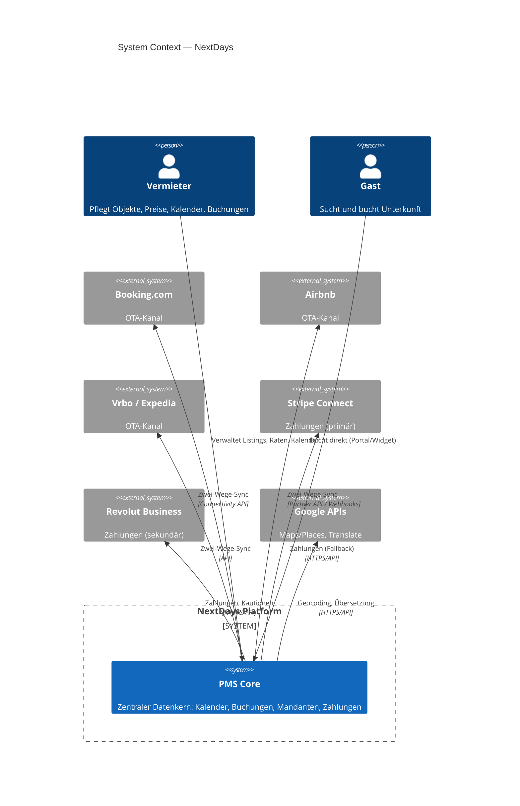

---

## 3. Container (C4 Level 2)

Die ausführbaren Bausteine und Datastores des Systems, mit Technologie und Protokoll.

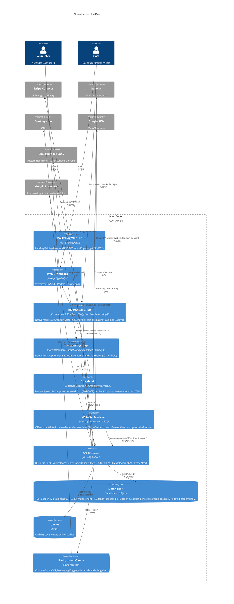

> **Hinweis zur C4-Notation:** „Container" meint hier eine _separat ausführbare App
> oder einen Datastore_ (Next.js, FastAPI, Postgres, Redis) — nicht zwingend einen
> Docker-Container. Die Marketing-Website ist bewusst entkoppelt (eigenes Deployment).

### Slice-Landkarte (Component-Ebene, API-Backend)

Die Vertical Slices und ihre Datenbereiche — der Stand der Geschäftslogik:

```mermaid
flowchart TB
    subgraph API["API Backend (FastAPI) — /api/v1"]
        subgraph CORE["core/ (Querschnitt)"]
            CFG["config · logging · supabase · security (JWT ES256/JWKS)"]
            MAIL["mail · mail_layout · mail_sprache · mail_texte · mail_empfaenger — Markenrahmen + Empfängersprache (24 EU-Sprachen, Kette Empfänger→Betrieb→en)"]
        end
        subgraph DONE["Slices mit Logik"]
            AUTH["auth — Register/Login/Me/Invite, Rollen+Capability-Matrix + ..-Berechtigungen (pro Nutzer); Einladung + Passwort-vergessen über Einmal-Tokens (einladung_service, user_auth_tokens 0334) — eigener Weg, weil GoTrue keinen Mailzugang hat"]
            CAL["calendar — Verfügbarkeit, Double-Booking, Preis-Override (liest Preis via pricing-Resolver); Sperr-Anträge der Eigentümer entscheiden (sperrantraege.py, APPROVE_BLOCK): genehmigen sperrt Nächte + pusht ARI, widerrufen gibt nur die eigenen wieder frei (availability.block_request_id)"]
            PRICE["pricing — Preis-Resolver (effective_price + quote) + Dynamic-Pricing-Engine (dynamic_prices; Regeln + gelernte Pickup-Kurve/Wetter; enabled = überall gültig inkl. OTA-Push)"]
            TASKS["tasks — Aufgaben, Checklisten+Foto, Vertretung, Inventar"]
            BUCH["buchhaltung — Rechnungen + Kunden (aus Taskilo, tenant-vereinheitlicht) + Firmenprofil/Logo; Nummernkreise (next_document_number)"]
            OWN["owners — Eigentümer-Stammdaten, Objekt-Zuweisung (Anteil + Provisions-Override je Objekt)"]
            OWNST["owner_statements — Auszahlungs-Abrechnung (Provision je Objekt, EU-Steuer/Reverse-Charge, Storno, Mehrwährung via ECB-Tageskurs)"]
            INBOXL["inbox — Threads (OTA + eigene Plattform), Versand, Vorlagen/KI + Wissensdatenbank, Platzhalter, Anhänge, geplante Nachrichten + planbare Automails (Zeit/Objekt-Zeitzone + Zuweisung Haus/Kanal + Auslöser Nachricht empfangen)"]
            ADDON["addons — Zusatzleistungen/Upsells je Objekt (Medien, Basis, appears_in, wann-anzeigen); Verkauf via booking_engine + Gäste-Portal, Extra-Umsatz in Owner-Statement, Task-Trigger addon_purchased, Payment-gegatet"]
            PROP["properties — Objekt-Stammdaten, Fotos, Typ-Attribute, Adress-Split, Owner-Scope (RLS); zentrale Objektwährung (currency, 0161); pro-Kanal-Sichtbarkeit als eigene Achsen: Website (listed_on_website, 0162) + Plattform/Marktplatz (listed_on_marketplace, 0159), getrennt vom Lebenszyklus status; Portale-Zustand aus channex_property_map. PropertyResponse.channels = abgeleitete 3-Kanal-Chips (Website·Plattform·Portale, je active/paused/not_connected/error). Kanal-Steuerung auf ZWEI Ebenen (Lodgify-Muster): zentral /channels + pro Objekt /objekte/[id]/kanaele (property-channels.tsx: Website/Plattform-Toggles via PATCH, Portale-Zeilen togglen die OTA-Verbindung, Connect-Wizard mit presetPropertyId; Markup = Phase 2); dazu die Nachschlag-Ebene /objekte/[id]/synchronisierung (alle Portale eines Objekts mit den Extranet-Kennungen hotel_id | room_code) und /objekte/[id]/synchronisierung/[portal] (ein Portal: Kennungen, Verkaufsschalter, letzter Abgleich)"]
            PPORTAL["property_portal — Gastmodul je Objekt (Portal-Schalter, Türcode maskiert); Info-Texte in messaging"]
            RATES["rates — Saison-/Event-Preise, Rate-Plans, Aufschläge"]
            RES["reservations — Buchungen, Lifecycle, Gast-Maskierung (Daten-Split); nach Domäne geteilt (_base/reads/writes/service-Fassade), Objekt-Statistiken (KPIs + Tages-Sparklines + KPI-Detail) in property_stats.py"]
            GUE["guests — Enterprise-Gästeprofil (Adressen/Kontakte/Ausweise/Consents), Merge, DSGVO"]
            PAY["payments — Stripe Connect Custom (primär), Charge + Provision, Kaution, Refund, Webhooks; OTA-Gate; Revolut sekundär"]
            POUT["payouts — Auszahlung nach Abreise, Verrechnung statt Rückholung; Cohost-Anteile"]
            SUB["subscriptions — Abo-Billing Tenant→myNextDays: Grundgebühr + Objekt-Staffel (graduated) + Zusatzmodule; Stripe Subscription/Checkout/Portal, Adaptive Pricing (27 EU); Modul-Entitlements"]
            CM["channel_manager — Channex (ARI-Push, Buchungs-Import, Webhooks, Hotel-ID-Flow, Stop-Sell, ARI-Outbox, Bewertungs-Spiegel channex_review via reviews_sync)"]
            BOOK["booking_engine — eigene Direktbuchungs-Strecke (provisionsfrei) + Buchungs-Widget"]
            PORTAL["public_portal — Eigentümer-Self-Service (§4.2): eigene Objekte, Kalender mit Netto-Auszahlung JE NACHT (owner_statements/common.py), Berichte, Sperrwünsche, Zählerstände, Dienstleistungen beauftragen (dienstleistungen.py, 0330 — Auftrag wird eine tasks-Zeile)"]
            NOTIF["notification_settings — Präferenzen je Kategorie×Kanal + Glocke; dispatcher (Präferenz→Glocke/Mail/SMS, dedup über alle Kanäle) + ereignisse.py als EINE Stelle, die aus einem Fachereignis eine Meldung macht"]
            ANN["announcements — Neuerungen vom Backoffice an die Betriebsleitung: zwei Router (/announcements Empfang, /platform/announcements Redaktion), Inhalt beim Speichern nh3-sanitisiert, Bilder nur PNG/WebP per Magic-Byte, 24 Sprachfassungen beim Verfassen erzeugt (0347) — von Hand geprüfte Fassungen sind vor maschineller Überschreibung geschützt"]
            WA["whatsapp — WhatsApp Cloud API (Conversations/Messages, im Posteingang integriert)"]
            TAG["travel_agencies — Reisebüro-Kartei (Profile, Verträge nach Jahren, Saison-Preise, Vertragsdateien)"]
            REV["reviews — Bewertungs-Cockpit des Betriebs: EINE Liste über alle Kanäle (public.reviews = myBestDays 1..5 + channex_review = Portale 0..10, normalisiert auf UnifiedReview), antworten (Portal zuerst, dann Spiegel), Betrieb→Gast (Zwei-Wege), Automatik (Auto-Bewertung + Gast-Erinnerung, review_automation/-_log), Zwei-Wege-Sichtbarkeit (publication.py, 14 Tage). OTA-Bewertungen sind INTERN — öffentlich nur eigene, verifizierte myBestDays-Bewertungen"]
            GREV["guest_reviews — Gast-Seite des Marktplatzes: öffentlicher, MASKIERTER Lesepfad je Objekt und je Betrieb (speist Listing-Sterne, Inserat-Abschnitt, Website-Block), abgeben/ändern mit Nachweis eines abgeschlossenen Aufenthalts"]
            SITE["site_config — Page-Builder: Branding, Custom-Domains (Cloudflare for SaaS), Seiten + Blöcke (Page-Builder), Templates, Draft-Token; öffentlicher by-domain-Resolver (s. §12)"]
        end
        subgraph SCAFFOLD["Slices als Gerüst (Health-only) — Logik folgt lt. Roadmap"]
            OCR["ocr"]; CRM["crm"]; DASH["dashboard (min.)"]; CONT["content (min.)"]
        end
    end
    DB[("Postgres — 195 Tabellen (Migrationen 0001–0339), RLS + revoke-Härtung")]
    DONE --> DB
    SCAFFOLD --> DB
    CORE --> DONE
    CORE --> SCAFFOLD
```

---

## 4. Component: Channel Manager (C4 Level 3)

Der `channel_manager`-Slice nutzt ein **Adapter-Pattern** (Anti-Corruption-Layer):
ein einheitliches Interface zum PMS-Kern, dahinter austauschbare Adapter pro Kanal.
So bleibt die Entscheidung _Direkt-Anbindung vs. Aggregator_ reversibel
(siehe [ADR-0001](decisions/0001-channel-manager-architektur.md)).

**Aktueller Stand: Aggregator-Pfad über Channex.** Statt N Direkt-Adapter je OTA
nutzen wir **Channex** als Aggregator (https://docs.channex.io) — eine API für alle
Kanäle (Booking.com, Airbnb, Expedia …). Der `ChannexClient` (`channex_client.py`)
ist der konkrete Adapter hinter der Facade; ARI/Buchungen laufen über die Channex-
API (Auth `user-api-key`, ARI gebündelt, Buchungen via `booking_revisions/feed`

- ack, Webhook als Trigger). Beträge in Cent. Mapping in `channex_*`-Tabellen
  (Migration `0027_channex.sql`).

**PMS-Mapping (NextDays hat keine Zimmerkategorien).** Eine `property` ist die
buchbare Einheit (Ferienwohnungs-Modell). Channex verkauft jedoch Room-Types mit
`count_of_rooms`. Der Content-Sync bildet daher ab: `property` → Channex-Property,
**ein synthetischer Room-Type pro Property** (`count_of_rooms=1`,
`local_unit_ref = property_id`), je lokalem `rate_plans`-Eintrag ein Channex-Rate-Plan.
Der Sync ist idempotent (POST/PUT je nach vorhandenem Mapping) und läuft non-blocking
beim Objekt-Anlegen.

**Kanäle inhouse verbinden (kein Provider-iFrame, white-label-Pflicht).** Der
Adapter implementiert den vollen Channel-API-Flow selbst: `test_connection` →
`mapping_details` → `create` (mit `group_id`, `rate_plans[]`, Codes als **Integer**)
→ `activate`. Die eigene UI (`channel-connect-button.tsx`) führt durch
Portal-Wahl → Zugangsdaten → Zimmer/Raten-Zuordnung; der Provider bleibt unsichtbar.
Für Tests ohne echtes OTA-Konto: Sandbox-Kanal (OpenChannel) gegen einen eigenen
Mock-OTA-Endpoint (`sandbox_ota.py`, Flag `channex_sandbox_portals`).

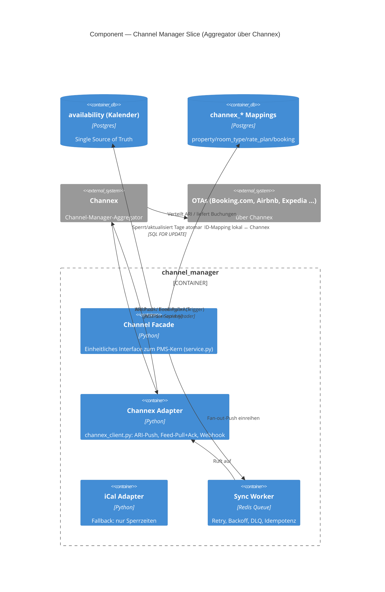

---

## 5. Datenmodell (ER-Diagramm)

Tatsächliches Schema aus **[supabase/migrations/](../supabase/migrations/)** (Phase 1).

> **Migrationen anwenden:** Es gibt **keinen** automatischen Runner — `deploy.yml`
> deployt nur Container, das Supabase-Image-Init läuft nur beim allerersten Start
> eines leeren Datenverzeichnisses. App-Migrationen werden mit
> **[supabase/apply-migrations.sh](../supabase/apply-migrations.sh)** eingespielt:
> das Skript fährt alle `supabase/migrations/*.sql` in Reihenfolge per SSH/psql
> gegen die Server-DB und trackt sie in `public.schema_migrations` (nur noch nicht
> Angewendete laufen, gefahrlos wiederholbar). Bei nachträglicher Tracking-Einführung
> auf einer bestehenden DB einmalig `--baseline` (markiert vorhandene Migrationen
> als angewendet, ohne ihr SQL erneut zu fahren).

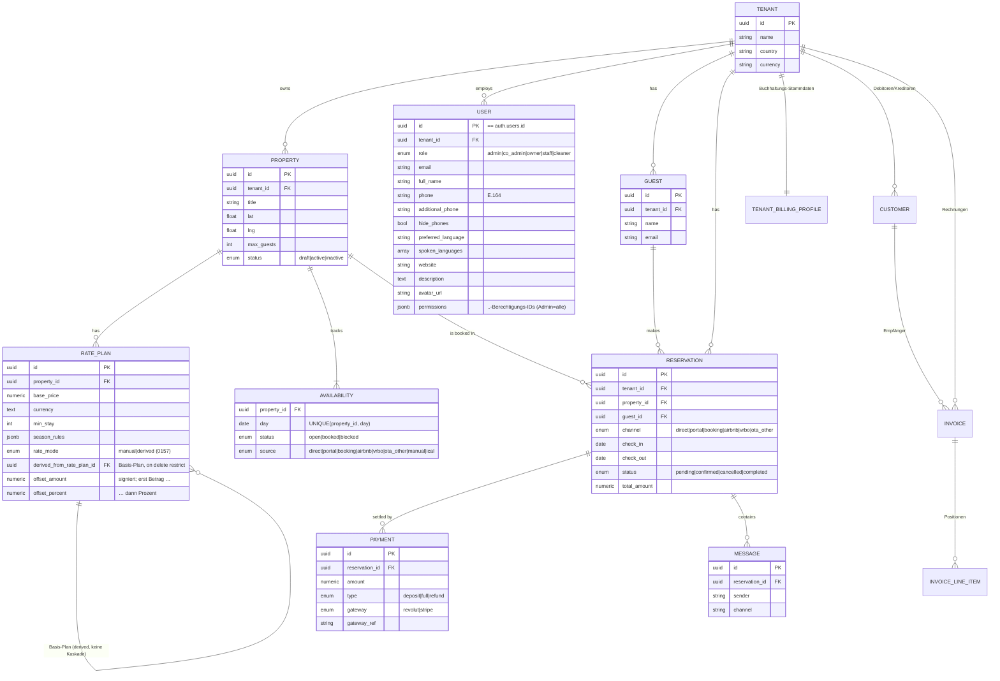

**Marktplatz-Tabellen (angelegt, mit RLS; Geschäftslogik in Phase 2):** `portal_guests`,
`reviews`, `commissions` — siehe [Migration 0006](../supabase/migrations/0006_marketplace.sql).
Das Kern-Diagramm oben zeigt bewusst nur die zentralen Entitäten; alle übrigen der
**195 Tabellen** sind nach Bereich gruppiert im nächsten Abschnitt aufgeführt.

**Kardinalität:** `||` = genau eins · `o{` = null bis viele · `|{` = ein bis viele.
`--` = identifizierend (Kind kann ohne Eltern nicht existieren).

### Datenmodell-Erweiterungen aus dem Lastenheft (Migrationen 0009 ff.)

Das Modell ist auf **195 Tabellen (alle mit RLS)** gewachsen — verifiziert gegen das
echte Supabase-Projekt. Zur Lesbarkeit hier nach Bereich gruppiert (Details in den
jeweiligen Migrationen):

```mermaid
erDiagram
    TENANT ||--o{ SEASON_TEMPLATE : has
    SEASON_TEMPLATE ||--o{ SEASON : contains
    SEASON ||--o{ SEASON_PERIOD : "gilt an"
    SEASON_TEMPLATE ||--o{ SEASON_ASSIGNMENT : "zugewiesen an"
    TENANT ||--o{ EVENT : has
    EVENT ||--o{ EVENT_PERIOD : "gilt an"
    PROPERTY ||--o{ SURCHARGE : "Aufschläge"
    PROPERTY ||--o{ PROPERTY_ADDON : "Zusatzleistungen/Upsells"
    RESERVATION ||--o{ RESERVATION_ADDON : "gekaufte Extras"
    PROPERTY_ADDON ||--o{ RESERVATION_ADDON : "Snapshot bei Kauf"

    TENANT ||--o{ TASK : has
    TENANT ||--o{ TASK_RULE : "wiederkehrend"
    TASK_RULE ||--o{ TASK_RULE_ASSIGNMENT : "je Objekt"
    TASK ||--o{ CHECKLIST_ITEM : enthaelt
    CHECKLIST_ITEM ||--o{ CHECKLIST_PHOTO : "Foto-Nachweis"
    TASK ||--o{ TASK_SUBSTITUTION : "Vertretung"
    TENANT ||--o{ INVENTORY_ITEM : "Inventar/Pool"
    USER ||--o{ STAFF_PROPERTY_ASSIGNMENT : "Stamm-MA"

    TENANT ||--o{ LEAD : "Akquise"
    TENANT ||--o{ PARTNER : has
    PARTNER ||--o{ DEAL : "Rabatte"

    TENANT ||--o{ MESSAGE_TEMPLATE : has
    MESSAGE_TEMPLATE ||--o{ MESSAGE_TRIGGER : "Timing/Kanal"
    TENANT ||--o{ CONTENT_BLOCK : "dreisprachig"
    CONTENT_BLOCK ||--o{ CONTENT_ASSIGNMENT : "zugewiesen"

    TENANT ||--o{ BLOCK_REQUEST : "Sperrung beantragt"
    PROPERTY ||--o{ METER_READING : "Zählerstand (append-only)"
    PROPERTY ||--o{ CO_OWNER : "Miteigentümer"
    PROPERTY ||--o{ PRICE_OVERRIDE : "Tagespreis"
    USER ||--|| DASHBOARD_LAYOUT : personalisiert

    PLAN ||--o{ SUBSCRIPTION : "unit-basiert"
    TENANT ||--|| SUBSCRIPTION : abonniert
```

**Channel-Manager-Mapping (Channex, Migration `0027_channex.sql`, alle mit RLS):**

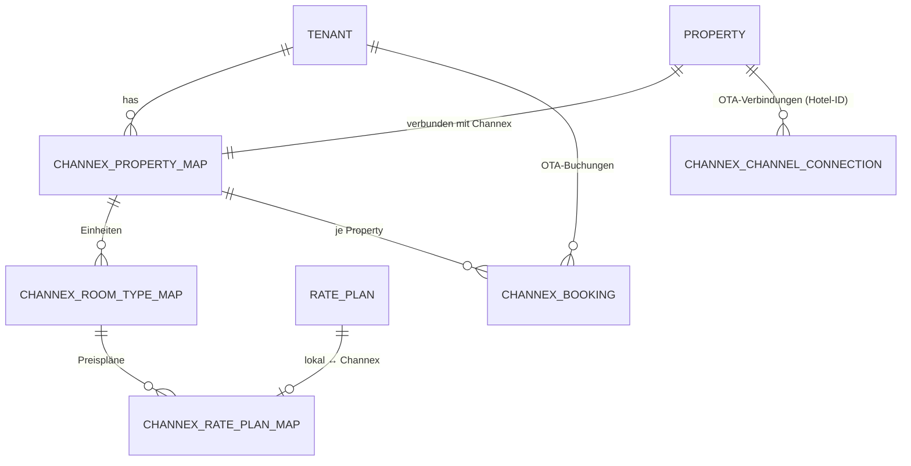

Jede Mapping-Tabelle hält die `channex_*_id` (externe UUID) neben der lokalen
Referenz; `channex_booking` speichert zusätzlich `revision_id`/`system_id` (Dedup),
die volle `raw`-Payload und seit Migration `0047` `guest_id` (Thread→Gast-Link, vom
zentralen Resolver gesetzt). Beträge in Cent (`amount_cents`). Die kanal-
übergreifende Gast-Identität trägt `guest_external_ids` (Migration `0047`: je
Tenant eindeutig pro `channel`+`external_id`). `channex_group_map`
(Migration `0028`) hält je Tenant die Provider-Group (Whitelabel-Konto-Modell:
ein Konto, eine Group pro Hotel). **White-Label-Pflicht:** Provider-Name/IDs
erscheinen nie im Frontend (Responses neutralisiert: `property_title`/`external_id`).

`channex_channel_connection` (Migration `0035`) persistiert pro (Objekt, Portal) die
vom Vermieter eingegebene **OTA-Hotel-ID**, den erzeugten Channel und den Aktiv-Status —
damit ist die Portal-Verbindung sichtbar und verwaltbar (Status, Trennen, Re-Connect
mit vorbefüllter Hotel-ID). Modell: Der Vermieter legt seine Unterkunft selbst beim OTA
an (Hotel-ID), trägt sie in NextDays ein → Auto-Connect über Channex. Ein OTA-seitiges
„Property von Null anlegen" ist kein verfügbarer Weg (s. ADR-0012).

**Weitere Änderungen am Bestand:** `property_type` + `type_attributes` an
`properties` (Ökosystem, ADR-0007); Rollen-Enum um `admin`, `co_admin`
erweitert; `payments`: `stripe_ref` → `gateway_ref` + `gateway`-Enum
(Adapter-Pattern ADR-0003; Primärwahl Stripe via ADR-0011).
Marktplatz-Tabellen (`portal_guests`, `reviews`, `commissions`) wie oben.
`users.permissions` (JSONB, Migration 0022) für feingranulare
..-Berechtigungen pro Nutzer.

**Zweistufiges Berechtigungsmodell (Konto → Benutzer):**

1. **Capability-Matrix** (`permissions.py`, rollenbasiert) — schützt interne
   Slice-Endpoints über `require_permission(Capability.…)` / `require_role(…)`.
2. **..-Berechtigungen** (`.._permissions.py`, pro Nutzer in
   `users.permissions`) — im Benutzer-Wizard zugewiesen (Default je Rolle,
   überschreibbar), per `require_.._permission(Permission.…)` an Endpoints
   durchgesetzt und im Frontend (`app-sidebar`, `getMe().permissions`) zum
   Aus-/Einblenden von Menüpunkten genutzt. **Admin = immer alle.** Die
   Nutzerverwaltung selbst sehen nur admin/owner/co_admin (sonst `403`); ein
   **Admin sieht alle Nutzer plattformweit**, Owner/Co-Admin nur den eigenen
   Tenant.

**Nutzerverwaltung: Liste + Detailseite (Migration 0356).** `/konto/nutzer`
listet die Tenant-Mitglieder mit Rolle und Zugangs-Status; jede Zeile führt auf
`/konto/nutzer/<id>` mit vier Abschnitten (Kontaktdaten, Zusätzliche
Informationen, Rolle und Berechtigungen, Zugewiesene Objekte), jeder über ein
eigenes Sheet bearbeitbar. Die Detailroute prüft **denselben Scope wie der
List-Pfad** (`GET /auth/account/users/{id}`, Wurzel 9) — ohne diese Re-Prüfung
wäre sie eine IDOR auf Kontaktdaten, Rechte und interne Anmerkungen fremder
Nutzer. `users` trägt dafür seit 0356 `additional_phone`, `hide_phones`,
`spoken_languages`, `notes`, `website`, `description`, `avatar_url` — Felder, die
der Contract (`AccountResponse`/`UpdateProfileRequest`) schon vorher versprach,
für die es aber KEINE Spalte gab: `PATCH /auth/account/profile` und der
Avatar-Upload liefen darauf in einen Fehler, die Wizard-Eingaben verschwanden
lautlos. Kein neues Grant: `users` bleibt für `anon`/`authenticated` gesperrt
(0337) und ist bewusst nicht in `supabase_realtime` — die Nutzerverwaltung lädt
deshalb serverseitig und aktualisiert per `router.refresh()`, statt ein stummes
Abo vorzutäuschen.

**Aufgaben: Overlay im Alltag, Seite für den Deep-Link.** Eine Aufgabe öffnet
aus Kalender/Team-/Meine-Liste als Overlay (`TaskDetailModal`) — so macht es
Lodgify im PM-Modul, und die Ansicht (Filter, Scrollposition) bleibt stehen.
Zusätzlich gibt es `/aufgaben/<task_id>` als echte Seite, weil unsere
Benachrichtigungs-Mail einen Link auf die einzelne Aufgabe verschickt
(Hostaway-Weg) und ein Overlay nicht verlinkbar ist. Lodgify verschickt genau
deshalb keine Aufgaben-Links: dort hat eine Aufgabe keine Adresse. **Beide
Rahmen bedienen dieselbe Komponente `TaskDetailInhalt`** — kein zweiter Aufbau
derselben Aufgabe. Die Pfadform `/aufgaben/<id>` liegt fest, weil sie in bereits
zugestellten Mails steht; sie lief zweimal ins 404 (Route fehlte, danach zeigte
der Link ersatzweise auf die Liste) und ist per Test in
`test_ereignisse.py` festgenagelt. Sichtbarkeit entscheidet der Server
(`GET /tasks/detail/<id>`): eigener Mandant, für staff/cleaner nur innerhalb der
Objekt-Freigabe — alles andere ist ein 404, und gelöscht/fremd/nicht-freigegeben
sehen für den Aufrufer gleich aus (Wurzel 9).

**Zugang sperren statt löschen (0356).** `users.deactivated_at`/`deactivated_by`
+ GoTrue-`ban_duration` + der Riegel `auth/aktiv_gate.py` in
`core.security.get_current_user`. Drei Stellen, weil keine allein reicht: das
Feld sperrt nichts, der Bann lässt ein bereits ausgestelltes Access-Token bis zu
einer Stunde weiterlaufen, und ein reiner App-Riegel wäre über den direkten
GoTrue-Login umgangen (Wurzel 7). Die Antwort trägt `login_gesperrt` getrennt
vom Feld-Zustand, damit ein Teilerfolg benannt und nicht als „erledigt"
ausgegeben wird. Details: `docs/API.md` → „Deaktivierte Zugänge".

**Enterprise-Posteingang & DSGVO-Daten-Split (drei unabhängige Achsen):** Der
Posteingang-Zugriff läuft **nicht** über den groben Rollen-Guard, sondern über die
feingranularen Berechtigungen — `inbox/authz.py` löst aus `users.permissions` ein
`InboxAccess` (Scope `inbox_view_all`, Aktionen `pm_chat`/`inbox_reply`/
`inbox_assign`/`inbox_manage_config`, Feld-Maske) auf. Die Feldsichtbarkeit von
Gastdaten (Name → nur Vorname ohne `view_guest_name`, Kontakt, Beträge, Quelle,
**Ausweisnummern** → `••• 1234` ohne `view_guest_id_docs`) ist in **einem**
zentralen Helper `auth/guest_masking.py` gebündelt und wird identisch von `inbox`,
`reservations`, `dashboard` und `guests` (Gästekarte) genutzt (Single Source of
Truth, fail-closed).

**Gästekarte (guests-Slice, Migration 0046):** Enterprise-Gästeprofil (vgl. OPERA
Cloud / protel) mit Stammdaten + Sub-Tabellen `guest_addresses`, `guest_contacts`,
`guest_identity_documents` (DSGVO-sensibel), `guest_preferences`, `guest_consents`
(append-only), `guest_notes`, `guest_documents` — alle tenant-scoped mit RLS.
Zugriff über `pm_guest_details`; DSGVO-Löschung anonymisiert bei Reservierungs-
bezug (statt Hard-Delete). Quelle der Wahrheit für die Permissions ist immer die DB (nicht das
evtl. veraltete JWT). Zuweisungen sind auditiert (`channex_booking.assigned_by/at`

- `inbox_assignment_log`, Migration `0045`).

**Nachrichteneingang — zwei Wege, ein Spiegel, ein Signal (`0293`/`0305`):**
Eine Gastnachricht erreicht uns über zwei Wege, die BEIDE durch dieselbe
Übersetzungsstelle laufen (`channel_manager/nachrichten_eingang.py`
`nachricht_spiegeln`): den Channex-Webhook (`event: "message"`, schnell) und
den Live-Feed-Tick alle 5 Minuten (`live_feed_sync`, Backstop). Gespeichert
wird in `portal_messages`, idempotent über `(tenant_id, message_ref)` — dass
beide Wege dieselbe Nachricht bringen, ist der Normalfall, kein Fehler.

Der Verlauf im Posteingang kommt aus dem Spiegel und wird beim Öffnen durch
den Live-Abruf beim Aggregator ERGÄNZT (`inbox/spiegel.py`, `_vereinen` über
die Nachrichten-ID). Damit steht der Chat auch dann, wenn das Portal nicht
antwortet. Nachrichten ohne Buchungsbezug (Airbnb-Support, Anfragen vor der
Buchung) werden gespeichert (`portal_thread_ref`), erscheinen aber in keiner
Thread-Liste — dort hängt jeder Eintrag an einer Buchung.

Realtime läuft NICHT über `portal_messages`: die Tabelle enthält den Klartext
der Gastnachrichten und bleibt für `anon`/`authenticated` gesperrt (Wurzel 6 —
ein `select`-Grant öffnete sie per PostgREST-Direktpfad für jede Rolle, am
Service-Layer und seinem Rollen-Split vorbei). Beobachtet wird stattdessen das
inhaltsfreie Signal `channex_booking.last_message_at`; den Inhalt lädt die UI
über die API nach. Das Signal geht nie rückwärts (das Journal garantiert keine
Reihenfolge) und setzt `is_read=false` nur bei `sender='guest'`, damit die
eigene Antwort den Thread nicht ungelesen macht.

**Reservierungs-Storno (Migration `0050`):** Stornieren erfordert eine
Pflicht-Begründung und ist dokumentiert — `reservations.cancel_reason/cancelled_by/
cancelled_at` + append-only `reservation_cancellation_log`. Kanal-agnostisch
(Direkt, eigene Plattform, alle 45+ Channex-OTAs): die belegten Tage werden
freigegeben und an Channex zurückgemeldet (availability=1); eine lokale Storno
hebt die OTA-Buchung NICHT beim Portal auf (das UI weist darauf hin). Guard:
`MANAGE_CALENDAR` + `EDIT_CALENDAR_BOOKINGS` (wie Verschieben).

**Buchungs-Zeitleiste (Migration `0122`):** Append-only Ereignis-Log je Buchung
(.. „Zeitleiste") — `reservation_events` (tenant-scoped RLS + Realtime). Die
Schreibpfade (`create/move/cancel/check_in/check_out`) protokollieren über den
zentralen best-effort-Helfer `ReservationsBase._log_event` je ein Ereignis
(`created/moved/repriced/checked_in/checked_out/cancelled`) — ein fehlgeschlagener
Log-Insert kippt die auslösende Aktion NIE (Wurzel 5, `# noqa: BLE001`). Der
Lesepfad `GET /reservations/{id}/timeline` bildet den **kompletten Buchungs-Flow**
ab: er mischt die echten Events mit **synthetischen Events aus ALLEN an der Buchung
hängenden Tabellen** — Reservierungs-Zeitstempel
(`created_at/checked_in_at/checked_out_at/cancelled_at`), Aufgaben (`tasks` →
`task_created`), Nachrichten (`messages` → `message`), Zahlungen (`payments` →
`payment`) und Zusatzleistungen (`reservation_addons` → `addon`). Eingehende
OTA-Buchungen (Booking/Airbnb) schreiben ihr `created`-Event direkt beim Import
(`bookings_sync._project_booking_to_reservation`, nur bei Neuanlage). So haben
Altbuchungen OHNE DB-Backfill sofort eine vollständige Zeitleiste; ein echtes Event
verdrängt das synthetische gleicher Art. Beträge + Nachrichtentext im `detail` sind
maskierungskonform (§4.3 — Personal/Cleaner ohne Finanz-/Kontakt-Einblick). Die
Zeitleiste ist ein **eigenes Tab** (`/reservierungen/{id}/zeitleiste`) mit
Ereignis-Filter; sie abonniert alle speisenden Tabellen per Realtime und stellt
neue `reservation_events` inkrementell voran (kein Reload). Der Detail-Slider zeigt
zusätzlich den **Objekt-Standort** (Adresse + OpenStreetMap-Karte aus
`properties.lat/lng` — kein Fremd-Key, white-label).

**Check-in/Check-out + Zimmerrechnung (Migrationen `0091`/`0092`):** Echte
Front-Desk-Aktionen im Kalender-Buchungs-Slider — `POST /reservations/{id}/
check-in|check-out` persistiert `checked_in_at`/`checked_out_at` (Guards wie
Storno); der Anzeige-Status „Eingecheckt" kommt seit `0091` aus diesen Feldern,
nicht mehr aus dem Anreisedatum, und der Check-out setzt `status='completed'`.
Fachliche Regeln (Nutzer-Entscheidung): Rechnungen aus Buchungen erst NACH
Check-in; **beim Check-out entsteht verpflichtend eine finale Rechnung mit
GoBD-Nummer** — schlägt die Rechnungserstellung fehl, findet kein Check-out
statt (Reihenfolge: erst Rechnung, dann Statuswechsel; Retry ist idempotent).
Der **Booking→Invoice-Builder** (`buchhaltung/reservation_invoice.py`, EINE
Quelle der Wahrheit für Check-out, `GET /buchhaltung/invoice-preview` und den
manuellen „Rechnung aus Buchung"-Flow) baut die Positionen aus
`reservations.quote_items` (neues optionales `kind`-Feld je Zeile:
`lodging|surcharge|fee|discount|tax|addon`; `tax`-Zeilen wie Kurtaxe → 0 % USt,
Bestands-Snapshots ohne `kind` via Label-Abgleich mit
`property_pricing_config.taxes`) plus `reservation_addons`
(Snapshot-Steuersatz; quote_items enthalten NIE Addon-Zeilen — Invariante).
Aufenthalts-Positionen werden mit `tenant_billing_profile.lodging_tax_rate`
versteuert (nullable, bewusst KEIN Default — fehlt der Satz, 422 mit klarer
Meldung; Kleinunternehmer → 0 %); Brutto→Netto wird je Zeile rückgerechnet, die
Brutto-Summe bleibt exakt der Gastpreis. Gast→Debitor-Brücke:
`customers.guest_id` (unique je Tenant, `KD-`-Nummern über
`next_document_number`). `invoices.reservation_id` + partieller Unique-Index
verhindern Doppelrechnungen (nach Storno ist eine neue möglich); Währung kommt
aus dem Buchungs-Snapshot, sonst deterministisch aus
`property_pricing_config.currency`/`rate_plans.currency`. **Zentrale
Objektwährung (`0161`, ADR-0014):** `properties.currency` (nullable, kein
Default) ist die eine Wahrheit je Objekt und gilt für ALLE Rate-Plans (Channex:
1 Objekt = 1 Währung). Rate-Plan-Anlage/-Update erbt sie, ein abweichender Wert
→ 422; Ändern zieht alle Pläne mit (Wurzel 1). Lese-Priorität überall:
Objektwährung → `rate_plans.currency` → leer (kein `\|\| "EUR"`). Channex-Resync fasst
Buchungen mit `checked_out_at` nicht mehr an (kein Status-Rollback);
`invoices`/`invoice_line_items` sind in der Realtime-Publication.

**USt-Satz je Gebühr (Snapshot-Kette wie Addons):** Gebühren im Preis-Setup
(`property_pricing_config.fees[]`, jsonb) tragen ein optionales `taxRate`
(z. B. Frühstück 19 % neben Logis 7 %; leer = Standard-Übernachtungssatz —
Override-Hierarchie, kein erfundener Wert). Der Pricing-Resolver schreibt den
Satz als Snapshot in die QuoteLine (`tax_rate`), der Buchungs-Snapshot
persistiert ihn in `reservations.quote_items`, und `build_positions` nutzt die
Prioritätskette **Kleinunternehmer → Zeilen-`tax_rate` → Abgabe
(kind='tax'/Label) 0 % → `lodging_tax_rate`**. Bestands-Snapshots und
Channex-Fees (liefern nie einen Satz — Modellgrenze) laufen unverändert über
den Übernachtungssatz.

**Rechnungssprache = Gastsprache (`0099`):** Belegtexte aus Buchungen
(Aufenthalts-Label, Sammelposition, `head_text`, Einheit, Addon-Label aus dem
mehrsprachigen `name`-jsonb) entstehen in der Korrespondenzsprache des Gastes
(`reservations.guest_language`) — Begriffskatalog `buchhaltung/doc_i18n.py`
(24 EU-Sprachen inkl. zählabhängiger Pluralformen und Datumsformat je Sprache;
unbekannt/fehlend → de). Die Sprache wird als `invoices.language` gespeichert
und über `InvoiceResponse`/`invoice-preview` (`guestLanguage`) ausgeliefert;
das PDF-Frontend übersetzt seine statischen Beschriftungen über
`apps/web/hooks/pdf/document-translations.ts` (24 Locales, gleiche Liste wie
`messages/*`) und belegt die Sprach-Auswahl im Versand-Dialog damit vor.
Der Kalender-Slider öffnet den Dokument-Dialog (PDF-Vorschau/Download/Druck)
direkt („Ansehen & versenden", `lib/invoice-document.ts` mappt die
snake_case-`InvoiceResponse` auf die camelCase-Dokumentform des Bestands).
Der **E-Mail-Versand** läuft über einen **eigenen Mailcow-Server** auf separatem
Host (`mail.mynextdays.dk`, außerhalb des DB-/App-Stacks); die API sendet per
SMTP-Submission (Port 587, STARTTLS) über `core/mail.py` (`MailService`). Ohne
konfigurierten `SMTP_HOST`/`SMTP_FROM_ADDRESS` ist der Versand fail-closed
deaktiviert (503, kein stiller Erfolg). Setup/DNS/Betrieb: [`deploy/mail/`](../deploy/mail/README.md).

**Zentrale Preis-Wahrheit (pricing-Slice, Migrationen `0051`/`0052`/`0053`):** Preise
liefen früher in vier unverbundenen Quellen auseinander — im Objekt bearbeitete
Preise erschienen nicht im Kalender/Quote. Jetzt gibt es **einen** Resolver
`pricing/resolver.py` als Single Source of Truth:

- `effective_price(property_id, day)` → Effektivpreis pro Tag in fester Priorität
  **manueller `price_overrides`(Tag) > `dynamic_prices` (Regel-Engine) >
  Wochentagspreis > `rate_plans.base_price`**; ohne Preis `None` (kein erfundener
  Fallback).
- **Abgeleitete Rate-Pläne (`0157`, SiteMinder-Modell):** ein Plan ist entweder
  `rate_mode='manual'` (obige Priorität) oder `rate_mode='derived'` — dann folgt
  sein Preis AUSSCHLIESSLICH dem Basis-Plan desselben Objekts:
  `preis(d) = round2((parent_effektiv(d) + offset_amount) × (1 + offset_percent/100))`
  — erst Betrag, dann Prozent (SiteMinder-Reihenfolge), kaufmännisch auf 2
  Nachkommastellen. Property-weite override/dynamic/weekday gelten NUR für
  `manual` (sonst zwei konkurrierende Quellen). Ergebnis ≤ 0 oder Parent-Tag ohne
  Preis → kein Preis (fail-closed, kein Clamp). Keine Kaskade: der Parent MUSS
  `manual` sein (Service 422); das Kind erbt die Parent-Währung; Datumspreise auf
  derived Plänen sind verboten (422). Die Ableitung rechnet LOKAL — die
  Channex-Rate-Plans bleiben ALLE `rate_mode: manual` (SiteMinder-PMS-Regel: nie
  in zwei Systemen ableiten). Plan/Belege: `docs/rate-plan-derived-plan.md`.
- `quote(property_id, range, guests, channel)` → vollständige Aufschlüsselung:
  Effektiv-Tagespreise + Längenpreis (verdrängt Basispreis), Kurzaufenthalts- und
  Extra-Gast-Aufschlag, Gebühren, Aktionen (Rabatt), Steuern → Summe + Positionen.
  Der Zeitraum ist auf `MAX_QUOTE_NIGHTS` (730) gedeckelt (422) — kein
  unbegrenzter Nächte-Loop aus Client-Input.
- **Steuern** rechnen mit ihrer Basis, nicht pauschal: Betrags-Steuern über
  `chargeBasis` × `period` (Kurtaxe „2,50 € pro Gast pro Nacht" = Betrag × Gäste
  × Nächte). **Lokale Prozent-Steuern rechnen auf den Grundpreis**, nicht auf
  Grundpreis + Gebühren — die am Objekt gepflegte `taxableBase` wirkt
  ausschließlich beim Airbnb-Export („für alle anderen Kanäle gelten Steuern nur
  auf den Basispreis", Branchenstandard live abgelesen). Die USt liegt
  unverändert auf der Zwischensumme; Gebühren mit eigenem Satz tragen ihn über
  `taxRate`. Die Bemessungsgrundlage wird VOR der Steuerschleife eingefroren,
  damit Steuern sich nicht gegenseitig besteuern. Angezeigt wird der gastseitige
  Name (`names[locale]`), nicht der interne.
- **Gebühren** kennen zwei Rechenarten: Pauschalbetrag nach `basis`, oder
  **Prozent** — dann EINMALIG auf den Zimmerpreis (einschließlich Aktionen), die
  Basis multipliziert nichts.
- **Kanal-Einschränkung** (`portalScope`) gilt auch hier: eine Gebühr/Steuer „nur
  an Booking" erscheint in einer Direktbuchung nicht. Die eigenen
  Buchungsstrecken zählen als Kanäle mit (`direct`, `portal`).

**Reichweite je Preis-Block (Editor-Kopfzeile).** Jeder Editor der Preise-Seite
trägt oben „Gilt für <Kanäle> · Nicht unterstützt von <Portale>" — gerechnet vom
Server (`channel_manager/abgaben_status.preisblock_status`) aus derselben Quelle,
aus der der Sync sendet. `base_price` und `extra_guest` gehen an jeden verbundenen
Kanal (ARI-Push bzw. `per_person`-Rate-Plan aus `content_sync._rate_plan_options`);
`short_stay` und `addons` sind bewusst nur für die eigenen Buchungsstrecken — ein
Kurzaufenthalts-Aufschlag hängt an der Aufenthaltslänge, ein Extra wird
dazugebucht, und dafür hat kein Portal ein Feld. Die **Preise nach
Aufenthaltsdauer** gehen dagegen sehr wohl raus: als Airbnb-Rabattregel
`STAYED_AT_LEAST_X_DAYS` (Prozentsatz aus dem Grundpreis abgeleitet, abwärts
gerundet); die übrigen Portale tragen „Manuelle Synchronisierung". Eine Regeltabelle in der Oberfläche wäre die
zweite Wahrheit, die genau dann auseinanderläuft, wenn es darauf ankommt.

**Preise von einem anderen Objekt übernehmen** (`POST /properties/{id}/pricing/
copy-from`, `preise_kopieren.py`): überschreibt den Preis-Block dieses Objekts
vollständig und spiegelt den Grundpreis in `rate_plans`. Währung und
Kanal-Einschränkungen werden VOR dem ersten Schreiben geprüft (abweichende
Währung → 422, nie umgerechnet). Aktionen, Extras und Verfügbarkeit bleiben außen
vor — sie tragen objekt-eigene Codes, Fotos und Kalender.

Jede Oberfläche liest Preise **ausschließlich** über den Resolver: der Kalender
(`calendar/get_availability`) zeigt denselben Effektivpreis wie die Buchungs-Quote;
`reservations.create` füllt `total_amount` + `quote_items` automatisch aus dem Quote
(manueller Betrag > 0 überschreibt); der Reservierungs-Wizard zeigt die Quote-
Aufschlüsselung live. Die zuvor opake Pricing-Konfiguration (Markups, Aufschläge,
Gebühren, Steuern) wurde aus `properties.type_attributes.pricing`
in die typisierte, vom Resolver gelesene Tabelle **`property_pricing_config`** (`0051`,
Backfill aus dem Blob) überführt; `properties.update` spiegelt jede Änderung dorthin.
`rate_plans` + `property_pricing_config` sind jetzt in der Realtime-Publication (`0052`)
— Preisänderungen erscheinen ohne Reload in allen Tabs (`calendar-board` abonniert sie).
Das zweite Saison-Modell (`seasons`/`season_*` aus `0011`) wurde mit `0053` als
deprecated für die _manuellen_ Tagespreise markiert (die laufen über
`price_overrides`); die Saison-/Event-**Perioden** werden aber von der Dynamic-
Pricing-Engine als Aufschlag-Signal gelesen (s. u.).

**Dynamic Pricing (Phase 1, regelbasiert, Migration `0055`):** Eine reine Regel-
Engine (`pricing/engine.py`, deterministisch/unit-testbar) berechnet je (Objekt,
Tag) einen dynamischen Preis + Min-Stay aus **multiplikativen** Faktoren auf den
Basispreis: Saison (`season_periods`), Event (`event_periods`), Wochenende, eigene
Auslastung (Belegung im ±30-Tage-Fenster), Lead-Time/Last-Minute (Tage bis Anreise),
Orphan-Gap (1–2-Nächte-Lücken in `availability`) — anschließend `clamp(min_price,
…, max_price)`. Der `recompute`-Service lädt die Quellen, ruft die Engine und
schreibt nach **`dynamic_prices`** (NIE in `price_overrides`); danach löst er den
vorhandenen Channex-ARI-Push (Preis in Cent + Min-Stay, run-length-kodiert) aus.
Konfiguration je Objekt in **`dp_settings`** (opt-in, **default AUS**). Der tägliche
Lauf kommt über `POST /pricing/recompute` (Cron-Secret, Coolify Scheduled Task,
Horizont 540 Tage); zusätzlich rechnet `reservations.create/cancel` die betroffenen
Tage (±2) sofort neu (Auslastung/Orphan ändern sich). **Manuell schlägt automatisch:**
ein vom Host gesetzter `price_override` gewinnt im Resolver immer über den DP-Vorschlag;
bei DP-AUS gibt es keine `dynamic_prices` und der Resolver fällt auf Basis zurück.
**Phase 2 (Migration `0056`)** ergänzt einen **Markt-/Wettbewerbs-Faktor** über eine
pluggable Provider-Schnittstelle (`pricing/market/`: `MarketSignalProvider` → comp_price/
demand_index/event_uplift_pct). Auswahl per Env `MARKET_DATA_PROVIDER`: Default
**NullProvider** (neutral → exakt wie Phase 1), `AirDnaProvider` nur mit `AIRDNA_API_KEY`.
Der Markt-Faktor zieht den Preis gewichtet (`market_sensitivity`) Richtung Markt-Median +
Nachfrage, gedeckelt auf ±`market_max_adjust_pct`; Markt-Events werden mit `event_periods`
gemerged (Maximum, keine Doppelzählung). Markt ist opt-in (`dp_settings.market_enabled/
market_key/comp_refs`). Die Engine persistiert je Tag die **Faktor-Aufschlüsselung**
(`dynamic_prices.factors`), die der Kalender als „Warum dieser Preis?"-Tooltip zeigt
(Saison/Wochenende/Markt/Auslastung … mit %-Beitrag). Verteilpfad unverändert. Ohne
AirDNA-Konto läuft alles über den NullProvider — DP wie Phase 1, nur mit Markt-Schaltern

- Preis-Erklärung bereit. Optionale Alternative: ein PriceLabs-IAPI-Connector als
  umschaltbare Preis-Quelle (separat), der ebenfalls nach `dynamic_prices` schreibt.
  **Phase 3 (Migration `0057`)** bringt das zentrale Bedienmodell gängiger
  Channel-Manager (Hostaway) ins UI: ein eigener Hauptmenü-Bereich **`/dynamic-pricing`**
  mit einer **Objekt-Tabelle** (alle Objekte: Basispreis + Modus-Label, Min/Max,
  Aktiv-Toggle, Bearbeiten-Slider, 35-Tage-Vorschau `/dynamic-pricing/{id}`), gespeist
  aus `GET /pricing/overview` (`settings_service.overview`). Pro Objekt wählt der
  Vermieter den **Basispreis-Modus** (`dp_settings.base_mode`): `data_driven` (Anker aus
  `rate_plans.base_price`, Aggressivität `base_rate_mode` konservativ/empfohlen/aggressiv
  = ×0,5/×1,0/×1,5 auf Auslastung+Markt) oder `manual` (fester `manual_base_price`). Die
  Engine (`DpSettings.effective_base`/`aggressiveness`) ist der einzige Ort dieser Logik;
  Resolver-Priorität (manuell > dynamisch > Wochentag > Basis) und Verteilpfad bleiben
  unverändert. Rein additiv, Defaults bilden das bisherige Verhalten ab.
  **Phase 4 — KI-Lernen + RateBoard-Bausteine (Migration `0060`):** Drei Erweiterungen,
  alle opt-in und additiv. (a) **Pickup-Erfassung + gelernter Forecast**: ein täglicher
  Snapshot je (Objekt, Anreisetag) in **`dp_pickup_snapshots`** (booked/days_before) ist
  das Lern-Fundament. `pricing/forecast.py::PickupCurveModel` lernt daraus die erwartete
  Belegungs-Wahrscheinlichkeit je (Anreise-Monat × Vorlauf-Bucket) — die normale
  Buchungskurve des Objekts. Der heutige Ist-Stand vs. diese Erwartung ergibt eine
  **Forecast-Velocity** (Ist über Erwartung → schneller → Aufschlag, antizipativ); sie
  speist denselben `pickup`-Faktor und ersetzt das grobe Phase-2-Lookback-Signal, wo die
  Kurve trägt. **Cold-Start:** unter `_MIN_OBSERVATIONS` Beobachtungen je Zelle KEIN
  Signal (neutral, keine erfundenen Werte). (b) **Wetter** (`pricing/weather.py`): Tages-
  Score aus DWD/Bright Sky (amtlich, frei, kein Key) für Tage im Forecast-Horizont
  (~10 Tage); gutes Wetter → Aufschlag, gedeckelt `weather_max_adjust_pct`. Opt-in
  `dp_settings.weather_enabled` + Objekt-Koordinaten (`properties.lat/lng`); ferne Tage
  neutral. (c) **Rate Rules** (`dp_settings.rate_rules`): manuelle Regeln
  (weekday/month/Vorlauf-Fenster → adjust_pct), die als bewusster Vermieter-Override
  OBENDRAUF auf die kombinierten Auto-Faktoren wirken (nicht von der Anti-Über-
  Rabattierung erfasst). (d) **EIN Schalter** (`dp_settings.enabled`): rechnen heißt
  überall gelten — Kalender, eigene Plattform UND Channex-OTA-Push. Den früheren
  Autopilot-Zwischenmodus („rechnen, aber nicht veröffentlichen") gibt es nicht mehr:
  Reconcile/Full-Sync bauten ihre Soll-Kurve ohnehin aus dem Resolver inkl. dynamic —
  das Gate war eine Attrappe, und vier Flächen mit verschiedenen Preisen zerstören
  das Vertrauen in die Preisführung. Die DB-Spalte `autopilot_enabled` bleibt
  bestehen, wird aber nicht mehr gelesen.
  Anti-Über-Rabattierung (nur stärkster Rabatt zählt, Aufschläge stapeln) +
  asymmetrische Caps (−20 %/+15 %) + Vorlauf-Buckets sind ebenfalls in `0060`. Damit
  erreicht die Engine das Funktionsniveau von PriceLabs/Beyond/RateBoard mit eigenen
  Daten; die Booking-Market-Insights-Quelle dockt später über dieselbe
  `MarketSignalProvider`-Schnittstelle an.
  **Kostenpflichtiges Modul + Erweiterungs-Fläche (`dynpricing_ledger`, `0277`):**
  „Dynamische Preise" ist ein einzeln buchbares Zusatzmodul (0,5 % vom
  Buchungsumsatz, nachgelagert über den Ledger fakturiert — nie über einen
  währungslosen Stripe-Meter). Gebucht wird auf der eigenen Fläche
  **`/erweiterungen`** (Kachel-Raster) → **`/erweiterungen/[slug]`** (Beschreibung,
  Preis aus Stripe, „Aktivieren"/„Kündigen" über `POST|DELETE
  /subscriptions/modules`); Katalog-Texte in `web/lib/erweiterungen.ts`, bewusst
  NICHT in der Abrechnung (`/konto/tarif`), die Tarif und Rechnungen zeigt.
  **Drei Gates, eine Quelle** (`subscriptions/entitlements.py::modul_aktiv`,
  fail-closed): (1) `recompute` rechnet ohne Entitlement nicht, (2)
  `settings_service.update` lehnt `enabled=true` mit **402** ab (ein Toggle, der
  nichts bewirkt, wäre eine Attrappe), (3) `GET /pricing/overview` liefert
  `module_active` — ohne Buchung zeigt `/dynamic-pricing` die Verkaufsseite
  (`components/erweiterungen/modul-verkaufsseite.tsx`) statt der Objekt-Tabelle.
  Buchen setzt ein laufendes Abo voraus (sonst 422): ohne Stripe-Kunden wäre die
  erfasste Nutzung nie abrechenbar.
  **Der Schlüssel braucht die Migration (`0278`):**
  `tenant_module_entitlement.module_key` trägt einen CHECK, der die Module
  namentlich aufzählt (`0117`, danach `0254`/`0256`). Ein neuer `module_key` im
  Code ohne diese Erweiterung ist live ein 23505/23514 beim Upsert — „Aktivieren"
  quittiert mit 500, während die Unit-Tests grün bleiben (der DB-Fake kennt keine
  CHECKs). Genau so war `dynamische_preise` unbuchbar. Gegen die Wiederholung
  vergleicht `subscriptions/tests/test_modul_keys_migration.py` `MODULE_KEYS` mit
  der jüngsten Constraint-Definition in `supabase/migrations`; den ganzen Weg
  (Gate 402 → `add_module` → `module_active` → Kündigen) spielt
  `scripts/subscriptions/e2e_modul_dynamische_preise.py` live gegen die Server-DB
  und räumt hinter sich auf.

**Kanalübergreifende Nachricht→Gast-Zuordnung (Resolver, Migration 0047):** Jede
eingehende Buchung/Nachricht — OTA via Channex, WhatsApp, manuelle Reservierung,
künftig E-Mail/Direkt — läuft durch **einen** zentralen Resolver
`guests/identity.py::resolve_or_create_guest`. Deterministische Match-Reihenfolge:
(1) normalisierte E-Mail, (2) normalisierte Telefonnummer (E.164), (3) kanal-
spezifische externe ID (`guest_external_ids`: OTA-Guest-ID / WhatsApp-Nummer /
`external_ref`), sonst (4) Neuanlage. **Nie** allein auf den Namen mergen; bei
mehrdeutigem Treffer (E-Mail ≠ Telefon) wird konservativ neu angelegt und
`guests.needs_review` gesetzt (manuelles Merge via `/guests/merge`). `channex_booking`
trägt jetzt `guest_id` (direkter Thread→Gast-Link, ersetzt die fragile Brücke über
`reservations.source_channex_booking_id`); `whatsapp_conversation` ebenso. Damit
zeigt die Gästekarte (`GET /guests/{id}/threads`) verknüpfte Threads, und im
Posteingang führt jeder Thread zur Gästekarte. Korrektur durch Berechtigte
(`inbox_manage_config`): `PUT /inbox/{thread_id}/guest` ordnet einen Thread manuell
einem Gast zu oder legt „Gast aus Thread an". Backfill für Alt-Threads:
`scripts/backfill_guest_links.py`. Kanal-IDs gelten als personenbezogen
(DSGVO-Löschung/Anonymisierung).

**Eigentümer-Abrechnung (owners + owner_statements, Migrationen `0063`–`0071`):**
Zwei Slices. **`owners`** (`0063`) hält die Eigentümer-Stammdaten (Adresse, Steuer-/
USt-IdNr., Bank, `default_commission_pct`) und die Objekt-Zuweisung
`owner_properties` (Anteil `ownership_share` + Provisions-Override
`commission_override_pct` je Objekt). **`owner_statements`** (`0064`) ist die
Auszahlungs-Abrechnung je Eigentümer + Zeitraum, mit Snapshot der PM-/Owner-
Stammdaten, Status (`draft`/`finalized`/`cancelled`) und eingefrorenen Summen.

- **Provision je Objekt (`0068`):** `owner_statements.commission_pct` ist NULL =
  Provision je Objekt aus den Stammdaten (`commission_override_pct`, sonst
  `default_commission_pct`); ein gesetzter Wert ist ein manueller, abrechnungsweiter
  Override. Buchungssatz = (`total_amount` − `channel_fee`) × (1 − Provision); je
  Reservierung mit dem Satz IHRES Objekts gerechnet (gemischte Sätze korrekt).
- **EU-Steuer (`0065`, `tax.py`):** Kategorie/Satz nach EU-Recht — Kleinunternehmer
  → 'E', Reverse-Charge (Käufer-USt-IdNr. + beide EU + Aussteller≠Käufer) → 'AE',
  sonst 'S'. Fortlaufende Nummern über den Buchhaltungs-Bestand
  (`next_document_number`/`tenant_billing_profile`, kein paralleles System).
- **Storno:** Eine finalisierte Rechnung wird nicht gelöscht, sondern per
  Stornorechnung (eigene Nummer, negierte Beträge, Referenz) neutralisiert; das
  Original bleibt `cancelled` (`kind`/`cancels_statement_id`/`cancelled_by_statement_id`).
- **Mehrwährung (`0069`/`0070`, `fx.py` + `currencies.py`):** Buchungen kommen in
  ihrer Quellwährung (`reservations.currency`, via Channex ODER eigene Plattform).
  Der Eigentümer gibt sein **Herkunftsland** an → **Owner-Zielwährung**
  (`currencies.COUNTRY_CURRENCY`). NUR die Owner-Auszahlung wird umgerechnet — mit
  dem **ECB-Tageskurs am Check-out** je Reservierung. Kursquelle: **Frankfurter**
  (ECB, kostenlos, kein Key), gecacht in **`fx_rates`** (`rate_date,base,quote,rate,
source`; Tageskurs stabil/reproduzierbar, GoBD). **Kein Fallback** — fehlt ein
  Kurs, `FxError` → 502 (keine erfundenen Beträge). Verwaltungsanteil bleibt je
  Quellwährung getrennt (`pm_payout_by_currency`); Owner-Summe in `owner_currency`
  (`0070`). Beträge verschiedener Währungen werden nie addiert.
- **Live (`0071`):** `owners`, `owner_properties`, `owner_expenses`,
  `owner_statements` sind in der Realtime-Publication — die Eigentümer-Seite
  aktualisiert sich vollständig per WebSocket (s. § Echtzeit).

### Zusatzleistungen / Add-ons (`0074`/`0075`)

- **`property_addons`** (`0074`): Upsells je Objekt (Reinigung, Wäsche, Hund,
  Frühstück …) mit Preis, Medien, `appears_in` und `available_until` (z. B.
  `anytime` / vor Anreise). Realtime via `0076`.
- **`reservation_addons`** (`0075`): pro Reservierung gekaufte Add-ons
  (Snapshot von Bezeichnung/Preis zum Kaufzeitpunkt — kein Nachträglich-
  Verändern). Verkauf über `booking_engine` + Gäste-Portal, fließt als
  Extra-Umsatz in das Owner-Statement, triggert die Aufgabe `addon_purchased`.

### Zahlungen & Stripe Connect (`0079`–`0083`)

Das Zahlungs-Fundament (vgl. `payments`-Slice, ADR-0011 — Stripe primär):

- **`0081` Connect-Account** — Felder auf `tenant_billing_profile`:
  `stripe_account_id`, `stripe_charges_enabled`, `stripe_payouts_enabled`,
  `stripe_details_submitted`, `stripe_onboarding_at`. Der `account.updated`-
  Webhook spiegelt den KYC-Status hierher.
- **`0082` payments_core** — neue Tabelle **`stripe_webhook_event`** (Event-ID-
  Dedup → Idempotenz); `reservations.payment_status` (Enum
  `reservation_payment_status`: `unpaid|pending|paid|refunded|deposit_held`);
  `properties.deposit_amount` (Kautionsbetrag); `payments.gateway` Default
  `stripe`.
- **`0083` billing_kyc** — `tenant_billing_profile.account_type`
  (`individual|company`) + `owner_dob` (date): die für die Stripe-Freischaltung
  nötigen KYC-Angaben, erfasst im Konto (Stammdaten) und per Auto-Connect an
  Stripe übertragen.

**AGB & Stripe Connected Account Agreement (Custom-Pflicht):** Die Agentur-AGB
liegen als 24-sprachige TS-Module in `apps/web/content/legal/agb/` (öffentliche
Route `/agb`, `de.ts` ist die Quellfassung); § 5 verankert das
[Stripe Connected Account Agreement](https://stripe.com/connect-account/legal/full)
nach Stripes Empfehlungstext. Der „Zahlungen aktivieren"-Klick
(`components/zahlungen/payments-activation.tsx`) verlinkt AGB + Stripe-Vertrag
und dokumentiert die Annahme via `tos_acceptance` (date + echte Nutzer-IP).
Gast-AGB für den Marktplatz: `plattform/app/agb` (`?sprache=<code>`).

- **`0079` `properties.platform_description`** — abweichender Beschreibungstext
  nur für die eigene Buchungsstrecke (OTAs erhalten weiter den kanonischen Text).
- **`0080` `availability` CTA/CTD** — Closed-to-Arrival/Departure je Tag.

**Geldfluss-Regel (OTA-Gate):** Ein PaymentIntent (Buchung/Kaution) entsteht
**nur** für eigene Kanäle (`channel` ∈ {`direct`,`portal`} ohne
`source_channex_booking_id`). OTA-Buchungen (`booking`/`airbnb`/`vrbo`/`ota_other`) zahlt der
Gast bei der OTA — die zahlt den Vermieter direkt aus, kein Stripe (409). **0%
Buchungsgebühr** auf eigene Buchungen (ADR-0006); Provision nur im
Phase-2-Marktplatz (`commissions`).

### Härtung, Page-Builder & Betriebsart (`0084`–`0090`)

- **`0084` RLS-Nachzügler** — schließt eine Security-Audit-Lücke: 6 public-Tabellen
  hatten volle anon/authenticated-Grants, aber **kein aktiviertes RLS** (über
  PostgREST tenant-übergreifend les-/schreibbar). Tenant-gebundene Tabellen
  (`ari_outbox`, `channex_tax_map`, `stop_sell`) erhalten die Standard-tenant-Policy;
  System-/globale Tabellen bekommen bewusst **keine** permissive Policy (nur
  `service_role`). Konsequenz-Regel: **jede neue public-Tabelle braucht RLS.**
- **`0085` service_role statement_timeout** — DB-Backpressure: `statement_timeout
= 15s` + `lock_timeout = 8s` für die Rolle `service_role` (vorher unbegrenzt —
  eine langsame Query konnte Connections aushungern). Teil des Rate-Limiting-/
  Backpressure-Konzepts, siehe [deploy/RATE-LIMITING.md](../deploy/RATE-LIMITING.md).
- **`0086` tenant_site_config** — Fundament des Page-Builders:
  `tenant_site_config` (Branding 1:1 je Tenant) + `tenant_custom_domains`
  (Kunden-Domains, Cloudflare-Custom-Hostname-Status). Details in [§12](#12-page-builder).
- **`0087` site_pages / site_blocks** — Seiten + geordnete Inhaltsblöcke des
  Page-Builders (10 Block-Typen per CHECK, partieller Unique-Index „genau eine
  Home-Seite je Tenant"). Details in [§12](#12-page-builder).
- **`0088` travel_agencies** — Reisebüro-/Partner-Kartei (Profile, Kontakte,
  Verträge nach Jahren, Saison-Preiszeilen, Vertragsdateien im privaten Bucket
  `agency-contracts`); `stop_sell.agency_id` (Adressat einer Stop-Sale-Meldung).
- **`0089` stop_sell_agency_idx** — partieller Index auf `stop_sell.agency_id`
  (FK-Löschpfad + Partner-Filter der Kartei).
- **`0090` tenants.accommodation_type** — **Betriebsart** des Mandanten:
  `'vacation_rental' | 'hotel'` (Default `vacation_rental`, CHECK-Constraint).

**Betriebsart (`accommodation_type`, `0090`):** myNextDays bedient
Ferienwohnungs-Vermieter UND Hotels. Die Betriebsart steuert die
Dashboard-Navigation in `apps/web` (Hotel- vs. FeWo-Sidebar, Begriffe wie
„Objekte" vs. „Zimmer"; Eigentümer-Modul nur für Ferienvermietung) und wird im
**5-Schritte-Onboarding** als eigener Schritt („Betriebsart") abgefragt
(`onboarding-wizard.tsx`: welcome → type → company → tax → done). Umstellen per
`PATCH /api/v1/auth/tenant/accommodation-type` (Capability `MANAGE_TENANT`).
**Nicht verwechseln:** die Channex-OTA-„Hotel-ID" (`channex_channel_connection`,
§4) ist eine externe Portal-Kennung und hat mit der Betriebsart nichts zu tun;
ebenso beschreibt `tenants.business_type` (`0066`) das Vermarktungsmodell
(agency/self_managed), nicht die Beherbergungsart.

**Betriebsart-Scope der Objektlisten:** Die Typ-Gruppen leben serverseitig in
`properties/schemas.py` (`VR_TYPES`/`HOTEL_TYPES` +
`types_for_accommodation()`, Spiegel von `apps/web/lib/property-meta.ts`).
`GET /properties` filtert nach der Betriebsart des Tenants (Hotel sieht nur
Zimmertypen, Ferienvermietung nur Ferienobjekt-Typen; `accommodation_type`
NULL = kein Filter) — damit sind ALLE Flächen (Kalender inkl. Views/Wizard,
/objekte, /stop-sell, Dialoge, Channel-Mapping) in einem Schnitt korrekt.
`owners/available_properties` filtert identisch. `create`/`update` lehnen
betriebsfremde Objekttypen mit 422 ab (sonst entstünden unsichtbare Objekte);
`GET /properties/{id}` bleibt bewusst ungefiltert (Direktlink als
Sicherheitsventil für falsch typisierte Bestandsobjekte).

**Einheiten (`property_units` + `reservations.unit_id`, `0265`) — was verkauft
wird.** Ein Objekt ist der Einheiten-TYP, darunter hängen seine identischen
Einheiten (Bestand: genau eine je Objekt). Verfügbarkeit an die Portale ist
deshalb eine STÜCKZAHL, keine 0/1 — Booking.com führt sie am Typ („number of
rooms available to sell"), SiteMinder sendet sie als `AvailStatusMessage
@BookingLimit` je `@InvTypeCode`, Hostaway nennt die Einheiten „sub-units".
Berechnet wird sie in `channel_manager/einheiten.freie_einheiten_spannen` aus
dem KALENDER (nicht aus Reservierungen: der Push läuft im Import vor dem
Anlegen der Reservierungszeile).

`availability` trägt seit **`0266`** die Spalte `unit_id` (NOT NULL): eine Zeile
gehört genau einer Einheit, ein Sperr-Tag des ganzen Typs steht als je eine
Zeile pro Einheit. Aufgefächert wird zentral in `core/einheiten.je_einheit`,
damit die Regel nicht in neun Schreibpfaden (calendar, external_calendar,
reservations ×2, properties, channel_manager ×2) einzeln nachgebaut wird;
Konflikt-Ziel ist `core.einheiten.AVAILABILITY_CONFLICT`
(`property_id,unit_id,date`). Die ALTE Unique-Bedingung `(property_id, date)`
steht absichtlich noch daneben — sie fällt erst in dem Schritt, der das
Aufteilen in mehrere Einheiten freischaltet, weil sonst die auf dem Server
laufende Vorversion (die mit dem alten Konflikt-Ziel schreibt) sofort brechen
würde.

**Gebäude (`buildings` + `properties.building_id`, `0264`) — Träger der
Portal-Kennung.** Die Betriebsart entscheidet AUSDRÜCKLICH NICHT (mehr), welche
Objekte sich bei den Portalen eine Kennung teilen; das tut das Gebäude:

- Objekte mit demselben `building_id` teilen EINE Channex-Property (= eine
  Booking-Unterkunft mit mehreren Einheiten). Der Gebäudename ist der Name, den
  die Portale über den Einheiten zeigen.
- `building_id IS NULL` → das Objekt steht für sich und bekommt eine eigene
  Kennung. Das ist der Normalfall verstreuter Ferienobjekte.
- Warum eine eigene Zeile statt „abgeleitet aus `channex_property_map`": die
  Gruppierung steht dort zwar (mehrere Objekte auf einer `channex_property_id`),
  aber erst NACH dem Verbinden und ohne Namen. Ohne Namen stünde bei einer
  Agentur mit drei Häusern dreimal der Betriebsname bei Booking.com.
- Booking.com zum Fall „mehrere Einheiten an einer Adresse" (Partner-Hilfe,
  „How do I register multiple properties or units?"): „To add two properties of
  the same type at the same address, choose Home, Hotel, or Alternative places
  as a property type. You can then choose between listing your full place or
  individual rooms and add multiple units if needed."
- Der Bestand wurde aus der Wirklichkeit abgeleitet (Objekte, die sich schon
  eine `channex_property_id` teilen, plus Hotels ohne Verbindung), nicht aus dem
  Flag — sonst wären bestehende Verbindungen beim nächsten Sync zerfallen.
- Wechsel der Zuordnung nach dem Verbinden: 409. Die Kennung liegt dann beim
  Portal; ein Umhängen schickte ARI an das falsche Haus.
- Gelesen wird das in `content_sync` (Property-Wiederverwendung) und
  `channels._ensure_property_registered` (alle Einheiten des Gebäudes
  registrieren). Endpunkte: `GET/POST /properties/buildings`, Zuordnung über
  `PATCH /properties/{id}` (`building_id`, Leerstring löst).

### Eigentümer-Portal, Einladungen & Ankündigungen (`0330`–`0339`)

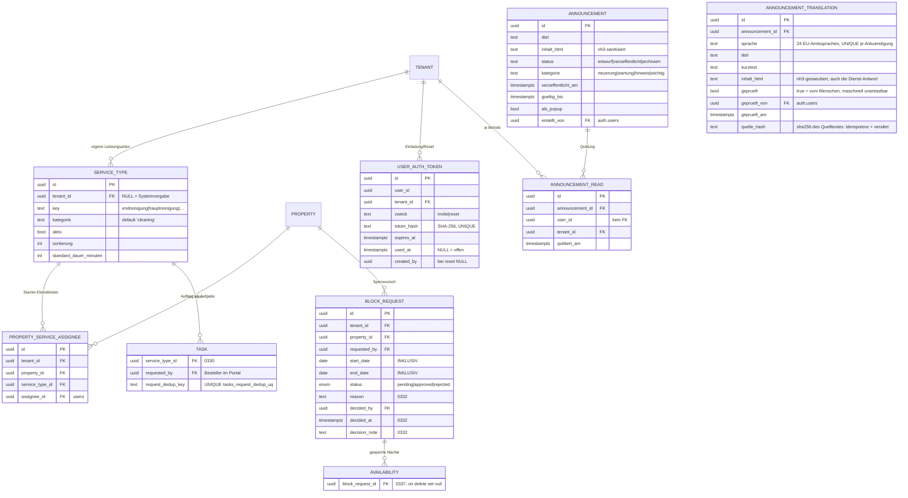

- **`0330` Dienstleistungs-Katalog** — `service_types` (`tenant_id IS NULL` =
  Systemvorgabe: endreinigung, hauptreinigung, fensterreinigung, rasenmaehen,
  terrassenreinigung; sonst eigener Typ des Betriebs, je zwei UNIQUE-Indizes für
  System- und Tenant-Schlüssel) und `property_service_assignees` (Stamm-
  Dienstleister je Objekt und Typ). `tasks` bekommt `service_type_id`,
  `requested_by` und `request_dedup_key` — Letzterer mit UNIQUE-Backstop
  `tasks_request_dedup_uq`, damit ein Doppelklick im Portal keine zweite Reinigung
  auslöst (Wurzel 2). Nicht zu verwechseln mit `property_addons` (`0074`): das ist
  die Leistung, die der **Gast** kauft.
- **`0331` Benachrichtigungen** — sechs Spalten an `notification_settings`
  (`task_assigned_*`, `owner_booking_*`, `owner_service_*`) und
  `owners.statement_frequency` um **`yearly`** erweitert (CHECK jetzt
  `none | monthly | yearly`). Der Auto-Run erzeugt je Rhythmus genau ein Statement
  pro Zeitraum; welcher gemeint ist, sagt die Länge des Zeitraums (bis 31 Tage
  `monthly`, darüber `yearly`).
- **`0332`/`0333`/`0337` Sperranträge** — `block_requests` bekommt `reason`,
  `decided_at`, `decision_note` plus einen partiellen Index auf die offene
  Warteschlange; `select` wird `anon`/`authenticated` entzogen (der Schreibpfad war
  seit `0229` zu). `0333_sperrantrag_ueberlappung` fügt die
  EXCLUDE-Constraint `block_requests_kein_ueberlapp` hinzu (GiST über
  `property_id` + `daterange(start,end,'[]')`, nur `status='approved'`,
  `btree_gist`) — zwei genehmigte Sperrungen über demselben Zeitraum sind damit
  auf DB-Ebene unmöglich, nicht nur „im Service geprüft".
  `0337_availability_sperrantrag_bezug` hängt `availability.block_request_id` an
  (`on delete set null`): erst damit weiß der Widerruf, welche Sperrnächte ihm
  gehören, und lässt eine parallele Handwerker-Sperre der Agentur stehen (Wurzel 1).
- **`0334` Einladung & Passwort-Reset** — `user_auth_tokens`: 32 Byte aus dem
  CSPRNG, in der DB liegt **nur der SHA-256** (UNIQUE), Klartext existiert
  ausschließlich im Mail-Link. `zweck` ist `invite` (7 Tage) oder `reset`
  (1 Stunde); `used_at` wird per bedingtem UPDATE gesetzt (`where used_at is
  null`) und ist damit der Einmaligkeits-Riegel. Bei `reset` bleibt `created_by`
  bewusst `NULL` — der Anfordernde ist nicht angemeldet, seine Identität wäre
  geraten. Voll gesperrt für `anon`/`authenticated` (`revoke all` + restriktive
  `deny_all`-Policy).
- **`0335` Empfänger-Sprache** — `owners.language` und `tenants.default_language`,
  beide nullable ohne Default, mit CHECK gegen die 24 EU-Amtssprachen; derselbe
  CHECK wird auf dem bestehenden `users.preferred_language` nachgetragen.
  Details zur Kette: [§10 Mailversand](#mailversand-layout-sprache-texte-coremail).
- **`0337_ankuendigungen` / `0338`** — `announcements` (bewusst **ohne**
  `tenant_id`: eine Ankündigung gilt für alle Betriebe) und `announcement_reads`
  (die Quittung, UNIQUE je `announcement_id` + `user_id`). Beide sind für
  `anon`/`authenticated` vollständig gesperrt und **nicht** in
  `supabase_realtime` — die Zusage lautet „erscheint beim nächsten Login", nicht
  „sofort". `0338` legt den öffentlichen Bucket `announcement-images` an (10 MB,
  nur `image/png`/`image/webp`); geschützt wird über den unerratbaren Dateinamen,
  wie bei `property-images` (`0062`).
- **`0347_ankuendigung_uebersetzungen`** — `announcement_translations`: eine
  Zeile je (Ankündigung, Sprache) mit Titel, Kurztext und Inhalt in allen 24
  EU-Amtssprachen. Übersetzt wird **beim Verfassen** (Google Cloud Translation
  v2, derselbe Zugang wie `content`/`channel_manager`), nicht beim Lesen: der
  Text trägt rechtliche Aussagen und Geldbeträge und muss vor dem
  Veröffentlichen prüfbar sein.
  `geprueft = true` markiert eine von einem Menschen korrigierte Fassung; jedes
  maschinelle Schreiben trägt `where geprueft = false`, eine geprüfte Zeile ist
  für den Automaten also **nicht adressierbar**. `quelle_hash` (sha256 über die
  drei übersetzbaren Felder) trägt die Idempotenz (Wurzel 2: ein zweiter Lauf
  mit unverändertem Text macht null API-Aufrufe) und die Anzeige „veraltet".
  Fällt der Dienst aus, wird **nichts** geschrieben (Wurzel 5) und nie der
  Ausgangstext als Übersetzung abgelegt (Wurzel 4). Wie die Mutter-Tabelle für
  `anon`/`authenticated` vollständig gesperrt und nicht in `supabase_realtime`.
- **`0336`/`0337`/`0339` DB-Härtung** — siehe [§6.2](#62-db-direktpfad-geschlossen-wurzel-6-migrationen-03360339).

> **Nummernkollisionen:** `0333` und `0337` sind je mehrfach vergeben
> (`0333_kanal_aus_ota_name_nachziehen` / `0333_sperrantrag_ueberlappung`;
> `0337_ankuendigungen` / `0337_availability_sperrantrag_bezug` /
> `0337_direktpfad_sensible_tabellen_schliessen`). Das ist bewusst so belassen:
> `apply-migrations.sh` sortiert nach **Dateiname**, innerhalb einer Nummer also
> stabil und reproduzierbar, und `schema_migrations` trackt den Dateinamen — eine
> Umbenennung würde die Migration ein zweites Mal laufen lassen. Regeln und die
> nächste freie Nummer stehen in
> [supabase/migrations/README.md](../supabase/migrations/README.md).

### Weitere Tabellen nach Bereich

Über die oben im ER-Diagramm gezeigten Kern-Entitäten hinaus existieren diese
Detail-/Hilfstabellen (mit RLS, tenant-scoped):

| Bereich      | Tabellen                                                                                               | Zweck                                                                             |
| ------------ | ------------------------------------------------------------------------------------------------------ | --------------------------------------------------------------------------------- |
| Buchhaltung  | `quotes`, `quote_line_items` (`0024`), `number_sequences` (`0025`)                                     | Angebote + GoBD-Nummernkreise                                                     |
| Sicherheit   | `user_mfa` (`0021`), `user_auth_tokens` (`0334`)                                                       | TOTP-2FA pro Nutzer; Einmal-Tokens für Einladung/Passwort-Reset (nur SHA-256, voll gesperrt) |
| Eigentümer-Portal | `block_requests` (`0014`/`0332`/`0333`), `service_types`, `property_service_assignees` (`0330`), `meter_readings` | Sperranträge mit Genehmigungs-Workflow und Überlappungssperre; Katalog beauftragbarer Leistungen + Stamm-Dienstleister je Objekt; Zählerstände |
| Ankündigungen | `announcements`, `announcement_reads` (`0337`), `announcement_translations` (`0347`)                  | Neuerungen vom Backoffice an die Betriebsleitung + Gelesen-Quittung (ohne `tenant_id`, voll gesperrt, kein Realtime) + eine Fassung je EU-Amtssprache (`geprueft` schützt vor maschineller Überschreibung) |
| Onboarding   | `tenant_onboarding` (`0029`)                                                                           | Onboarding-Fortschritt des Tenants                                                |
| Channex      | `stop_sell` (`0032`), `ari_outbox` (`0033`), `channex_tax_map` (`0034`), `channex_tax_set_map` (`0273`), `sandbox_message` (`0036`) | Stop-Sell, ARI-Outbox-Queue, Steuer-/Gebühren-Mapping, Tax-Sets je Portal (Kanal-Einschränkung), Sandbox-Mock-OTA |
| Posteingang  | `inbox_ai_settings` (`0037`), `inbox_scheduled_message`, `inbox_thread_note` (`0040`), `inbox_attachment` (`0259`), `inbox_knowledge_fact` (`0260`), `portal_messages` (`0293`/`0305`) | KI-Settings, geplante Nachrichten, Thread-Notizen, Anhänge, Wissensdatenbank, Nachrichten-Spiegel — seit `0337` **alle sechs** für anon/authenticated gesperrt (vorher nur die letzten drei) |
| WhatsApp     | `whatsapp_conversation`, `whatsapp_message` (`0041`)                                                   | WhatsApp Cloud API — im Posteingang integriert                                    |
| Objekte      | `property_photos` (`0061`)                                                                             | Objekt-Fotos (mehrsprachige Caption, Cover, Sortierung)                           |
| Page-Builder | `tenant_site_config`, `tenant_custom_domains` (`0086`), `site_pages`, `site_blocks` (`0087`)           | White-Label-Website je Tenant: Branding, Custom-Domains, Seiten + Blöcke (s. §12) |
| Reisebüros   | `travel_agencies`, `travel_agency_contacts`, `travel_agency_contracts`, `travel_agency_rates` (`0088`) | Partner-Kartei mit Verträgen + Saison-Preisen                                     |
| Bewertungen  | `reviews` (`0006`/`0181`/`0186`), `guest_reviews_by_host` (`0186`), `channex_review` (`0262`), `review_automation`, `review_automation_log` (`0263`), `guest_review_queue` (`0267`) | Gast→Objekt (Schreiben seit `0337` entzogen, `anon`-Lesen seit `0339` entzogen — der öffentliche Weg läuft über den API-Slice `guest_reviews`, nicht mehr über den DB-Direktpfad), Betrieb→Gast (nur service_role), Portal-Bewertungen `channex_review` (seit `0337` für anon/authenticated gesperrt und aus `supabase_realtime` entfernt — das frühere Realtime-Abo darauf gibt es nicht mehr), Automatik + Idempotenz-Log (voll gesperrt) |

---

## 6. Mandantenfähigkeit & RLS

Jeder Vermieter ist ein **Tenant**. Die Isolation läuft über **Row-Level-Security (RLS)**
in Postgres — nicht über Anwendungslogik. Das ist das **Pool-Modell** (geteiltes Schema,
`tenant_id` auf allen Tabellen).

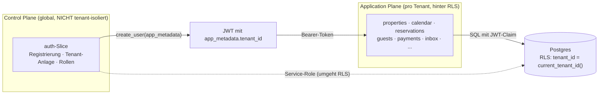

**Schlüsselpunkte:**

- `tenant_id` steht im **JWT `app_metadata`**; `public.current_tenant_id()` liest sie.
- Jede Policy filtert `tenant_id = current_tenant_id()`. Tabellen ohne eigene
  `tenant_id` (`rate_plans`, `availability`, `messages`, `payments`) leiten ihn über
  den Parent ab.
- **Control Plane vs. Application Plane:** Der `auth`-Slice (Tenant-Anlage, Onboarding)
  ist _global_ — er läuft über den **Service-Role-Client**, der RLS bewusst umgeht
  (beim Registrieren existiert noch kein `tenant_id` im JWT → Henne-Ei).

### 6.1 Eigentümer-Objekt-Scope (zweite RLS-Achse, Lastenheft §4.2)

Innerhalb eines Tenants gibt es eine **zweite Isolationsachse**: ein eingeloggter
**Eigentümer** (Rolle `owner`) sieht nur SEINE Objekte, die Agentur (admin/co_admin/
staff/cleaner) den ganzen Tenant. Read-only-Stufe — Eigentümer haben keinen
Schreibzugriff.

- **Zuordnung:** `owner_property_assignments (tenant_id, user_id, property_id)`
  (Migration 0058, Vorbild `staff_property_assignments`). Die Agentur pflegt sie über
  `GET/PUT /auth/owners/{user_id}/properties` (Capability `MANAGE_OWNERS`) + UI in
  Konto → Benutzer.
- **Rolle aus dem JWT:** `public.current_user_role()` liest `app_metadata.role`
  (analog `current_tenant_id()`).
- **Durchsetzung (RLS, Migration 0059):** RESTRICTIVE SELECT-Policies via
  `public.owner_can_see_property(property_id)` auf `properties` + allen 23
  `property_id`-Tabellen. Die Funktion gibt für Nicht-owner immer `true` (Agentur-Sicht
  unverändert), für owner nur bei zugeordnetem Objekt. RESTRICTIVE = UND-verknüpft mit
  der tenant-Policy, kann also nur weiter einschränken.
- **API-Durchsetzung:** Da die FastAPI-Slices den Service-Role-Key nutzen (RLS umgangen),
  setzt die Pricing-API den Scope zusätzlich explizit durch (`overview()` filtert auf
  zugeordnete Objekte; `update()` → 403 für owner).
- **UI:** Der Eigentümer bekommt eine **eigene Fläche** statt eines reduzierten
  Agentur-Dashboards: die Route-Gruppe `web/app/(portal)/portal/*` (Übersicht,
  Kalender, Berichte, Sperrungen, Zählerstände, Dienstleistungen,
  Benachrichtigungen) mit eigener Sidebar/Topbar
  (`web/components/portal/portal-sidebar.tsx`). Die Weiche sitzt **serverseitig**
  in den beiden Layouts (`web/lib/rollen-guard.ts`), bewusst nicht in der
  Middleware: die erneuert nur Tokens und ist seit CVE-2025-29927
  (`x-middleware-subrequest`) keine Auth-Schranke. Das frühere Ausblenden von
  Menüpunkten (`OWNER_ALLOWED_HREFS` in `components/app-sidebar.tsx`) war reine
  Navigations-Kosmetik — wer `/buchhaltung` in die Adresszeile tippte, landete
  trotzdem im Agentur-Layout. Der Guard ist die zweite Verteidigungslinie, nicht
  die einzige: den Datenscope erzwingt weiterhin FastAPI
  (`require_permission` + Owner-Scope im `public_portal`-Service).
- **Abrechnung:** Der `owner_statements`-Slice setzt denselben Scope durch — eine
  Abrechnung umfasst nur die dem Eigentümer zugeordneten Objekte (`owner_properties`),
  deren Reservierungen, Provision je Objekt und Auszahlung (s. Datenmodell).
  Zusätzlich läuft die **Betragsmaske**: `total_price` (Gast-Bruttopreis) und
  `pm_payout`/`pm_payout_by_currency` (Ertrag der Verwaltung) sind für den
  Eigentümer `None` — er sieht seine Auszahlung, nicht den Verkaufspreis und
  nicht die Marge der Agentur. Beide standen vorher im PDF, das er sich selbst
  aus dem Portal herunterlädt.
- **Eine Auszahlungsformel für zwei Slices:** `owner_statements/common.py` ist die
  einzige Stelle, die rechnet — `owner_statements` (Abrechnung) und
  `public_portal` (Netto-Auszahlung je NACHT im Eigentümer-Kalender) rufen
  dieselbe Kette auf: `buchungs_payout` (`total_amount` + Extras − `channel_fee`)
  → `effektive_provision_pct` (`owner_properties.commission_override_pct` ??
  `owners.default_commission_pct`) → `owner_payout` → `payout_je_nacht`
  (gleichmäßig über die Nächte, letzte Nacht trägt die Rundungsdifferenz, sodass
  die Summe exakt dem Buchungs-Payout entspricht). Ohne diesen Ort stünde die
  Formel zweimal im Code und liefe auseinander — der Kalender zeigte eine andere
  Zahl als die Abrechnung über denselben Zeitraum. Fehlt eine Rechengrundlage,
  gibt es **keinen** Ersatzwert: `PayoutUnbekannt` benennt den Grund
  (`provision` | `provision_ungueltig` | `betrag` | `naechte`), und die UI zeigt
  eine leere Zelle mit erkennbarem Grund statt einer erfundenen Zahl (Wurzel 4).

### 6.2 DB-Direktpfad geschlossen (Wurzel 6, Migrationen `0336`–`0339`)

RLS erzwingt nur den **Mandanten**. Ein Client mit gültigem JWT und dem
öffentlichen anon-Key spricht PostgREST/Realtime direkt an und umgeht FastAPI
samt Rollen-Datensplit (§4.3), Gast-Maskierung und Owner-read-only komplett.
Supabase grantet `anon`/`authenticated` per Default volles DML auf `public` —
solange dieser Grant steht, sind Service-Layer-Prüfungen gegen ein `curl` auf
`/rest/v1/<tabelle>` wirkungslos. Diese vier Migrationen schließen das:

- **`0336` Gast-PII** — `revoke select,insert,update,delete on public.guests from
  anon, authenticated`, zusätzliche restriktive `for all`-Policy
  `guests_tenant_restrict`, `guests` aus der Publication `supabase_realtime`
  entfernt. Zusätzlich `alter default privileges … revoke select on tables`
  (Rollen `supabase_admin` und `postgres`), damit eine künftige Tabelle nicht
  wieder offen entsteht.
- **`0337_direktpfad_sensible_tabellen_schliessen`** — die Fortsetzung über
  **alle** sensiblen Tabellen: Gast-Akte, Nachrichten/Posteingang/WhatsApp,
  OTA-Inbound (`channex_*`, `ota_account`), Eigentümer/Vertrieb/Buchhaltung
  (`owners`, `owner_properties`, `customers`, `quotes`, `travel_agency*`,
  `number_sequences`), Auszahlungen/Abos, Nutzer und Zugänge (`users`,
  `user_mfa`, `user_auth_tokens`, `login_devices`, `platform_admins`,
  `api_clients`), Gebäude- und Objekt-Interna (`property_access`,
  `property_guest_portal`, `property_housebook`, …). Dazu 40 Policies (37 davon
  `as restrictive for all`, Kindtabellen über ein `exists(...)` auf die Eltern),
  76 Tabellen aus `supabase_realtime` entfernt, `revoke create on schema public
  from anon, authenticated` als Backstop und der Entzug der Default-Privilegien
  auf Tabellen und Sequenzen.
- **`0339`** — kürzt das anon-Leserecht katalogseitig auf das Nötige: eine
  Schleife entzieht `anon` auf **jeder** `public`-Tabelle mit verbliebenem
  `select` sämtliche Rechte. Übrig bleiben **genau zwei**:
  `property_categories` und `property_subtypes` (die öffentliche
  myBestDays-Taxonomie).

**Bewusst offen bleibt** eine Leseschicht für `authenticated` (Schreibrechte
entzogen, RLS entscheidet die Zeilen): `reservations`, `properties` +
Objekt-Detailtabellen, `availability`/`stop_sell`, Preis- und Rate-Plan-Tabellen,
`tasks`/Checklisten, `site_pages`/`site_blocks`, `notifications`,
`support_tickets`/`support_messages` u. a. — sie speisen die Realtime-Abos der
Oberfläche. Für den Gast (`portal_guest`) bleiben `guest_message_threads` und
`guest_messages` lesbar, jetzt aber ausschließlich über die eigene
`auth.uid()`-Policy statt über den Tenant.

**Folge für Realtime:** Jedes Abo auf eine der geschlossenen Tabellen ist seither
eine **stumme Attrappe** — die UI sieht live aus und aktualisiert nie. Betroffene
Ansichten hören auf eine erlaubte Quelle (meist `reservations`) oder verzichten
auf das Abo. Prüfen mit `bash scripts/realtime/abos-pruefen.sh`.

**Verifikation:** `bash scripts/security/direktpfad-pruefen.sh` (nicht von Hand
prüfen). Das Skript geht per SSH auf die Server-DB und probiert für 99 Tabellen
je Rolle (`anon`, `authenticated`) SELECT/INSERT/UPDATE/DELETE innerhalb einer
zurückgerollten Transaktion durch. Entscheidend: **eine leere Ergebnismenge gilt
NICHT als Beweis** — nur `SQLSTATE 42501` (`insufficient_privilege`) zählt als
„dicht". Danach prüft es gegen, dass `service_role` alle Tabellen weiterhin lesen
UND schreiben kann, damit die Härtung nicht den FastAPI-Pfad mit abgeklemmt hat.
Exit 0 nur, wenn alle drei Stufen sauber sind.

**Regel für jede neue Tabelle** (auch in
[supabase/migrations/README.md](../supabase/migrations/README.md) festgehalten):
RLS + tenant-Policy reicht bei sensiblen Daten NICHT — zusätzlich `revoke` und
eine restriktive Rollen-Policy, danach `direktpfad-pruefen.sh`.

---

## 7. Kritische Flows (Sequenzdiagramme)

### 7.1 Registrierung (atomar mit Rollback)

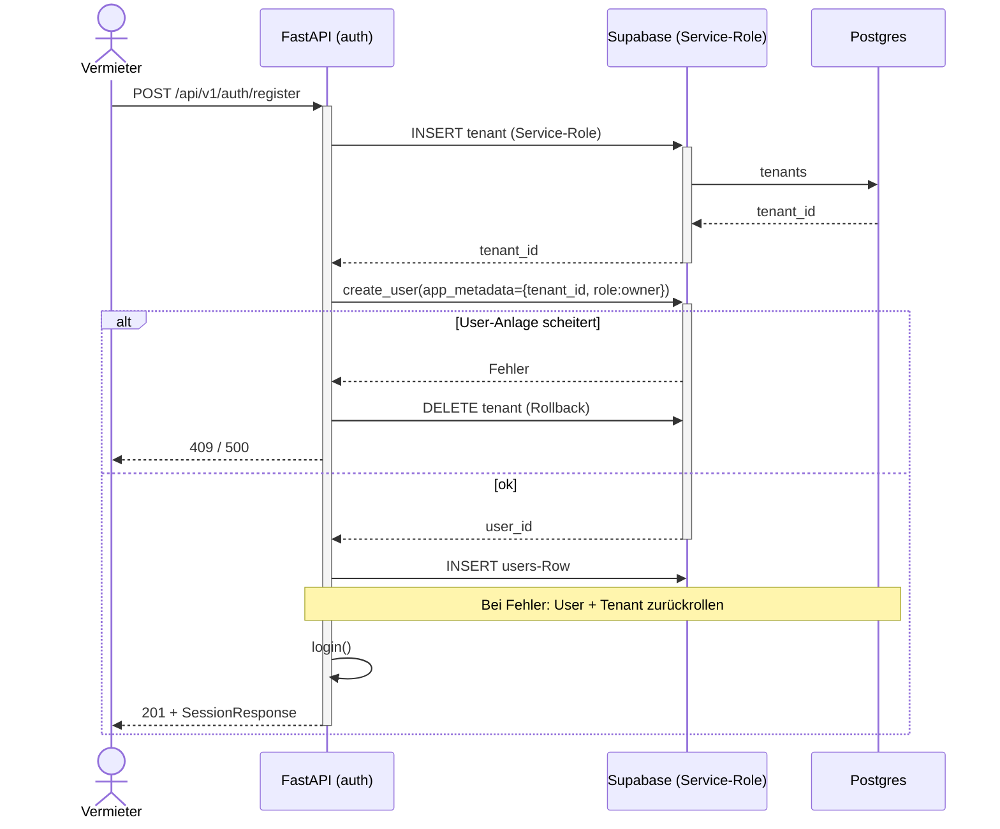

### 7.1a Social-Login (Google via Supabase OAuth)

Neben dem FastAPI-Login („E-Mail/Passwort", Cookies `nd_access`/`nd_refresh`)
gibt es einen Social-Login über **Supabase Auth**. Der Browser spricht hier
direkt mit Supabase (publishable Key), die Session liegt in den Supabase-
Auth-Cookies (`@supabase/ssr`). Das Dashboard-Gate akzeptiert **beide**
Session-Arten.

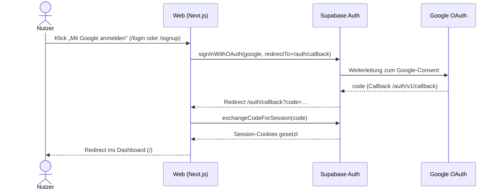

- **Google-Client:** OAuth-Client-ID in Google Cloud (Projekt `nextdays`),
  Redirect-URI = `https://<ref>.supabase.co/auth/v1/callback`. Das Client-Secret
  liegt **nur** in Supabase (Provider-Konfiguration), nie im Repo.
- **Apple:** vorgesehen, aber noch nicht konfiguriert (Buttons deaktiviert).
- **Rollen/Tenant:** ein per Social-Login angelegter Nutzer hat noch keine
  FastAPI-Rolle; das Profil/Tenant-Mapping folgt im auth-Slice.

### 7.2 Direktbuchung mit Double-Booking-Schutz

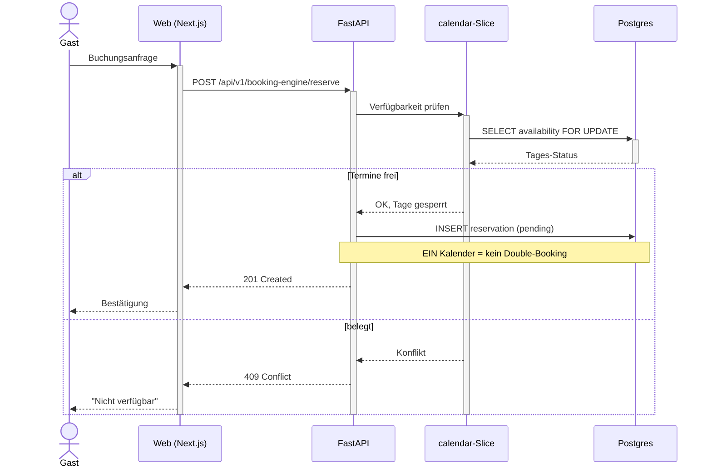

### 7.3 Auto-Aufgaben bei Buchung + Vertretung (§2.5/§4.3)

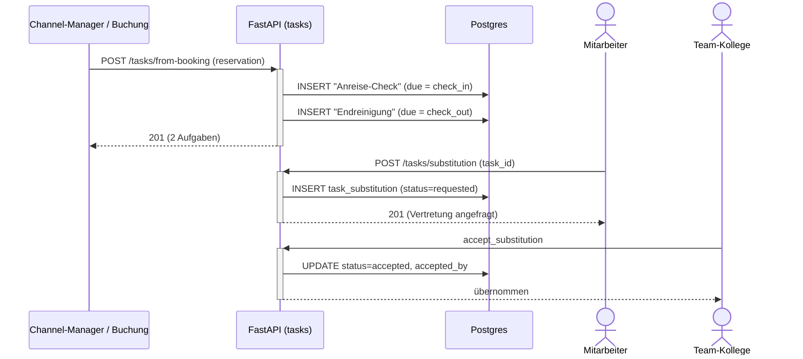

---

## 8. Reservierungs-Lifecycle (State)

`reservation.status` ist eine echte State-Machine.

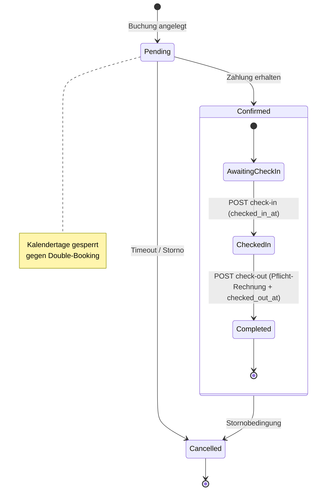

Beim **manuellen Anlegen** über den Kalender (`POST /api/v1/reservations`,
Reservierungs-Assistent im Vermieter-Dashboard) kann der Vermieter den Status
direkt auf `confirmed` setzen; das Backend belegt sofort die Übernachtungstage
in `availability` (= `booked`).

Seit `0091` sind Check-in/Check-out **echte Übergänge** (Front-Desk-Buttons im
Buchungs-Slider): `checked_in_at`/`checked_out_at` persistieren den Zustand,
`completed` wird beim Check-out gesetzt. Der Check-out erzeugt verpflichtend
die finale Rechnung (siehe Abschnitt Check-in/Check-out + Zimmerrechnung) —
ohne Rechnung kein Übergang nach `Completed`.

---

## 9. Deployment & Skalierung

DSGVO-konform, self-hosted bevorzugt. EU-Datenresidenz als harte Grenze.

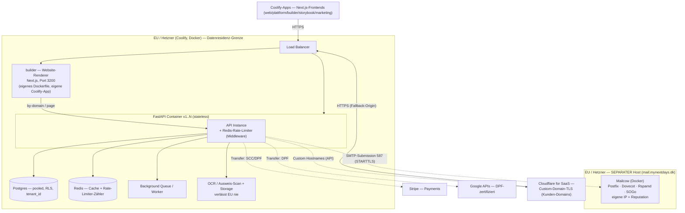

> **Worker spricht Coolifys API (Deploy-Spiegel):** Der Worker hängt neben
> `supabase-internal` auch im Docker-Netz `coolify`
> ([`deploy/worker/docker-compose.yml`](../deploy/worker/docker-compose.yml)).
> Er liest dort den Deploy-Zustand und schreibt ihn nach `public.deploy_spiegel`,
> damit das Backoffice ihn per Realtime abonnieren kann statt zu pollen (Details:
> [API.md → Deploy-Monitor](API.md#platform_admin--deploy-monitor-apiv1platformdeploy)).
> Das ist **ausgehender** Verkehr — die Regel „der Worker braucht kein
> coolify/Traefik-Netz" gilt für eingehenden: er nimmt weiterhin nichts an
> (keine Ports, keine Traefik-Labels). Ohne diesen Netz-Eintrag löst
> `COOLIFY_API_URL` den Host `coolify` nicht auf und der Monitor bleibt leer.

> **Mailserver bewusst auf separatem Host:** Ein Mailserver braucht exklusive Ports
> (25/465/587/…) und eine saubere IP-Reputation und darf beim Crash NICHT den
> DB-Stack mitreißen (Regel „Worker nie in DB-Stack"). Deshalb läuft Mailcow auf
> einem eigenen Hetzner-Server außerhalb der Coolify-Datenresidenz-Gruppe, aber
> weiterhin in der EU. Die API erreicht ihn nur outbound über SMTP-Submission (587,
> STARTTLS). Setup/DNS/Härtung: [`deploy/mail/`](../deploy/mail/README.md).

**Prinzipien:**

- FastAPI **zustandslos & containerisiert** → horizontale Skalierung (`x1..N` hinter LB).
- Aller State (Postgres, Redis, Queue, Storage) **externalisiert** — alle Instanzen
  teilen ihn, keine lokalen Daten im Container.
- **Kein** Serverless (Cold Starts, DB-Pooling-Probleme bei langlaufendem FastAPI).
- **US-Cloud als Compute bewusst vermieden** (CLOUD Act vs. DSGVO-Positionierung).
- Jede EU-Grenze überschreitende Kante ist mit Transfer-Rechtsgrundlage annotiert.
- **builder/** ist eine eigenständige Next.js-App mit **eigenem Dockerfile** und
  eigener Coolify-App (Port 3200) — die öffentlichen Vermieter-Websites skalieren
  unabhängig vom Dashboard. Kunden-Domains terminieren TLS über **Cloudflare for
  SaaS** (Custom Hostnames → Fallback-Origin).
- **Rate-Limiting & Backpressure:** Redis-backed Fixed-Window-Limiter als
  ASGI-Middleware (`core/ratelimit.py` + `ratelimit_middleware.py`; gestaffelte
  Buckets, 429 + `Retry-After`/`X-RateLimit-*`, fail-open außer Auth/Payments)
  plus `statement_timeout` für `service_role` (`0085`) — Details in
  **[deploy/RATE-LIMITING.md](../deploy/RATE-LIMITING.md)**.

---

## 10. Backend-Aufbau (Vertical Slices)

Pro Feature ein **in sich geschlossener Slice** unter `apps/api/src/features/<name>/`:

```
features/auth/
├── router.py        # HTTP-Endpoints (FastAPI APIRouter)
├── service.py       # Business-Logik
├── schemas.py       # Pydantic-Modelle (explizit typisiert)
├── dependencies.py  # slice-spezifische Dependencies (optional)
└── tests/           # Tests des Slice
```

Gemeinsame Infrastruktur in `apps/api/src/core/`:

| Modul         | Inhalt                                                                |
| ------------- | --------------------------------------------------------------------- |
| `config.py`   | `Settings` mit `SecretStr` für alle Secrets                           |
| `logging.py`  | structlog (Console lokal, JSON in Produktion)                         |
| `supabase.py` | Client-Factory — Anon (RLS) und Service-Role (System) getrennt; jeder Client bekommt einen Retry-Transport gegen tote Keep-Alive-Verbindungen (Kong beendet idle HTTP/2, teils erst NACH den Headern → der Body wird schon im Transport gelesen). Nach begonnener Antwort wird nur GET/HEAD/OPTIONS wiederholt, sonst liefe ein POST doppelt (Wurzel 2). |
| `security.py` | Supabase-JWT-Verifikation (ES256/JWKS) → `AuthContext`, `CurrentUser` |
| `mail.py`     | SMTP-Versand (`MailService`, `OutboundMessage`) — Transport, MIME, Header |
| `mail_sprache.py` | Sprachregel: `SUPPORTED` (24 EU-Amtssprachen), `FALLBACK = "en"`, `normalisieren`, `aufloesen` |
| `mail_texte.py`   | Der Mail-Textkatalog `TEXTE[schlüssel][sprache]` + `text()`; `MailTextFehlt` bei unbekanntem Schlüssel |
| `mail_empfaenger.py` | Woher die Sprache eines Empfängers kommt (`users`/`owners`/`tenants`) |
| `mail_layout.py`  | Der Marken-Rahmen: `MailInhalt` → `GerenderteMail` (Text **und** HTML) |

### Mailversand: Layout, Sprache, Texte (`core/mail_*`)

Vier Schichten, bewusst getrennt — `mail_sprache` (Regel) ← `mail_texte`
(Wortlaut) und `mail_empfaenger` (DB-Lesung) ← `mail_layout` (Form); `mail.py`
kennt keine davon und weiß nur von SMTP und MIME.

**Sprache — eine Kette, kein Default.** `aufloesen(*quellen)` nimmt die erste
Quelle, die eine unterstützte Sprache liefert:

1. **am Empfänger** — `users.preferred_language`, `owners.language`,
   `guests.language`, `portal_guests.preferred_locale`
2. **am Betrieb** — `tenants.default_language`
3. **Englisch** (`FALLBACK`)

Regionsvarianten werden auf die Basissprache gekappt (`de-AT` → `de`, `pt_BR` →
`pt`); ein unbekannter Code ergibt `None`, damit die Kette **weiterläuft** statt
sofort auf Englisch zu fallen. Es gibt bewusst **keine** Stufe „Browsersprache
des Aufrufers": beim Anlegen eines Eigentümers sitzt der *Betreiber* an der
Tastatur, sein `Accept-Language` sagt über den Empfänger nichts (Wurzel 4).
Englisch statt Deutsch als letzter Rückfall, weil Deutsch eine inhaltliche
Behauptung über den Empfänger wäre. Die Spalten kamen mit **`0335`**
(`owners.language`, `tenants.default_language`), zusammen mit einem CHECK gegen
die 24 Codes auf beiden neuen Spalten **und** auf dem bestehenden
`users.preferred_language` — `NULL` bleibt erlaubt und heißt ehrlich „nicht
erfasst", ein `not null default 'de'` wäre ein erfundener Wert.

**Texte** liegen als Python-Dict `TEXTE[schlüssel][sprache]` in `mail_texte.py`,
nicht in `web/messages/*.json`: der Backend-Container hat das Frontend-Verzeichnis
nicht, und Mailtexte ändern sich mit einem Geschäfts-/Rechtsprozess, nicht mit
der Oberfläche. Jeder Schlüssel trägt alle 24 Sprachen, und jede Übersetzung muss
dieselben `{platzhalter}` enthalten — beides erzwingt `test_mail_texte.py`. Ein
unbekannter **Schlüssel** wirft `MailTextFehlt` (Programmierfehler, fail-closed:
lieber keine Mail als ein roher Key im Postfach); eine unbekannte **Sprache**
fällt still auf Englisch.

**Layout.** `mail_rendern(MailInhalt, marke=…)` erzeugt aus EINER Quelle die
Text- und die HTML-Fassung. Tabellenlayout mit ausschließlich inline gesetzten
Styles, 600 px Inhaltsbreite — Outlook 2016/2019/2021 rendert mit der
Word-Engine, dort gibt es kein Flexbox/Grid und keine verlässliche
`<style>`-Kaskade. Zwei Marken, zwei Absender: `marke_nextdays` (Standard, PMS)
und `marke_bestdays` (Marktplatz — heute nur die Bewertungserinnerung an den
Gast). Das **Logo reist als CID-Anhang** (`inline_bilder`, `LOGO_CID`), nicht als
URL und nicht als Data-URI: Data-URIs verwerfen Gmail und Outlook, und eine
gehostete URL bräuchte einen öffentlich erreichbaren Host mit gültigem Zertifikat
— lokal und auf Staging gibt es den nicht. Der Kopfbereich setzt seine **eigene
dunkle Fläche** und trägt die `-light`-Logovariante, damit die Darstellung auch
nach der Dunkelmodus-Invertierung von Apple Mail stimmt. Jeder eingesetzte Wert
läuft durch `html.escape`; Link-Ziele werden gegen die Schema-Allowlist
`http`/`https`/`mailto` geprüft und sonst fail-closed abgelehnt
(`MailLayoutError`, Wurzel 8) — nicht „bereinigt". Fehlen die Anbieterangaben
(`COMPANY_LEGAL_NAME`), steht das als **sichtbarer Satz** im Fuß, statt still zu
fehlen.

**Kopfzeilen (`mail.py`).** `Date` (RFC 5322 §3.6) und `X-Mailer` werden gesetzt,
weil rspamd eine Testmail sonst mit `MISSING_DATE`/`MISSING_XM_UA` bewertet und
sie im Spam landete — weder Python (`EmailMessage` setzt kein `Date`) noch das
eigene Postfix (`always_add_missing_headers = no`) ergänzt sie. Marketing-Mails
erkennt `OutboundMessage` an einer gesetzten `unsubscribe_url` und bekommen
`List-Unsubscribe` + `List-Unsubscribe-Post` (RFC 8058 One-Click); alles andere
ist transaktional und bekommt stattdessen `Auto-Submitted: auto-generated`
(RFC 3834), damit keine Abwesenheitsnotiz zurückläuft.

**Wer sendet so:** `auth/einladung_service` (Einladung, Passwort-Reset),
`notification_settings/dispatcher` (alle Glocken-Kategorien),
`reviews/automation` (Gast-Erinnerung, myBestDays), `newsletter/service`,
`platform_admin/team_service` (Backoffice-Einladung/-Reset),
`calendar/sperrantraege` und `channel_manager/airbnb_zimmer_push`.

**Slices (Auswahl, namentlich):** `auth` · `properties` · `rates` · `pricing` ·
`calendar` · `reservations` · `guests` · `inbox` · `whatsapp` · `payments` ·
`channel_manager` · `booking_engine` · `addons` · `owners` · `owner_statements` ·
`buchhaltung` · `travel_agencies` · `reviews` · `guest_reviews` · `site_config` ·
`ocr` · `public_portal` · `tasks` · `crm` · `dashboard` · `content` ·
`notification_settings` · `announcements`. Der Ordner
`apps/api/src/features/` führt darüber hinaus weitere Slice-Bausteine
(`platform_admin`, `support`, `payouts`, `subscriptions`, `guest_*`, …) —
Router-Prefixe je unter `/api/v1`. Zwei Slices mounten **zwei** Router:
`site_config` (`/site-config` fürs Dashboard, `/site` als öffentlicher Resolver)
und `announcements` (`/announcements` für die Betriebsleitung,
`/platform/announcements` fürs Backoffice).

Die kleineren (`ocr`, `crm`) sind Health-/Gerüst-Slices; `dashboard`/`content`
minimal. Der Rest ist mit Geschäftslogik ausgebaut: u. a. `tasks`
(Aufgaben/Checklisten), `owners`/`owner_statements` (Eigentümer-Scope +
Auszahlungs-Abrechnung), `buchhaltung` (Rechnungen/Firmenprofil), `whatsapp`
(WhatsApp Cloud API im Posteingang), `addons` (Upsells). Der `payments`-Slice nutzt ein **Gateway-Adapter-Pattern**
(Stripe Connect Custom primär, Revolut sekundär/konfigurierbar —
[ADR-0011](decisions/0011-zahlungs-gateway-stripe-primaer.md), ersetzt ADR-0003).

Alle Router unter dem gemeinsamen Prefix **`/api/v1`** (versioniert von Anfang an).
`auth` ist als Referenz-Muster voll implementiert (siehe **[API.md](API.md)**).

---

## 11. Frontend & Design-System (apps/web)

- **Next.js** (App Router, TS) mit **Bun**; UI im **shadcn-Stil** (CVA + Radix-Slot
  - `cn`), Icons über **Iconify** (kein lucide-react, PROJECT.md §2).
- **Tailwind v4** über `@theme` in `styles/globals.css` — **kein**
  `tailwind.config.ts`. Light/Dark via `next-themes` (`.dark`-Klasse).
- **Design-Tokens** sind die einzige Quelle der Wahrheit für Farben/Radius
  (`:root` + `.dark` in `globals.css`). Startwerte aus dem NextDays-Logo
  (Primär `#0a0a0a`, Akzent-Rot `#b82028`) — **vorläufig, vom Designer
  überschreibbar**. Komponenten referenzieren nur semantische Tokens.
- **Storybook** (react-vite) als lebende Komponenten-Doku & Design-System-Brücke
  ([ADR-0008](decisions/0008-storybook-design-system.md)) — **live deployt**
  als Coolify-App `nextdays-storybook`
  (https://u67kn5pj9cb2gqryt2ezsc8r.65.21.144.136.sslip.io/sb) — **zugangsgeschützt** (Login
  erforderlich, siehe Auth-Proxy unten; enthält die ganze Idee + sensible Daten,
  daher kein öffentlicher Zugriff). Addons: `addon-docs` (MDX/Autodocs),
  `addon-a11y` (WCAG-Prüfung), `addon-themes` (Light/Dark), `addon-designs`
  (Figma-Einbettung).
- **Bibliotheks-Umfang** (deckungsgleich mit den Lastenheft-Modulen):
  - **20 UI-Bausteine** (`UI-Bausteine/…`): Input, Label, Textarea, Select,
    Checkbox, Switch, Badge, Avatar, Dialog, DropdownMenu, Tabs, Tooltip,
    Popover, Accordion, Separator, Table, Skeleton, Alert, Progress, Breadcrumb
    (+ Button, Card).
  - **15 PMS-Komponenten** (`PMS-Komponenten/…`, je mit Modul-/Tabellen-Bezug):
    Status-Badges, Rollen-Badge, Preis-Anzeige, Kanal-Icon, Objekt-Karte,
    Reservierungs-Karte, Saison-Legende, Kalender-Tageszelle, **Multi-Kalender
    (§2.2 Herzstück)**, Aufgaben-Checkliste, Inventar-Zeile, Nachrichten-Bubble,
    Onboarding-Stepper (§6), Berechtigungs-Matrix (§4), Zahlungs-Zeile.
  - **7 Eigentümer-Doku-Seiten** (`Einführung/…`, MDX, nicht-technisch): Was ist
    NextDays · Rollen & wer sieht was · Der Multi-Kalender erklärt · Preissystem
    · Nachrichten & Automatisierung · Aufgaben & Checklisten · Häufige Fragen.
  - **Architektur-Diagramme** (`Architektur/…`, MDX): technische C4-/ER-/Flow-
    Diagramme **und** Eigentümer-freundliche „So funktioniert es"-Diagramme.
  - **Austausch/Team-Chat** (`Austausch/…`, MDX): Echtzeit-Chat fürs Team
    (Supabase Realtime, siehe unten).
  - **Design/Tokens**: visuelle Token-Palette.
- Status-Tokens `--success` / `--warning` in `globals.css` ergänzt (für die
  Status-Badges), weiterhin als semantische Tokens — kein Hardcoding.

**Trennung App ↔ Design-System (bewusst entkoppelt):** Das Storybook ist ein
**eigenständiges Package `apps/storybook`** — die Werkstatt des UX/UI-Designers.
UI-Komponenten entstehen dort; eine fertige Komponente wird **erst dann** ins
Web-Projekt `apps/web` übernommen. So bleibt `apps/web` schlank und enthält keine
in Entwicklung befindlichen Komponenten.

```
apps/web/                # Next.js — App-Gerüst (Dashboard/Portal)
├── app/                 # Route-Gruppen (auth)/(dashboard)/(portal)/(public)
│   ├── (auth)/          # Anmeldung + die Token-Strecken ohne Session:
│   │                    #   einladung/ · passwort-vergessen/ · passwort-neu/
│   ├── (dashboard)/     # Agentur-Fläche (admin/co_admin/staff/cleaner), u. a.
│   │                    #   kalender/sperrantraege/ · neuerungen/
│   ├── (portal)/portal/ # Eigentümer-Fläche (Rolle owner) mit eigener Sidebar:
│   │                    #   kalender · berichte · sperrungen · zaehlerstaende
│   │                    #   · dienstleistungen · benachrichtigungen
│   └── (public)/marketing/   # Öffentliche Marketing-Landingpage (kein Auth-Gate)
├── components/marketing/     # Sektions-Komponenten der Landingpage (Hero, Trial, …)
├── public/marketing/channels/ # Buchungskanal-Logos (Booking.com, Airbnb, …)
├── public/marketing/reviews/  # Review-Plattform-Logos (Capterra, Trustpilot, …)
├── lib/rollen-guard.ts  # Serverseitige Weiche (dashboard) ↔ (portal), Wurzel 9
└── lib/supabase/        # Browser- + Server-Client (@supabase/ssr)

apps/storybook/          # Design-System + Auth-Proxy (eigenes Package, eigene Coolify-App)
├── app/                 # Next.js App Router (Auth-Hülle vor dem Storybook)
│   ├── login/           # Login-Seite (Supabase signInWithPassword)
│   ├── admin/           # Admin-Bereich: Nutzer anlegen (Sofort-Passwort)
│   ├── api/users/       # Service-Role: Nutzer anlegen/listen (nur Admins)
│   └── sb/[[...path]]/  # Catch-all: liefert das GESCHÜTZTE Storybook aus
├── middleware.ts        # Auth-Gate: jede Route außer /login + /api verlangt Session
├── protected/sb/        # statisch gebautes Storybook (privat, nie direkt erreichbar)
├── components/
│   ├── ui/              # 22 shadcn-Stil-Primitive
│   ├── pms/             # 15 fachliche PMS-Komponenten
│   └── docs/            # team-chat.tsx (Realtime) · mermaid.tsx (Diagramme)
├── stories/
│   ├── ui/ · pms/       # Stories je Komponente
│   └── *.mdx            # Eigentümer-Doku · Architektur · Austausch · Design/Tokens
├── lib/
│   ├── utils.ts         # cn()
│   ├── supabase-server.ts   # updateSession() für Middleware
│   ├── supabase-browser.ts  # Browser-Client (Login)
│   └── supabase-chat.ts     # SSR-Browser-Client (Chat sieht Login-Session)
├── styles/globals.css   # Tailwind v4 @theme — Tokens (Quelle der Wahrheit)
└── .storybook/          # main.ts · preview.tsx · BUILD_REFERENCE.md (Bau-Standard)
```

### Zugangsschutz: Auth-Proxy vor dem Storybook

Das Storybook enthält die gesamte Produktidee und sensible Daten — es darf nur
von befugten Personen gesehen werden. Statt eines statischen Builds liegt vor dem
Storybook eine **Next.js-Auth-Hülle** im selben Package:

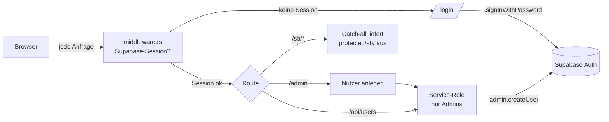

- **`middleware.ts`** prüft serverseitig die Supabase-Session. Ohne Session →
  Redirect auf `/login`. Greift auch für **alle** Storybook-Assets (`/sb/*`),
  sodass nichts ohne Login ausgeliefert wird. `/api/*` antwortet selbst mit
  `403`-JSON statt Redirect.
- Das Storybook wird statisch nach **`protected/sb/`** gebaut (außerhalb von
  `public/`, daher nicht direkt erreichbar) und nur über den Catch-all
  `/sb/[[...path]]` mit gültiger Session ausgeliefert. In die `index.html` wird
  `<base href="/sb/">` injiziert, damit relative Asset-Pfade auflösen.
- **Accounts gibt es nur per Admin** (`/admin` → `/api/users`, Service-Role-Key
  bleibt serverseitig). Kein Self-Signup. Optionale strikte Allowlist über
  `STORYBOOK_ALLOWED_EMAILS`; Admins über `STORYBOOK_ADMIN_EMAILS`.

### Echtzeit-Austausch (Team-Chat)

`Austausch/Team-Chat` ist ein Echtzeit-Chat direkt im Storybook über **Supabase
Realtime** (Tabelle `storybook_chat`, Migration `0020`, Publication
`supabase_realtime`). Der Chat nutzt **dieselbe Login-Session** (SSR-Browser-
Client) — der Anzeigename kommt automatisch aus dem eingeloggten Account, keine
zweite Anmeldung. Seit `0337` hat der **anonyme** Schlüssel auf `storybook_chat`
gar keine Rechte mehr (`revoke select,insert,update,delete … from anon`); lesen
und schreiben darf nur noch `authenticated` (`update`/`delete` entzogen), und die
Lese-Policy `storybook_chat_read` verlangt eine angemeldete `auth.uid()`. Vorher
durfte der anon-Key `SELECT` + `INSERT` — ein nicht angemeldeter Besucher konnte
also mitlesen und schreiben. Der Chat ist bewusst von allen PMS-/Kundendaten
getrennt.

**Grundsatz Realtime statt Polling:** Datengetriebene Ansichten aktualisieren sich
über **Supabase Realtime (WebSocket, `postgres_changes`)** — kein Polling, kein
manuelles Reload. Zentraler Hook **`apps/web/lib/use-realtime.ts`**: ein
dedizierter Realtime-Client als **Modul-Singleton** (nur für Realtime, getrennt
vom Auth-Client), der **zwingend `realtime.setAuth(App-JWT)` VOR `.subscribe()`**
aufruft — sonst joint der Channel mit anon-Claims und es kommen **0 Events**
(RLS filtert alles weg). Der Hook abonniert eine Tabelle (optional gefiltert),
debounced die Events und folgt dem **Server-Props-Sync-Muster**: pro Seite eine
`<Domain>Realtime`-Komponente, die alle speisenden Tabellen abonniert und bei
Änderung `router.refresh()` (+ ggf. gezieltes Neuladen) auslöst — die Seite
bleibt server-gerendert, Realtime triggert nur den Refresh. Beispiele:
`property-realtime.tsx` (Objektseite), `calendar-board` (Preise, `0052`),
`owner-realtime.tsx` (Eigentümer-Seite: `owners`/`owner_properties`/
`owner_expenses`/`owner_statements`/`reservations`, Publication via `0071`).
Voraussetzung je Tabelle: Aufnahme in die Publication `supabase_realtime` per
Migration.

**Posteingang-Automails (inbox, Migration `0072`):** Planbare Auto-Nachrichten
(Buchungsbestätigung, Anreise-/Check-out-Info). `message_automation` (0037) trägt
zusätzlich `anchor` (arrival|departure|booking), `send_time`, `offset_days`
(vorzeichen-behaftet) sowie die Zuweisung `property_ids[]`/`channels[]` (leer =
alle, **UND-verknüpft**: Haus UND Kanal). Bei jedem Booking-Import plant
`schedule_automations_for_thread` je passender Regel eine Zeile in
`automation_scheduled_message` (Dedup über `(automation_id, thread_id)`); der Cron
`POST /inbox/internal/dispatch-automations` versendet fällige (Channex). Kein
Fallback bei fehlendem Ankerdatum (übersprungen). Beide Tabellen sind in der
Realtime-Publication. Kanäle sind OTAs **und** der eigene Marktplatz „myBestDays"
(gleichwertiger Buchungskanal, kein „Direkt").

**Posteingang-Ausbau (inbox, Migrationen `0257`–`0260`):**

- **Platzhalter** (`inbox/felder.py`): 22 Merge-Felder (`{{guest_first_name}}`,
  `{{check_in_date}}`, …) in vier Gruppen. Schlüssel sprachneutral englisch,
  Beschriftung aus `inbox.field_*`. Aufgelöst wird **beim Senden**, nicht beim
  Planen (ein Türcode steht oft erst kurz vor Anreise fest). Fehlender Wert →
  Abbruch mit Feldliste, nie ein Ersatzwert (Wurzel 4); unbekannter Schlüssel
  beim Speichern → 422.
- **Auslöser `message_received`** (`0257`): Abwesenheitsantwort mit Wochentags-
  und Uhrzeitfenster (auch über Mitternacht) und „nur erste Nachricht".
  Angestoßen vom Channex-Webhook-Event `message`; der Dedup-Index
  `(automation_id, thread_id)` begrenzt sie auf einmal je Thread. Da
  `automation_scheduled_message.thread_id` per FK auf `channex_booking` zeigt,
  gilt der Auslöser nur für OTA-/Plattform-Threads, nicht für WhatsApp.
- **Objekt-Zeitzone** (`0258`): `properties.timezone` (IANA, per Trigger gegen
  `pg_timezone_names` validiert) + `message_automation.use_property_timezone` —
  `send_time` als Ortszeit des Objekts. Ohne hinterlegte Zeitzone wird die
  Planung übersprungen und geloggt, statt still UTC anzunehmen.
- **Anhänge** (`0259`): privater Bucket `inbox-attachments` + `inbox_attachment`.
  Dateityp per Magic Bytes (Wurzel 8), 10 MB Deckel, Auslieferung nur per
  signierter URL. Lehnt der Kanal die Datei ab, bleibt sie gespeichert und die
  Zeile trägt `channel_error` — die Oberfläche zeigt „nicht zugestellt".
- **Wissensdatenbank** (`0260`): `inbox_knowledge_fact` (betriebsweit oder je
  Objekt) liefert dem KI-Antwortvorschlag die Angaben, die er als Fakten
  verwenden darf — vorher durfte er sich nichts ausdenken und konnte deshalb
  auf „Wie ist das WLAN-Passwort?" nur um Klärung bitten.

Beide neuen Tabellen sind für `anon`/`authenticated` gesperrt (`revoke all` +
`as restrictive for all using (false)`, Wurzel 6) und haben bewusst **kein**
Realtime-Abo — ein Abo darauf wäre eine stumme Attrappe.

**Bewertungen über alle Kanäle (Migrationen `0262`/`0263`/`0266`/`0267`):**

Bis dahin lagen die Bewertungen in zwei Welten, die sich nicht kannten: die
eigenen Marktplatz-Bewertungen in `public.reviews` (Skala 1..5, Zwei-Wege mit
`guest_reviews_by_host`, Sichtbarkeit nach dem Airbnb-Modell) und die
Portal-Bewertungen, die `ota_extras.py` bei jedem Aufruf LIVE durchgereicht hat.

- **Eigener Bestand** (`channex_review`, `0262`): der Webhook (`review`/
  `updated_review`) ist nur der AUSLÖSER, den Stand zieht `reviews_sync.py` per
  `GET /reviews/{id}` nach — Channex sichert keine Reihenfolge zu. Ohne diesen
  Bestand gäbe es kein „unbeantwortet"-Filter, keine Kennzahl über Kanäle
  hinweg, kein Realtime, und jeder Seitenaufruf kostete Portal-Requests. Grants
  wie bei `channex_booking`: `SELECT` für `authenticated` (Voraussetzung fürs
  Realtime-Abo), Schreiben nur `service_role` — eine Antwort muss zuerst beim
  Portal ankommen, sonst täuscht sie etwas vor, das den Gast nie erreicht
  (Wurzel 1). Zusätzlich Owner-/Staff-Objektscope wie bei `reviews` (0059/0136).
- **Ein Cockpit** (Slice `reviews`): liest beide Tabellen und normalisiert auf
  `UnifiedReview`. Die Rohnote bleibt mitsamt ihrer Skala erhalten (Portale
  0..10, myBestDays 1..5); `score_5` ist die umgerechnete Fassung für Sterne.
  Fehlt eine Note, bleibt sie `null` — kein Ersatzwert (Wurzel 4). Eigene
  Fähigkeiten `VIEW_REVIEWS`/`MANAGE_REVIEWS` statt weiter auf Kalender-Rechten
  mitzureiten; der Detailpfad prüft denselben Objekt-Scope wie die Liste
  (Wurzel 9). Der Slice `guest_reviews` bleibt die Gast-Seite (myBestDays);
  geteilte Helfer und die Sichtbarkeitslogik liegen in `reviews/common.py` und
  `reviews/publication.py`.
- **Automatik** (`0263`): Betrieb bewertet den Gast X Tage nach Abreise
  (optional erst ab einer Mindest-Gastnote) und/oder erinnert den Gast per
  E-Mail an seine myBestDays-Bewertung. Ausgeführt vom Worker-Tick
  (`REVIEWS_TICK_SECONDS`, stündlich), der zugleich den Fristablauf
  veröffentlicht — bis dahin war `publish_overdue` nirgends geplant, verdeckte
  Bewertungen blieben also für immer verdeckt.
- **Warteschlange** (`guest_review_queue`, `0267`): die Automatik lief anfangs
  BLIND — sie berechnete die fälligen Gäste und schickte im selben Atemzug ab.
  Der Betrieb sah nichts, konnte nichts anpassen und nichts auslassen, und eine
  abgeschickte öffentliche Bewertung lässt sich bei keinem Portal zurücknehmen.
  Seitdem legt der Tick nur einen **Entwurf** an (`status='geplant'`, mit
  `send_at` und — wo bekannt — `expires_at`); die Oberfläche zeigt die Restfrist
  und bietet Ändern · Überspringen · Sofort abschicken. Erst ein späterer Tick
  versendet. Der Status wird VOR dem Versand beansprucht (Wurzel 2), ein
  Fehlschlag landet als `fehler` samt Grund in derselben Zeile (Wurzel 5), ein
  übersprungener Eintrag BLEIBT stehen (sonst legte ihn der nächste Tick neu
  an). Portal-Entwürfe nur für Airbnb; kein Entwurf, dessen Fenster schon zu
  ist. Voll gesperrt für `anon`/`authenticated` und bewusst **ohne** Realtime —
  ein Abo wäre ohne Grant eine Attrappe, und die Schlange ändert sich stündlich.
- **Qualitäts-Dashboard** (`GET /reviews/quality`): Ø, 5-Sterne-Quote,
  Antwortquote, Kategorie-Durchschnitte, Tagesverlauf und die Rangliste der
  Objekte (schwächstes zuerst) über einen Zeitraum ≤ 366 Tage. Beide Skalen auf
  5 Sterne normalisiert; Tage ohne Bewertung bleiben OHNE Wert, statt als
  Nullpunkt einen Einbruch vorzutäuschen.
- **Website-Block** (`0266`): Blocktyp `reviews` im Page-Builder zeigt die
  eigenen, verifizierten myBestDays-Bewertungen auf der Betriebs-Website
  (gespeist vom neuen öffentlichen `guest-reviews/tenant/{id}`).

**Abgrenzung (bewusst):** Portal-Bewertungen bleiben INTERN. Öffentlich —
myBestDays-Marktplatz, Website des Betriebs — erscheinen ausschließlich eigene,
verifizierte Bewertungen; Booking.com und Airbnb erlauben das Weiter-
veröffentlichen ihrer Bewertungen nur eingeschränkt (Lodgify löst das deshalb
über den Drittanbieter Revyoos).

**Nebeneffekt:** `booking_engine._to_listing` füllt `rating`/`rating_count`
erstmals wirklich (Batch-Aggregat über veröffentlichte Bewertungen). Die
Sternanzeige in `plattform`, `builder` und `mobile-bestdays` war vorher fertig
gebaut, aber dauerhaft leer.

### Backoffice-Team (wer darf ins Backoffice?)

`platform_admins` (0202) ist die einzige Tabelle, die mandantenübergreifende
Rechte vergibt — geprüft wird sie bei JEDEM Request frisch (Wurzel 7), nie aus
dem JWT. Bis `0237` gab es dafür jedoch keinen Vergabeweg: ein neuer Kollege
brauchte einen GoTrue-Nutzer (Selbstregistrierung ist aus) UND eine Zeile per
psql. Seitdem läuft es über `/api/v1/platform/team` und die Seite
`admin/app/(backoffice)/team`:

- **Bestehendes Konto** → sofort freischalten (RPC `auth_user_id_by_email`, nur
  `service_role`, gibt ausschließlich eine uuid zurück).
- **Neue Person** → Konto mit Zufallspasswort + Einmal-Token; in der DB liegt
  nur der SHA-256, der Klartext steht nur im Link. Versand über unseren SMTP
  (`core.mail`) — GoTrue selbst hat keinen Mailzugang. Die eingeladene Person
  setzt ihr Passwort selbst unter `admin/app/einladung` (ohne Anmeldung
  erreichbar, Berechtigung ist der Token).
- **Passwort vergessen (`0279`)** → derselbe Weg, eigene Spalten
  (`reset_*`), **eine Stunde** gültig, Versand ebenfalls über `core.mail`. Die
  Anmeldung verlinkt „Passwort zurücksetzen" auf `admin/app/passwort-vergessen`,
  der Link aus der Mail führt auf `admin/app/passwort-neu` — beide ohne
  Anmeldung erreichbar (Middleware-Ausnahme), Berechtigung ist der Token. Die
  Anfrage antwortet IMMER wörtlich gleich (kein Existenz-Leak) und hat eine
  Sperrfrist von 1 Minute je Konto; nach dem Wechsel werden ALLE Sitzungen des
  Kontos widerrufen (`host_revoke_other_sessions`, `keep=NULL`, RPC aus `0191`).
  Ging die Mail nicht raus, wird der Token wieder entfernt (Wurzel 1).
  Live geprüft mit `scripts/platform/verify_backoffice_passwort_reset.py`
  (echte Server-DB, echter Mailversand — kein Mock, kein Testkonto).
- **Passwort-Eingaben** nutzen eine gemeinsame Komponente
  `admin/components/passwort-feld.tsx` mit Sichtbarkeits-Schalter (Auge,
  `aria-pressed`) — eine Stelle für Anmeldung, Einladung und Reset, damit
  Beschriftung und Verhalten nicht auseinanderdriften.
- **Aussperr-Schutz:** keine Selbst-Änderung der eigenen Rolle/Aktivität, und
  der letzte aktive `platform_admin` bleibt bestehen (409).

Rollen: `platform_admin` (voll, inkl. Freigaben/Sperren/Team) und
`platform_support` (lesend + Support-Konversationen). Durchgesetzt wird das über
`require_platform_write`, nicht über die Navigation.

### Einladung & Passwort vergessen für Betriebs-Nutzer (`0334`)

Derselbe Mechanismus wie beim Backoffice, jetzt für die Nutzer eines Betriebs
(`auth/einladung_service.py`, Tabelle `user_auth_tokens`) — und aus demselben
Grund selbst gebaut: GoTrue hat keinen SMTP-Zugang (`GOTRUE_SMTP_HOST` leer),
`reset_password_email()` läuft dort ins Leere.

- **Contract-Bruch gegenüber vorher:** `POST /auth/invite` nahm ein `password`
  entgegen, das der Wizard **im Browser** würfelte und per Zuruf weitergab — es
  lief damit durch den Browser des Einladenden und durch jedes HTTP-Log
  dazwischen. Das Feld gibt es nicht mehr; der Server legt den Auth-Nutzer mit
  einem Zufallspasswort an, das niemand kennt, und verschickt einen Einmal-Link.
- **Alles-oder-nichts:** Scheitert der Mailversand, wird die komplette Anlage
  (Auth-Nutzer + `users`-Zeile) zurückgerollt. Ein `201` bedeutet immer: Nutzer
  angelegt UND Mail raus — es entsteht nie ein Konto, zu dem niemand den Zugang
  bekommen hat (Wurzel 1).
- **Token:** 32 Byte CSPRNG, in der DB nur der SHA-256; **Einladung 7 Tage**,
  **Reset 1 Stunde**; Einlösung als bedingter UPDATE (`where used_at is null`),
  also einmalig. Nach dem Setzen werden alle weiteren offenen Tokens des Nutzers
  entwertet, nach einem **Reset** zusätzlich alle Sitzungen widerrufen.
- **Kein Orakel:** `passwort-vergessen` antwortet IMMER `200` mit demselben Text,
  auch bei unbekannter oder syntaktisch kaputter Adresse; ungültig, abgelaufen
  und verbraucht sind an der Fehlerantwort nicht zu unterscheiden. Eigener
  strenger Rate-Limit-Bucket `auth_public` (5/60 je IP, fail-closed) plus
  Sperrfrist je Konto.
- **Frontend:** `web/app/(auth)/einladung`, `…/passwort-vergessen`,
  `…/passwort-neu` — alle drei ohne Anmeldung erreichbar, Berechtigung ist der
  Token. Die Links baut der Server aus `APP_BASE_URL`; fehlt die, schlägt die
  Einladung mit `500` fehl, statt einen Link auf eine geratene Domain zu
  verschicken (Wurzel 4).

Die Mail selbst kommt aus dem Markenrahmen und in der Sprache des Empfängers
(`preferred_language` → `tenants.default_language` → Englisch) — siehe
[§10 Mailversand](#mailversand-layout-sprache-texte-coremail).

### Support-Live-Chat (Kunde ↔ Backoffice)

Der Hilfe-Eintrag im Konto-Menü des Dashboards öffnet einen **Live-Chat mit dem
myNextDays-Team** (`web/components/support/support-chat.tsx`); die Gegenstelle
ist die Agenten-Konsole im Backoffice (`admin/components/support-konsole.tsx`,
Route `/support`). Kein eigener Chat-Stack: eine Konversation ist ein Eintrag in
`support_tickets` mit ihren `support_messages` (Migrationen `0204`–`0206`,
Chat-Erweiterung `0236`) — dasselbe Vorgehen wie bei Intercom/Chatwoot, wo
Widget-Chat, E-Mail und Formular in EINEM Konversations-Stream liegen.

Drei Kanäle, drei Zuständigkeiten:

- **Nachrichten** über `postgres_changes` (RLS aus `0205`/`0206` entscheidet,
  wer welche Zeile sieht — interne Notizen sind für den Melder ausgeschlossen).
- **Tippt-Anzeige** über Supabase **Broadcast** auf dem privaten Topic
  `support:<ticket_id>` — flüchtig, ohne DB-Schreiblast, gedrosselt auf 2 s.
- **Anwesenheit** („Wir sind gerade da") über Supabase **Presence** auf
  `support:presence`. Autorisiert wird beides per RLS auf `realtime.messages`
  (`0236`): zuhören darf, wer Teilnehmer ist; **eintragen** nur ein aktiver
  Plattform-Admin — ein Kunde kann sich nicht als Team ausgeben.

Lese-Cursor je Seite (`reporter_last_read_at`/`agent_last_read_at`) statt einer
Lesebestätigungs-Tabelle (Chatwoot-Muster, zwei Parteien), Vorschau der letzten
SICHTBAREN Nachricht auf der Konversation, und `client_msg_id` mit partiellem
UNIQUE-Index als Idempotenz-Backstop (Wurzel 2) — derselbe Schlüssel ersetzt im
Frontend die optimistisch angezeigte Nachricht beim Realtime-Echo.

---

## 12. Page-Builder

Jeder Mandant kann eine eigene **White-Label-Website** betreiben — myNextDays als
Baukasten, PMS-integriert (Suche, Objektlisten und Buchung docken direkt an den
Datenkern an). Verbindliche Feature-Spezifikation und Bau-Vorlage des Editors ist
**[docs/FRAMER-FEATURES.md](FRAMER-FEATURES.md)** (Soll/Ist je Feature mit
✅/🟡/❌-Status). Drei physisch getrennte Ebenen:

1. **Editor (`apps/web`)** — Framer-artiger visueller Canvas-Editor auf
   **craft.js** (`@craftjs/core`/`layers`/`utils`) als Vollbild-Overlay über dem
   Dashboard (`app/(dashboard)/website/[pageId]/page.tsx`). Die Seite wird
   serverseitig geladen (`listBlocks()`); `serialize.ts` konvertiert die flache
   DB-Blockliste in craft.js-Nodes am ROOT-Canvas. Beim Speichern diff't
   `syncBlocks()` (`lib/site-pages.ts`) den serialisierten craft-Baum gegen die
   DB über die einzelnen CRUD-Endpunkte (löschen/aktualisieren/anlegen/neu
   ordnen — **kein Bulk-Endpoint**); frische DB-IDs fließen zurück in die
   craft-Props. Editor-Features: unendliche Bühne mit Kamera (Pan,
   Zoom-zum-Cursor, `use-camera.ts`), Device-Frames/Breakpoints (Desktop 1200 /
   Tablet 810 / Phone 390 + Custom, Resize per Ziehgriff mit Live-Maß-Badge),
   Layer-Tree, Insert-Panel, Framer-Style-Inspektor
   (Seiten-/Frame-/Element-Ebene), Font-Picker (kuratierter Katalog + voller
   Google-Fonts-Katalog über die Next-Route `/api/google-fonts`), Inline-Text,
   Effekte/Motion. Der Editor nutzt bewusst **kein** Realtime; die Seitenliste
   (`/website`) abonniert `site_pages`.
2. **Backend (`apps/api`, Slice `site_config`)** — zwei Router:
   `manage_router` (`/api/v1/site-config`, JWT + Capability
   `MANAGE_SITE_CONFIG`, tenant-gescoped) und `public_router` (`/api/v1/site`,
   JWT-los). Der Service arbeitet immer mit dem Service-Role-Client + explizitem
   tenant-Scope aus dem JWT; RLS ist der default-deny-Backstop. Block-`content`
   wird **pro Typ strikt gegen Pydantic-Schemas validiert**. Alle Endpunkte im
   Detail: **[API.md → site_config](API.md#site_config-page-builder--implementiert)**.
3. **Renderer (`builder/`)** — eigenständige Next.js-App (Port 3200, eigenes
   Dockerfile, eigene Coolify-App). `middleware.ts` löst den Host über
   `GET /api/v1/site/by-domain` auf und setzt die Header
   `x-tenant-id`/`x-site-branding`; die öffentlichen Seiten (`app/page.tsx` =
   Home, `app/[slug]/page.tsx`) laden über `lib/site.ts` →
   `GET /api/v1/site/page` **nur veröffentlichte** Blöcke und rendern sie mit
   `components/blocks/block-renderer.tsx`. TLS für Kunden-Domains kommt von
   **Cloudflare for SaaS** (Custom Hostnames,
   `site_config/cloudflare_client.py`; ohne Cloudflare-Konfiguration antworten
   die Domain-Endpunkte `503`).

### Datenmodell (Migrationen `0086`/`0087`)

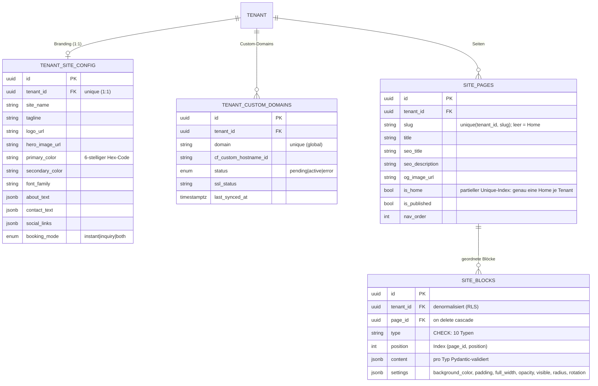

Alle vier Tabellen haben RLS (`tenant_id = current_tenant_id()`, using + with
check), `replica identity full` und sind in der Publication `supabase_realtime`.

**Die 10 Block-Typen** (DB-CHECK + `BlockType`-StrEnum + je ein eigenes
Pydantic-content-Schema): `hero` · `rich_text` · `image` · `gallery` · `button`
· `spacer` · `contact` · `search` · `properties_grid` · `featured_properties`.
Mehrsprachige Texte liegen als `{locale: text}`-Objekte im `content`. Drei
Start-Templates (`templates.py`: bergchalet/kueste/stadt, Unsplash-Bilder)
befüllen eine leere Site per `POST /site-config/templates/apply`.

### Draft-Token (Vorschau unveröffentlichter Seiten)

Der öffentliche Renderer liefert grundsätzlich nur `is_published`-Seiten. Für die
Editor-Vorschau erzeugt `POST /site-config/pages/{id}/draft-token` einen
kurzlebigen Token: **HMAC-SHA256** über `tenant_id.page_id.exp`, signiert mit
`SITE_DRAFT_SECRET`, Format `{exp}.{sig}`, **TTL 3600 s**, Verifikation
konstant-zeitig (`hmac.compare_digest`). `GET /api/v1/site/page/draft?page_id&token`
rendert damit auch unveröffentlichte Seiten (`403` bei ungültigem/abgelaufenem
Token). Die Draft-Route des Renderers (`builder/app/render/[pageId]/page.tsx`)
und die postMessage-Brücke (`canvas-bridge.tsx`) existieren als Infrastruktur für
eine iframe-Live-Vorschau, sind im aktuellen Editor aber **nicht verdrahtet**
(der Editor rendert die Nodes direkt, ohne iframe).

### Bewusste Abweichung: Editor-Modell vs. Persistenz-Modell

Der Editor ist funktional ein Framer-Klon, die Persistenz ein schlanker
10-Block-Stack — gekoppelt ausschließlich über `serialize.ts`. Der ehrliche
Ist-Stand:

1. **Persistiert wird eine flache, geordnete Liste** der 10 Block-Typen
   (`site_blocks`); der Editor arbeitet mit einem hierarchischen craft.js-Baum
   inkl. frei positionierter Frames (x/y/Breite/Höhe) und Layout-Containern.
2. **Frame/Stack/Grid/Masonry überleben das Speichern nicht:**
   `craftJsonToBlocks` iteriert nur die Top-Level-Nodes des ROOT und überspringt
   Typen außerhalb `NODE_BY_TYPE` — Container samt Kindern werden beim Speichern
   verworfen.
3. **Settings nur teilweise wirksam:** `splitProps` kennt 7 settings-Keys; das
   Backend verwirft Nicht-Schema-Felder. Der öffentliche Renderer wertet nur
   `content` + `settings.background_color` aus — `opacity`/`radius`/`rotation`/
   `visible` wirken derzeit nur im Editor.
4. **Page-Variables und Code-Overrides** (`variables-context.tsx`,
   CodeMirror-Editor) sind reiner In-Memory-Editor-State ohne DB-Ziel — nach
   einem Reload weg.
5. **Draft-Render + postMessage-Brücke** sind gebaut, aber nicht verdrahtet (s. o.).

[docs/FRAMER-FEATURES.md](FRAMER-FEATURES.md) hält diesen Soll-/Ist-Stand je
Feature fest und ist die verbindliche Vorlage für den Ausbau (u. a. Persistenz
des Editor-Baums).

### Ablauf: bearbeiten → veröffentlichen → öffentlicher Abruf (Custom-Domain)

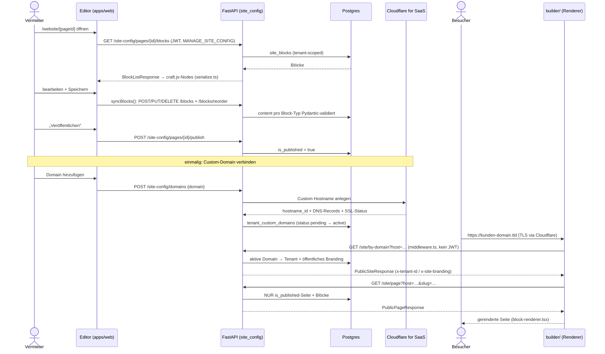

---

## Externe Dienste

Vom FastAPI-Backend als Dienste aufgerufen, Datenhoheit bleibt bei uns. Jeder Dienst
wird in **[docs/decisions/](decisions/)** mit Rechtsgrundlage dokumentiert.

| Dienst                  | Zweck                                                                                                                                                                                                                                                                        |
| ----------------------- | ---------------------------------------------------------------------------------------------------------------------------------------------------------------------------------------------------------------------------------------------------------------------------- |
| Google Maps / Places    | Adress-Autocomplete, Geocoding, Kartenansicht (Portal)                                                                                                                                                                                                                       |
| Google Calendar         | optionaler Sync persönlicher Sperrzeiten (nicht Kanal-Sync)                                                                                                                                                                                                                  |
| Google Translate        | mehrsprachige Inhalte (server-seitig gecacht)                                                                                                                                                                                                                                |
| OCR (self-hosted)       | Ausweis-/Pass-Scan (Meldepflicht) + Belege — bleibt auf Hetzner                                                                                                                                                                                                              |
| **Channex**             | Channel-Manager-Aggregator: OTA-Distribution (Booking.com, Airbnb, Expedia …). ARI-Push + Buchungs-Pull über den `channel_manager`-Slice (`channex_client.py`). Secrets: `CHANNEX_API_KEY`, `CHANNEX_BASE_URL`, `CHANNEX_WEBHOOK_SECRET`.                                    |
| Frankfurter (ECB)       | Tages-Wechselkurse (ECB-Referenz, kostenlos, kein Key) für die Eigentümer-Abrechnung (`owner_statements/fx.py`); gecacht in `fx_rates`. Kein Fallback bei Ausfall.                                                                                                           |
| DWD / Bright Sky        | amtliche Wetterdaten (frei, kein Key) als Dynamic-Pricing-Signal (`pricing/weather.py`).                                                                                                                                                                                     |
| **Google Fonts**        | Font-Katalog des Website-Editors (Developer API `webfonts/v1`). Aufgerufen über die server-seitige Next-Route `apps/web/app/api/google-fonts/route.ts` (kein FastAPI-Endpunkt); Key `GOOGLE_FONTS_API_KEY` bleibt serverseitig — ohne Key antwortet die Route `503`.         |
| **Cloudflare for SaaS** | Custom-Hostname-TLS für die Kunden-Domains des Page-Builders (`site_config/cloudflare_client.py`). Secrets: `CLOUDFLARE_API_TOKEN`, `CLOUDFLARE_ZONE_ID`, `CLOUDFLARE_FALLBACK_ORIGIN` (+ optional `CLOUDFLARE_BASE_URL`); fehlen sie, antworten die Domain-Endpunkte `503`. |
| Unsplash                | Stock-Bilder der Website-Start-Templates (`site_config/templates.py`) — nur referenzierte Bild-URLs, kein API-Key, kein Server-Aufruf.                                                                                                                                       |

---

> **Diagramme pflegen:** Alle Diagramme sind Mermaid-Code in dieser Datei — im PR
> diffbar, mit dem Code versioniert. Bei Architektur-Änderungen hier aktualisieren.
> C4Context/C4Container sind in Mermaid „experimental" — nach Änderungen im
> GitHub-Preview gegenprüfen.

---

## „My Next" — Taskilo-Integration (Buchhaltung · Marktplatz · HR · Jobs)

NextDays wird um den Geschäftsumfang von **Taskilo** erweitert. Maßgeblich:
**[ADR-0009](decisions/0009-taskilo-integration-architektur.md)**, Bestand:
**[TASKILO-INVENTAR.md](TASKILO-INVENTAR.md)**.

**Leitplanken (ADR-0009):**

- **Ein Stack, ein Backend, ein Supabase, eine Auth.** Die neuen Bereiche werden
  als **Vertical Slices in `apps/api`** umgesetzt (wie die PMS-Slices),
  Mandant **`tenant_id`** (RLS via `current_tenant_id()`), `companies` → `tenants`
  (+ `tenant_billing_profile`).
- **Frontend im NextDays-Paradigma:** Server Actions in `apps/web/lib/<domäne>.ts`,
  UI ausschließlich `components/ui/*` + Tokens (kein `@tasko/ui`, kein react-query).
  Taskilo-Komponenten werden **neu geschrieben**, nicht kopiert.
- **Eine App, Pfade statt Subdomains:** `/dashboard`, `/buchhaltung`, `/marktplatz`,
  `/hr`, `/jobs` unter einer Domain. **Keine** Feature-Subdomains (bricht
  Auth/Session). Nur Marketing-Website ↔ App darf per Subdomain getrennt werden.
- **Eine große Sidebar** mit aufklappbaren Gruppen je Domäne; Menü per
  ..-Berechtigung gegated.
- **NICHT übernommen:** Chat, Admin-Dashboard, SEO/Marketing, WhatsApp,
  Advertising, Taskilos eigene Auth + Onboarding.

**Neue Slices (geplant):** `buchhaltung` (✅ Basis), `tax`, `datev`, `einvoice`,
`banking`, `employees`, `jobs`, `job_applications`, `marketplace`.
Vorgehen je Modul: **DB-Migration → Backend-Slice → Server Actions → UI**.
