# Architektur

> Verbindliche Grundlage: **[PROJECT.md](../PROJECT.md)**. Dieses Dokument erläutert
> die Architektur mit Diagrammen und beschreibt den **tatsächlich umgesetzten** Stand.
>
> **Notation:** [C4-Modell](https://c4model.com) (System Context · Container · Component)
> + ergänzende ER-, Sequenz-, State- und Deployment-Diagramme. Alle Diagramme sind als
> Mermaid (Diagrams-as-Code) eingebettet und werden von GitHub nativ gerendert.

## Inhalt

1. [Leitidee](#1-leitidee-pms-kern-in-der-mitte)
2. [System Context (C4 Level 1)](#2-system-context-c4-level-1)
3. [Container (C4 Level 2)](#3-container-c4-level-2)
4. [Component: Channel Manager (C4 Level 3)](#4-component-channel-manager-c4-level-3)
5. [Datenmodell (ER-Diagramm)](#5-datenmodell-er-diagramm)
6. [Mandantenfähigkeit & RLS](#6-mandantenfähigkeit--rls)
7. [Kritische Flows (Sequenzdiagramme)](#7-kritische-flows-sequenzdiagramme)
8. [Reservierungs-Lifecycle (State)](#8-reservierungs-lifecycle-state)
9. [Deployment & Skalierung](#9-deployment--skalierung)
10. [Backend-Aufbau (Vertical Slices)](#10-backend-aufbau-vertical-slices)

---

## 1. Leitidee: PMS-Kern in der Mitte

NextDays ist kein loses Bündel aus Tools, sondern **ein Datenkern**, an den alle
Kanäle andocken. Der gemeinsame Nenner ist die **`availability`-Tabelle**: eine Zeile
pro `(property_id, date)` mit `UNIQUE`-Constraint — die *eine Wahrheit* und der
strukturelle Schutz gegen Double-Bookings über alle Kanäle hinweg.

---

## 2. System Context (C4 Level 1)

Wer nutzt NextDays, und mit welchen externen Systemen spricht es?

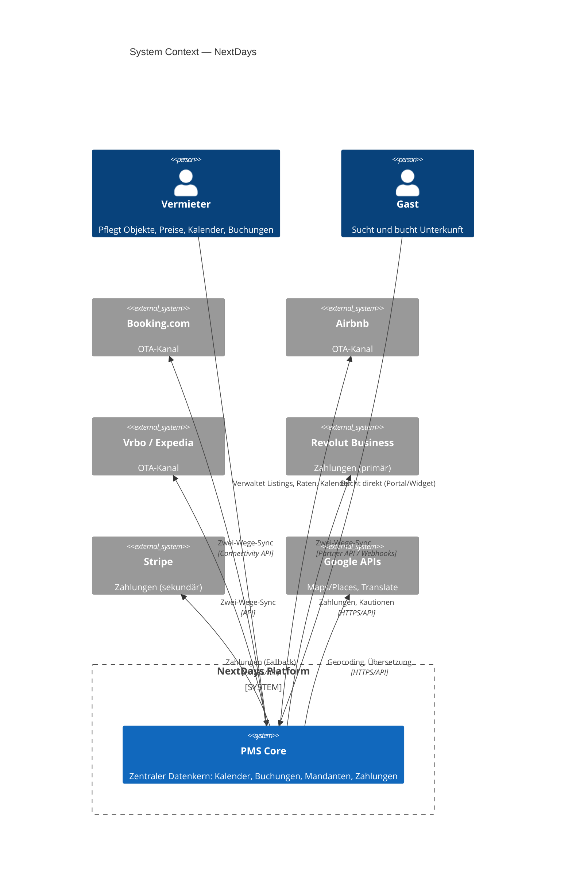

---

## 3. Container (C4 Level 2)

Die ausführbaren Bausteine und Datastores des Systems, mit Technologie und Protokoll.

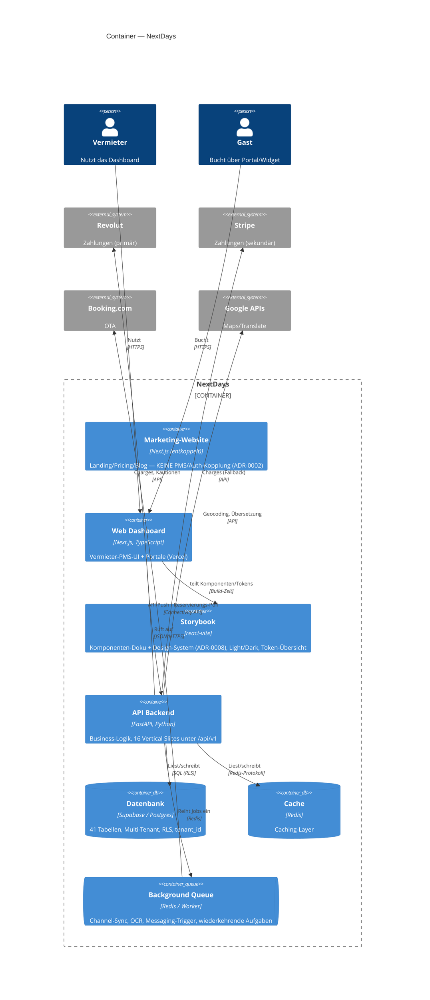

> **Hinweis zur C4-Notation:** „Container" meint hier eine *separat ausführbare App
> oder einen Datastore* (Next.js, FastAPI, Postgres, Redis) — nicht zwingend einen
> Docker-Container. Die Marketing-Website ist bewusst entkoppelt (eigenes Deployment).

### Slice-Landkarte (Component-Ebene, API-Backend)

Die 16 Vertical Slices und ihre Datenbereiche — der Stand der Geschäftslogik:

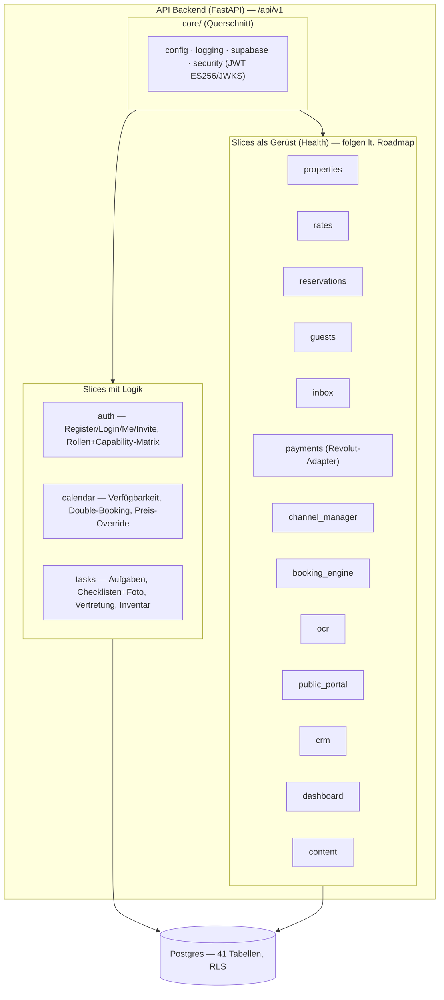

---

## 4. Component: Channel Manager (C4 Level 3)

Der `channel_manager`-Slice nutzt ein **Adapter-Pattern** (Anti-Corruption-Layer):
ein einheitliches Interface zum PMS-Kern, dahinter austauschbare Adapter pro Kanal.
So bleibt die Entscheidung *Direkt-Anbindung vs. Aggregator* reversibel
(siehe [ADR-0001](decisions/0001-channel-manager-architektur.md)).

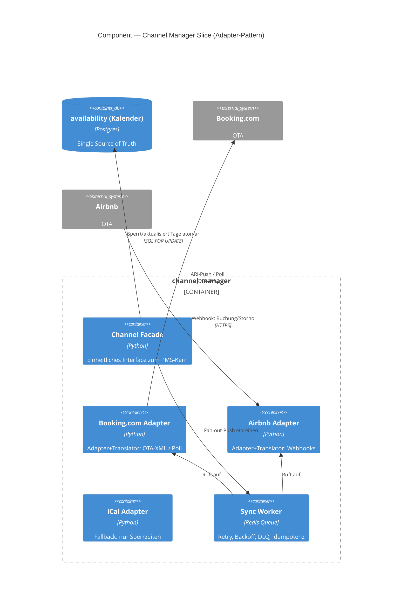

---

## 5. Datenmodell (ER-Diagramm)

Tatsächliches Schema aus **[supabase/migrations/](../supabase/migrations/)** (Phase 1).

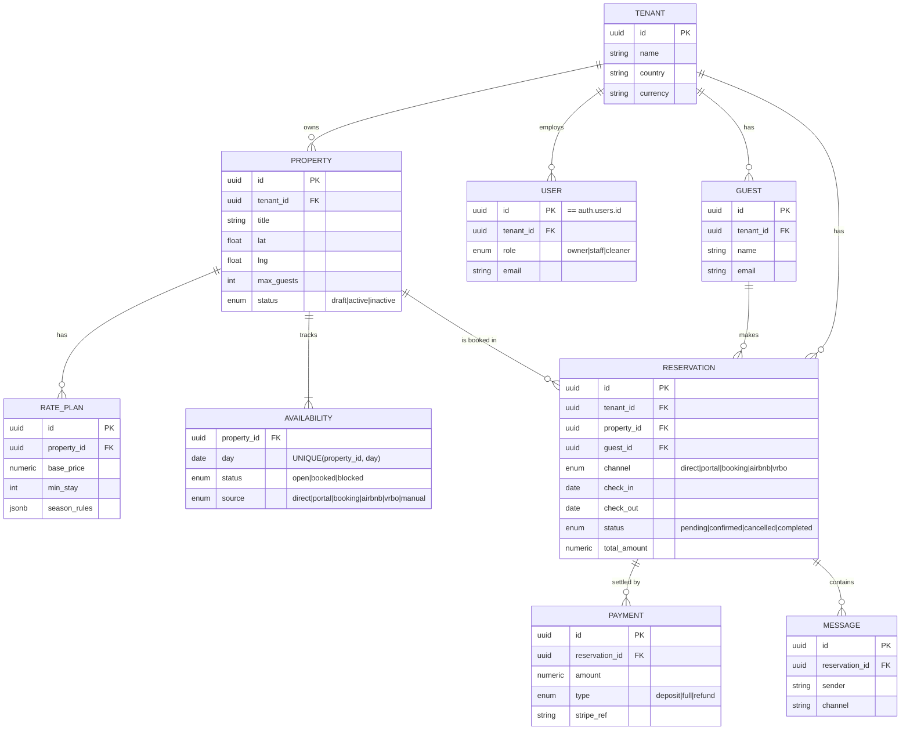

**Marktplatz-Tabellen (Phase 2, Struktur vorbereitet):** `portal_guests`, `reviews`,
`commissions` — siehe [Migration 0006](../supabase/migrations/0006_marketplace.sql).

**Kardinalität:** `||` = genau eins · `o{` = null bis viele · `|{` = ein bis viele.
`--` = identifizierend (Kind kann ohne Eltern nicht existieren).

### Datenmodell-Erweiterungen aus dem Lastenheft (Migrationen 0009–0019)

Das Modell ist auf **41 Tabellen (alle mit RLS)** gewachsen — verifiziert gegen das
echte Supabase-Projekt. Zur Lesbarkeit hier nach Bereich gruppiert (Details in den
jeweiligen Migrationen):

```mermaid
erDiagram
    TENANT ||--o{ SEASON_TEMPLATE : has
    SEASON_TEMPLATE ||--o{ SEASON : contains
    SEASON ||--o{ SEASON_PERIOD : "gilt an"
    SEASON_TEMPLATE ||--o{ SEASON_ASSIGNMENT : "zugewiesen an"
    TENANT ||--o{ EVENT : has
    EVENT ||--o{ EVENT_PERIOD : "gilt an"
    PROPERTY ||--o{ SURCHARGE : "Aufschläge"

    TENANT ||--o{ TASK : has
    TENANT ||--o{ TASK_RULE : "wiederkehrend"
    TASK ||--o{ CHECKLIST_ITEM : enthaelt
    CHECKLIST_ITEM ||--o{ CHECKLIST_PHOTO : "Foto-Nachweis"
    TASK ||--o{ TASK_SUBSTITUTION : "Vertretung"
    TENANT ||--o{ INVENTORY_ITEM : "Inventar/Pool"
    USER ||--o{ STAFF_PROPERTY_ASSIGNMENT : "Stamm-MA"

    TENANT ||--o{ LEAD : "Akquise"
    TENANT ||--o{ PARTNER : has
    PARTNER ||--o{ DEAL : "Rabatte"

    TENANT ||--o{ MESSAGE_TEMPLATE : has
    MESSAGE_TEMPLATE ||--o{ MESSAGE_TRIGGER : "Timing/Kanal"
    TENANT ||--o{ CONTENT_BLOCK : "dreisprachig"
    CONTENT_BLOCK ||--o{ CONTENT_ASSIGNMENT : "zugewiesen"

    TENANT ||--o{ BLOCK_REQUEST : "Sperrung beantragt"
    PROPERTY ||--o{ METER_READING : "Zählerstand (append-only)"
    PROPERTY ||--o{ CO_OWNER : "Miteigentümer"
    PROPERTY ||--o{ PRICE_OVERRIDE : "Tagespreis"
    USER ||--|| DASHBOARD_LAYOUT : personalisiert

    PLAN ||--o{ SUBSCRIPTION : "unit-basiert"
    TENANT ||--|| SUBSCRIPTION : abonniert
```

**Weitere Änderungen am Bestand:** `property_type` + `type_attributes` an
`properties` (Ökosystem, ADR-0007); Rollen-Enum um `admin`, `co_admin`
erweitert; `payments`: `stripe_ref` → `gateway_ref` + `gateway`-Enum (ADR-0003).
Marktplatz-Tabellen (`portal_guests`, `reviews`, `commissions`) wie oben.

---

## 6. Mandantenfähigkeit & RLS

Jeder Vermieter ist ein **Tenant**. Die Isolation läuft über **Row-Level-Security (RLS)**
in Postgres — nicht über Anwendungslogik. Das ist das **Pool-Modell** (geteiltes Schema,
`tenant_id` auf allen Tabellen).

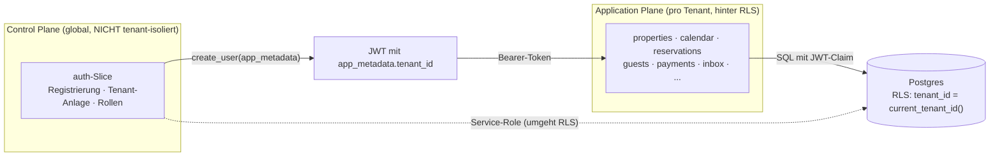

**Schlüsselpunkte:**
- `tenant_id` steht im **JWT `app_metadata`**; `public.current_tenant_id()` liest sie.
- Jede Policy filtert `tenant_id = current_tenant_id()`. Tabellen ohne eigene
  `tenant_id` (`rate_plans`, `availability`, `messages`, `payments`) leiten ihn über
  den Parent ab.
- **Control Plane vs. Application Plane:** Der `auth`-Slice (Tenant-Anlage, Onboarding)
  ist *global* — er läuft über den **Service-Role-Client**, der RLS bewusst umgeht
  (beim Registrieren existiert noch kein `tenant_id` im JWT → Henne-Ei).

---

## 7. Kritische Flows (Sequenzdiagramme)

### 7.1 Registrierung (atomar mit Rollback)

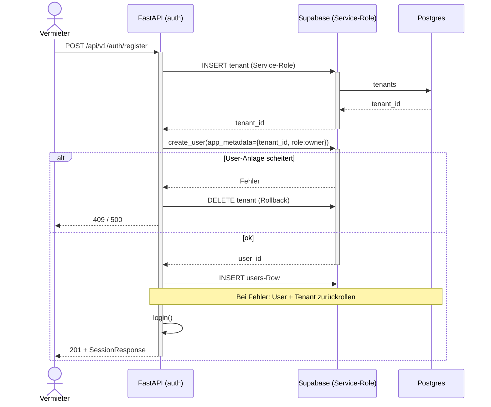

### 7.2 Direktbuchung mit Double-Booking-Schutz

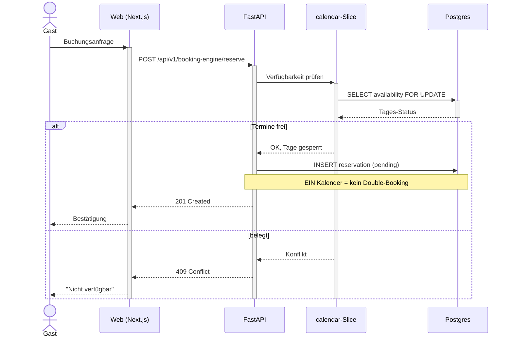

### 7.3 Auto-Aufgaben bei Buchung + Vertretung (§2.5/§4.3)

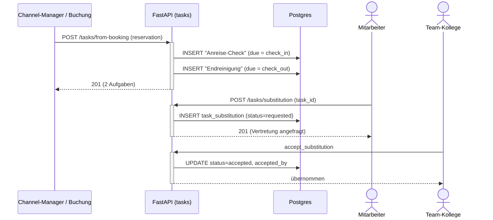

---

## 8. Reservierungs-Lifecycle (State)

`reservation.status` ist eine echte State-Machine.

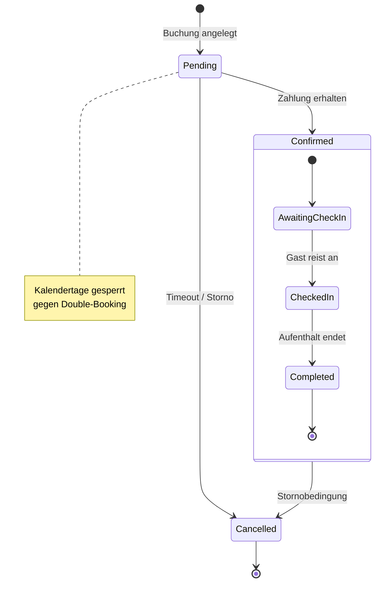

---

## 9. Deployment & Skalierung

DSGVO-konform, self-hosted bevorzugt. EU-Datenresidenz als harte Grenze.

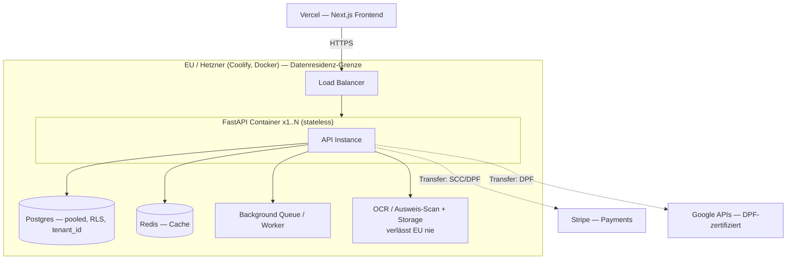

**Prinzipien:**
- FastAPI **zustandslos & containerisiert** → horizontale Skalierung (`x1..N` hinter LB).
- Aller State (Postgres, Redis, Queue, Storage) **externalisiert** — alle Instanzen
  teilen ihn, keine lokalen Daten im Container.
- **Kein** Serverless (Cold Starts, DB-Pooling-Probleme bei langlaufendem FastAPI).
- **US-Cloud als Compute bewusst vermieden** (CLOUD Act vs. DSGVO-Positionierung).
- Jede EU-Grenze überschreitende Kante ist mit Transfer-Rechtsgrundlage annotiert.

---

## 10. Backend-Aufbau (Vertical Slices)

Pro Feature ein **in sich geschlossener Slice** unter `apps/api/src/features/<name>/`:

```
features/auth/
├── router.py        # HTTP-Endpoints (FastAPI APIRouter)
├── service.py       # Business-Logik
├── schemas.py       # Pydantic-Modelle (explizit typisiert)
├── dependencies.py  # slice-spezifische Dependencies (optional)
└── tests/           # Tests des Slice
```

Gemeinsame Infrastruktur in `apps/api/src/core/`:

| Modul | Inhalt |
|---|---|
| `config.py` | `Settings` mit `SecretStr` für alle Secrets |
| `logging.py` | structlog (Console lokal, JSON in Produktion) |
| `supabase.py` | Client-Factory — Anon (RLS) und Service-Role (System) getrennt |
| `security.py` | Supabase-JWT-Verifikation (HS256) → `AuthContext`, `CurrentUser` |

**Slices:** `auth` · `properties` · `rates` · `calendar` · `reservations` ·
`guests` · `inbox` · `payments` · `channel_manager` · `booking_engine` · `ocr` ·
`public_portal` · `tasks` · `crm` · `dashboard` · `content`.

Die letzten vier (`tasks`, `crm`, `dashboard`, `content`) ergänzen den durch das
[Lastenheft](LASTENHEFT.md) erweiterten Funktionsumfang (Aufgaben/Checklisten,
Eigentümer-Akquise & Partner, Dashboard-Personalisierung, dreisprachige
Standardtexte). Der `payments`-Slice nutzt ein **Gateway-Adapter-Pattern**
(Revolut primär, Stripe sekundär — [ADR-0003](decisions/0003-zahlungs-gateway-revolut-primaer.md)).

Alle Router unter dem gemeinsamen Prefix **`/api/v1`** (versioniert von Anfang an).
`auth` ist als Referenz-Muster voll implementiert (siehe **[API.md](API.md)**).

---

## 11. Frontend & Design-System (apps/web)

- **Next.js** (App Router, TS) mit **Bun**; UI im **shadcn-Stil** (CVA + Radix-Slot
  + `cn`), Icons über **Iconify** (kein lucide-react, PROJECT.md §2).
- **Tailwind v4** über `@theme` in `styles/globals.css` — **kein**
  `tailwind.config.ts`. Light/Dark via `next-themes` (`.dark`-Klasse).
- **Design-Tokens** sind die einzige Quelle der Wahrheit für Farben/Radius
  (`:root` + `.dark` in `globals.css`). Startwerte aus dem NextDays-Logo
  (Primär `#0a0a0a`, Akzent-Rot `#b82028`) — **vorläufig, vom Designer
  überschreibbar**. Komponenten referenzieren nur semantische Tokens.
- **Storybook** (react-vite) als lebende Komponenten-Doku & Design-System-Brücke
  für den UX/UI-Designer ([ADR-0008](decisions/0008-storybook-design-system.md)):
  Light/Dark-Umschalter, Design-Token-Übersicht (`Design/Tokens`), Stories je
  Komponente. Build verifiziert; statisch deploybar (eigene URL für den Designer).

```
apps/web/
├── app/                 # Route-Gruppen (auth)/(dashboard)/(public)
├── components/
│   ├── ui/              # shadcn-Stil-Komponenten (+ .stories.tsx)
│   ├── theme-provider.tsx · theme-toggle.tsx
├── lib/
│   ├── supabase/        # Browser- + Server-Client (@supabase/ssr)
│   └── utils.ts         # cn()
├── stories/             # Design/Tokens-Übersicht
├── styles/globals.css   # Tailwind v4 @theme — Tokens (Quelle der Wahrheit)
└── .storybook/          # main.ts (react-vite) · preview.tsx (Theme-Switcher)
```

---

## Externe Dienste

Vom FastAPI-Backend als Dienste aufgerufen, Datenhoheit bleibt bei uns. Jeder Dienst
wird in **[docs/decisions/](decisions/)** mit Rechtsgrundlage dokumentiert.

| Dienst | Zweck |
|---|---|
| Google Maps / Places | Adress-Autocomplete, Geocoding, Kartenansicht (Portal) |
| Google Calendar | optionaler Sync persönlicher Sperrzeiten (nicht Kanal-Sync) |
| Google Translate | mehrsprachige Inhalte (server-seitig gecacht) |
| OCR (self-hosted) | Ausweis-/Pass-Scan (Meldepflicht) + Belege — bleibt auf Hetzner |

---

> **Diagramme pflegen:** Alle Diagramme sind Mermaid-Code in dieser Datei — im PR
> diffbar, mit dem Code versioniert. Bei Architektur-Änderungen hier aktualisieren.
> C4Context/C4Container sind in Mermaid „experimental" — nach Änderungen im
> GitHub-Preview gegenprüfen.
